!!! info "Довідник бонус-уроку «Pandas: аналіз даних, графіки і Dash»"
    Теорія до уроку. Урок з ноутбуками й Dash-застосунком на справжніх даних — [Бонус. Pandas](../bonus_pandas.md).

# 🧠 Основи Data Analytics: Патерни, Мислення та Структура

---

## 📖 Знайомство: хто розповідатиме цю історію

Цей довідник — не перелік визначень, а історія однієї аналітикині. Кожну ідею ти побачиш так, як вона з'являється в роботі: спершу питання від живої людини, потім таблиця, потім код — і лише наприкінці правило.

!!! note "📖 Історія"
    **Ліна** щойно прийшла аналітикинею в благодійний фонд **«Хлібний кошик»**, який розвозить продуктові набори по Україні. Вона знає Python і трохи pandas — приблизно стільки ж, скільки ти після першого ноутбука уроку.

    **Марта Петрівна** — керівниця фонду. Вона щодня вирішує, куди їде вантажівка і що в ній буде. Часу в неї мало: таблиця на 112 тисяч рядків їй не потрібна, їй потрібна відповідь «куди везти і чому».

    **Тарас** — волонтер. Він збирає ціни на ринках і щотижня надсилає Ліні таблиці. У них бувають нулі, `9999`, пропуски й дублікати — не зі зла, а тому що реальні дані завжди такі.

Дані в прикладах схожі на ті, що в уроці (ціни WFP): колонки `date`, `market`, `commodity`, `unit`, `price`. Ось перша таблиця, яку Тарас надіслав Ліні:

```python
import pandas as pd

prices = pd.DataFrame({
    "date": pd.to_datetime(["2024-01-15", "2024-02-15", "2024-03-15", "2024-04-15"] * 3),
    "market": ["Київ"] * 4 + ["Львів"] * 4 + ["Харків"] * 4,
    "commodity": "Хліб житній",
    "unit": "батон",
    "price": [34.0, 34.5, 35.0, 35.5,
              32.0, 32.0, 32.5, 33.0,
              33.0, 35.0, 38.0, 41.0],
})
print(prices.head(6))
print("Рядків:", len(prices))
```

```text
        date market    commodity   unit  price
0 2024-01-15   Київ  Хліб житній  батон   34.0
1 2024-02-15   Київ  Хліб житній  батон   34.5
2 2024-03-15   Київ  Хліб житній  батон   35.0
3 2024-04-15   Київ  Хліб житній  батон   35.5
4 2024-01-15  Львів  Хліб житній  батон   32.0
5 2024-02-15  Львів  Хліб житній  батон   32.0
Рядків: 12
```

Дванадцять рядків, три ринки, чотири місяці. На цій маленькій таблиці ми пройдемо весь шлях від сирих чисел до рішення.

---

## 🎯 Три ідеї зі «Storytelling with Data», які знадобляться всюди

Книга Коул Нассбаумер Кнафлік «Storytelling with Data» (і її практикум «Let's Practice!») починає не з графіків, а з **контексту**. Ми теж почнемо з нього.

**1. Дослідження ≠ пояснення.** Аналіз має два режими:

- **exploratory (дослідницький)** — ти сама відкриваєш сто «устриць», щоб знайти дві-три «перлини»: перебираєш графіки, групування, фільтри;
- **explanatory (пояснювальний)** — ти показуєш аудиторії **лише перлини**, а не всі сто відкритих устриць.

Типова помилка новачка — принести Марті Петрівні всі 40 графіків, які довелося побудувати в процесі. Вона хоче побачити один, той що відповідає на її питання.

**2. Big Idea — одне речення.** Перш ніж відкривати PowerPoint чи Dash, сформулюй головну думку одним реченням, у якому є:

- твоя **позиція** (не «ось дані», а «я вважаю, що…»);
- **що на кону** (що станеться, якщо діяти або не діяти).

> ❌ «Аналіз цін на хліб за січень–квітень 2024 року.»
> ✅ «Хліб у Харкові дорожчає вп’ятеро швидше, ніж у Києві, — якщо не переглянути розподіл бюджету зараз, у травні ми нагодуємо на сотню родин менше, ніж могли б.»

**3. Історія на 3 хвилини.** Уяви, що Марта Петрівна зустріла тебе в коридорі й має 3 хвилини. Чи зможеш ти пояснити, що знайшла, чому це важливо і що пропонуєш, — без слайдів? Якщо так, ти розумієш свої дані. Якщо ні, сідати за графіки ще рано.

??? question "Перевір себе"
    Ліна пише Марті: «Ось зведена таблиця цін по 27 ринках за 2014–2024 роки». Що не так із точки зору Big Idea?

    ??? success "Відповідь"
        Немає ні позиції, ні того, що на кону: це опис даних, а не думка. Марті доведеться самій шукати висновок у таблиці. Краще: «Ціни на олію з 2022 року ростуть швидше за курс — варто перейти на закупівлю на пів року наперед».

---

## 📊 Архітектурне бачення аналізу даних

Увесь довідник — про один шлях:

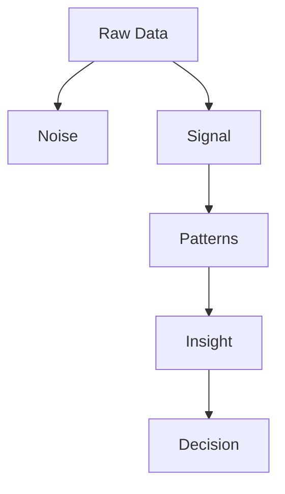

Сирі дані містять і шум, і сигнал. Сигнал складається в закономірності (патерни), патерн дає розуміння (інсайт), а інсайт має закінчитися **рішенням**. Якщо до рішення не дійшло, аналіз зупинився на пів дороги.

---

# 1. Що таке аналіз даних (глибоке пояснення)

Аналіз даних часто сприймається хибно.

## ❌ Чим аналіз даних НЕ є

- **не просто побудова красивих графіків.** Гарний графік без висновку — як красива обгортка без цукерки;
- **не сліпе застосування математичних формул.** `mean()` порахувати легко, але чи має середнє сенс саме тут?
- **не технічна робота з написання коду для бази даних.** SQL і pandas — інструменти, як молоток для теслі; меблі робить не молоток.

---

## ✅ Чим він є насправді

Аналіз даних — це **дисциплінований процес мислення та дослідження доказів**,
спрямований на те, щоб перетворити сирі, хаотичні числа на знання,
яке веде до реальних дій і рішень.

Аналітик схожий на **детектива**. Детектив не вигадує злочинця, а збирає сліди, перевіряє алібі й відкидає хибні версії. Так само аналітик збирає числа, перевіряє гіпотези й відкидає ті пояснення, яких дані не підтверджують.

!!! note "📖 Історія"
    Першого ж дня Марта Петрівна питає Ліну: «Хліб подорожчав?» Ліна відкриває таблицю Тараса й розуміє: на це просте питання є чотири різні відповіді, і кожна глибша за попередню.

---

## 🔍 Рівні аналітики (Analytics Maturity Model)

Щоб мислити аналітично, треба розрізняти рівні роботи з даними. Вони утворюють **ієрархію аналітичної зрілості (Analytics Maturity Model)**. Кожен наступний рівень:

- складніший технічно;
- дає глибше розуміння;
- приносить більше користі для рішень.

Порівняй з лікарем. Термометр показує 38,5° — це опис. Лікар з'ясовує, що це ангіна, — діагноз. Він каже: «Без лікування за три дні буде 39,5°», — прогноз. І виписує антибіотик — рецепт, тобто рекомендація дії.

---

## 🧠 Загальна архітектура


---

## 📊 1.1. Описова аналітика (Descriptive Analytics) — "Що відбулося?"

**Ключове питання:** *Що відбулося?*

!!! note "📖 Історія"
    «Хліб подорожчав?» — питає Марта Петрівна. Ліна не вгадує, а рахує: середня ціна батона по трьох ринках у кожному місяці.

**Життєвий приклад.** Ти відкриваєш банківський застосунок: «У квітні ви витратили на продукти 6 200 грн, це на 12% більше, ніж у березні». Це чиста описова аналітика: факт про минуле, без жодного «чому».

```python
by_month = prices.groupby("date")["price"].mean()
print("Середня ціна батона по місяцях:")
print(by_month.round(2))
change = (by_month.iloc[-1] / by_month.iloc[0] - 1) * 100
print(f"\nЗміна за 4 місяці: {change:+.1f}%")
```

```text
Середня ціна батона по місяцях:
date
2024-01-15    33.00
2024-02-15    33.83
2024-03-15    35.17
2024-04-15    36.50
Name: price, dtype: float64

Зміна за 4 місяці: +10.6%
```

Відповідь є: **так, на 10,6%**. Дванадцять рядків стиснулися до одного числа. Це і є суть описової аналітики.

### 📌 Суть

Це базовий рівень, який фокусується на:

* фактах;
* історичних даних;
* поточному стані системи.

### ⚙️ Інструменти

* агрегація (`mean`, `sum`, `count`);
* BI-системи (дашборди);
* SQL `GROUP BY` / pandas `groupby`.

### 🧠 Ментальна модель: «дзеркало заднього виду»

Ти чудово бачиш дорогу, яку вже проїхала, але не бачиш поворот попереду.

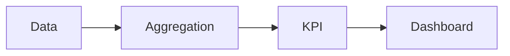

### 📉 Типові результати

* продажі за місяць = 1 млн грн;
* конверсія = 3,2%;
* трафік упав на 20%;
* батон подорожчав на 10,6%.

### ⚠️ Обмеження

Описова аналітика:

* **не пояснює причину** («чому +10,6%?»);
* **не дає рішення** («то що робити?»);
* **не прогнозує** («а в травні?»).

??? question "Перевір себе"
    Дашборд фонду показує «Видано наборів за тиждень: 1 240». Який це рівень аналітики і на яке питання він **не** відповідає?

    ??? success "Відповідь"
        Описовий. Він не каже, чому наборів стільки (діагностика), скільки буде наступного тижня (прогноз) і скільки треба закупити (рекомендація).

---

## 🔍 1.2. Діагностична аналітика (Diagnostic Analytics) — "Чому це відбулося?"

**Ключове питання:** *Чому це сталося?*

!!! note "📖 Історія"
    «Десять відсотків — це багато, — каже Марта Петрівна. — Чому?» Ліна підозрює, що «середня ціна» ховає різні історії різних міст. Вона розкладає середнє на ринки (drill-down).

**Життєвий приклад.** Середня оцінка класу з математики впала з 9 до 8. Вчителька дивиться на оцінки кожного учня й бачить: у двадцяти людей нічого не змінилось, а троє, які пропустили місяць через хворобу, отримали по 4. «Клас став гірше розуміти математику» — хибне пояснення. Правильне — «троє учнів пропустили тему».

```python
# drill-down: розкладаємо «середнє» на ринки
table = prices.pivot(index="market", columns="date", values="price")
first, last = table.columns[0], table.columns[-1]
growth = (table[last] - table[first]).sort_values(ascending=False)
print("Подорожчання батона з січня по квітень, грн:")
print(growth)
print(f"\nЧастка Харкова у загальному зростанні: {growth['Харків'] / growth.sum():.0%}")
```

```text
Подорожчання батона з січня по квітень, грн:
market
Харків    8.0
Київ      1.5
Львів     1.0
dtype: float64

Частка Харкова у загальному зростанні: 76%
```

Ось і причина: **три чверті зростання — це один Харків**. У Києві й Львові хліб подорожчав на 1–1,5 грн, тобто майже не змінився. Тепер Ліна може шукати причину вже в Харкові: подорожчання борошна, пошкоджена пекарня, логістика.

### 📌 Суть

Це рівень пошуку причин:

* аналіз зв'язків;
* розкладання системи на компоненти;
* перевірка гіпотез.

### ⚙️ Інструменти

* кореляційний аналіз (correlation analysis);
* пошук першопричини (root cause analysis);
* drill-down / slice & dice — розкладання по вимірах (місто, товар, місяць);
* A/B-аналіз.

### 🧠 Ментальна модель: «рентген системи»

Зовні видно лише «температуру», а рентген показує, яка саме кістка зламана.

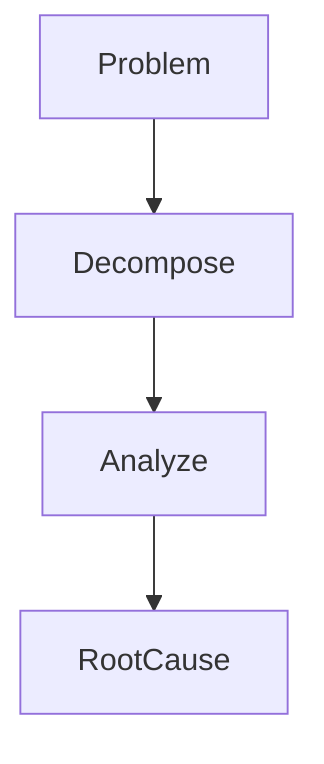

### 📉 Як змінюється відповідь

Було: *продажі впали.*

Стало: *падіння через те, що*

* мобільний трафік ↓ (оновлення застосунку зламало кошик);
* SEO ↓ (сайт випав із пошуку за ключовим запитом);
* конкуренти ↑ (у сусідів розпродаж).

### ⚠️ Обмеження

* не дає точного прогнозу;
* може помилятися через **хибні кореляції** («у місяці, коли продають більше морозива, більше й утоплень» — обидва явища спричиняє спека, а не одне одне);
* може помилятися через **шум**: на 3–4 точках випадковий стрибок легко сплутати з причиною.

??? question "Перевір себе"
    Середня ціна гречки по країні не змінилася. Чи означає це, що ні на одному ринку вона не змінилася?

    ??? success "Відповідь"
        Ні. Подорожчання в одних містах могло компенсуватися здешевленням в інших. Саме тому діагностика починається з розкладання середнього на частини.

---

## 🔮 1.3. Прогностична аналітика (Predictive Analytics) — "Що може відбутися?"

**Ключове питання:** *Що може відбутися?*

!!! note "📖 Історія"
    «Добре, — каже Марта Петрівна. — Скільки батон коштуватиме в Харкові в травні? Мені треба закласти бюджет.» Ліна помічає, що ціна росте майже рівномірно, і проводить через точки пряму лінію.

**Життєвий приклад.** Прогноз погоди «завтра 70% ймовірність дощу» не обіцяє дощу. Він каже: «у 70 зі 100 схожих днів у минулому дощ був». Ти береш парасольку не тому, що синоптик точно знає, а тому, що ризик вартий того.

```python
import numpy as np

months = np.array([1, 2, 3, 4])
kharkiv = np.array([33.0, 35.0, 38.0, 41.0])   # ціна батона, грн

# пряма лінія через 4 точки: price ≈ slope * month + intercept
slope, intercept = np.polyfit(months, kharkiv, deg=1)
print(f"Щомісяця батон дорожчає в середньому на {slope:.2f} грн")

may = slope * 5 + intercept
residuals = kharkiv - (slope * months + intercept)
print(f"Прогноз на травень: {may:.1f} грн")
print(f"Типова похибка моделі на історії: ±{residuals.std():.2f} грн")
```

```text
Щомісяця батон дорожчає в середньому на 2.70 грн
Прогноз на травень: 43.5 грн
Типова похибка моделі на історії: ±0.27 грн
```

Модель каже: **≈ 43,5 грн**. Але Ліна чесно додає застереження: модель бачила лише 4 точки й припускає, що тренд триватиме. Якщо в Харкові відремонтують пекарню, ціна може й упасти. Похибка ±0,27 грн — це похибка на **минулому**, а майбутнє завжди невизначеніше.

### 📌 Суть

Це рівень моделювання майбутнього:

* пошук патернів;
* побудова моделей;
* оцінка ймовірностей.

### ⚙️ Інструменти

* машинне навчання (Machine Learning);
* статистичні моделі;
* часові ряди (time series);
* регресія (як `np.polyfit` вище — найпростіша лінійна регресія).

### 🧠 Ментальна модель: «ймовірнісна кришталева куля»

Куля показує не одне майбутнє, а туман із більш і менш імовірних варіантів.


### 📉 Типові результати

- клієнт піде з імовірністю 85%;
- попит зросте на 12%;
- ризик повені = 0,67;
- батон у Харкові в травні ≈ 43,5 грн.

### ⚠️ ВАЖЛИВО

```text
Predictive ≠ certainty
```

Прогноз — це **не правда, а ймовірність**. Чесний прогноз завжди має діапазон або ймовірність і перелік припущень («якщо тренд триватиме…»).

??? question "Перевір себе"
    Модель на 4 точках дала прогноз 43,5 грн. Чому не варто давати прогноз на грудень тією самою моделлю?

    ??? success "Відповідь"
        Чим далі від даних, тим менше підстав вважати, що тренд не зміниться. Лінія через 4 весняні місяці нічого не знає про врожай, сезонність чи зміну курсу. Прогноз на 8 місяців уперед — це вже не модель, а здогадка.

---

## ⚖️ 1.4. Приписова аналітика (Prescriptive Analytics) — "Що робити?"

**Ключове питання:** *Що нам робити?*

!!! note "📖 Історія"
    На травень у фонду 50 000 грн на хліб. Родин у черзі: Київ — 300, Львів — 200, Харків — 600. Кожна родина отримує 2 батони. Грошей на всіх не вистачає. Марта Петрівна питає: «Як розподілити?» Ліна не відповідає «як вам зручніше». Вона рахує варіанти.

**Життєвий приклад.** Навігатор не просто показує карту (опис) і затор (діагноз), а прогнозує час у дорозі й **пропонує маршрут**: «Поїдьте через міст — так на 12 хвилин швидше». Це приписова аналітика: система порівнює варіанти й радить дію з урахуванням обмежень.

```python
import pandas as pd

budget = 50_000  # грн на хліб у травні
plan = pd.DataFrame({
    "market": ["Київ", "Львів", "Харків"],
    "price_may": [36.0, 33.3, 43.5],   # прогноз ціни батона
    "families": [300, 200, 600],       # родин у черзі
}).set_index("market")
plan["per_family"] = plan["price_may"] * 2   # 2 батони на родину


def allocate(order):
    """Роздає бюджет ринкам у заданому порядку → {ринок: родин}."""
    left, result = budget, {}
    for market in order:
        row = plan.loc[market]
        n = min(int(row["families"]), int(left // row["per_family"]))
        result[market] = n
        left -= n * row["per_family"]
    return result


a = allocate(plan.sort_values("per_family").index)   # найдешевші першими
b = allocate(["Харків", "Київ", "Львів"])             # найбільша потреба першою
print("A, максимум родин: ", a, "→ разом", sum(a.values()))
print("B, Харків першим:  ", b, "→ разом", sum(b.values()))
```

```text
A, максимум родин:  {'Львів': 200, 'Київ': 300, 'Харків': 173} → разом 673
B, Харків першим:   {'Харків': 574, 'Київ': 0, 'Львів': 0} → разом 574
```

Ось де стає видно, що «що робити» залежить від **мети**. Варіант A годує на 99 родин більше. Варіант B закриває найбільшу потребу там, де ціни ростуть найшвидше, але Київ і Львів лишаються без хліба. Код не ухвалює рішення за Марту Петрівну. Він показує ціну кожного вибору, і саме в цьому сила приписової аналітики.

Big Idea, яку Ліна приносить керівниці:

> «Якщо наша мета — нагодувати якомога більше родин, розподіл A дає 673 родини замість 574. Пропоную A і окремо шукати донора для Харкова, де хліб дорожчає найшвидше.»

### 📌 Суть

Це найвищий рівень. Система не просто аналізує, а **рекомендує дію** з урахуванням мети й обмежень (бюджет, час, люди).

### ⚙️ Інструменти

* оптимізація (лінійне програмування, жадібні алгоритми, як `allocate` вище);
* симуляція (Monte Carlo — «програємо 10 000 можливих травнів»);
* системи підтримки рішень;
* навчання з підкріпленням (Reinforcement Learning).

### 🧠 Ментальна модель: «меню рішень»

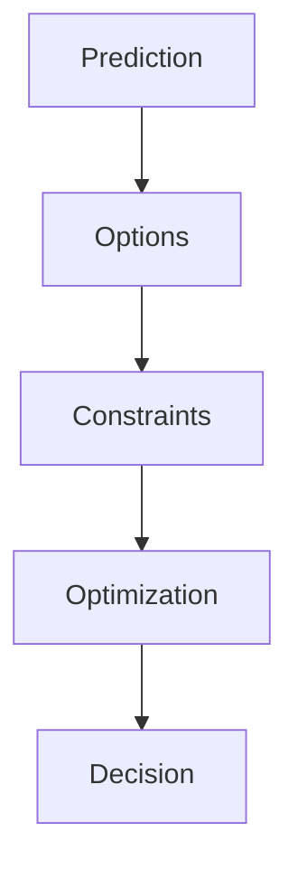

### 📉 Приклад із бізнесу

Прогностична аналітика каже: *якщо ціна +5%, продажі −10%.*
Приписова відповідає: *оптимальне підвищення ціни — +3,2%: прибуток максимальний, а відтік клієнтів прийнятний.*

### 🔥 Де це живе

* AI-системи;
* автоматичні рішення (ціноутворення, логістика);
* рекомендаційні системи («з цим товаром купують…»).

??? question "Перевір себе"
    Чому в прикладі з бюджетом немає однієї «правильної» відповіді?

    ??? success "Відповідь"
        Бо оптимум залежить від мети: «максимум родин» і «найбільша потреба першою» — різні цілі. Приписова аналітика оптимізує під задану мету, а обирає мету людина.

---

## 🔄 Повний аналітичний конвеєр

Одне питання Марти Петрівни «Хліб подорожчав?» провело Ліну через усі чотири рівні:


| Рівень       | Питання    | Результат   | У нашій історії |
| ------------ | ---------- | ----------- | --------------- |
| Descriptive  | Що сталося | Дані        | +10,6% за 4 місяці |
| Diagnostic   | Чому       | Причини     | 76% зростання — Харків |
| Predictive   | Що буде    | Ймовірність | травень ≈ 43,5 грн |
| Prescriptive | Що робити  | Рішення     | розподіл A: 673 родини |

---

## 🧠 ГОЛОВНИЙ ІНСАЙТ

```text
Аналітика = еволюція від спостереження → до дії
```

Ти не просто аналізуєш дані, а будуєш ланцюжок, що закінчується дією:

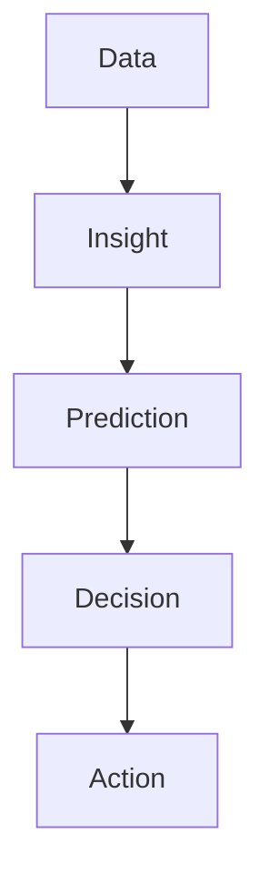

---

# 2. Основна ідея аналізу: "Знайти структуру"

Фундаментальна парадигма науки про дані:

```text
Дані = Інформація + Шум
```

**Життєвий приклад.** Ти на вокзалі намагаєшся почути оголошення про свій потяг. Голос диктора — інформація. Гомін натовпу, стук коліс і музика з кав'ярні — шум. Почути оголошення означає мозком «відфільтрувати» все зайве. Аналітик робить те саме з числами.

### 🧠 Архітектурна модель

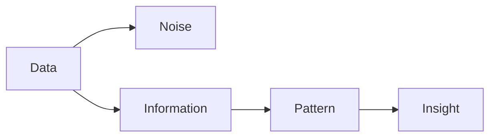

Сирі дані самі по собі — не корисна інформація. Це «сховище», де справжня інформація затуманена випадковим шумом. **Головна задача аналітика** — відфільтрувати шум і знайти сигнал.

### 🔍 Дані ≠ інформація

Сирі дані — це:

* безформний потік чисел;
* результат роботи системи;
* «тінь» реального процесу.

Ціна батона в таблиці Тараса — це тінь цілої системи: врожаю, курсу гривні, роботи пекарень, логістики, війни. Ми бачимо тінь, а хочемо зрозуміти предмет, який її відкидає.

```text
Дані — це не знання
Дані — це носій потенційного знання
```

### 🧬 Розширена модель

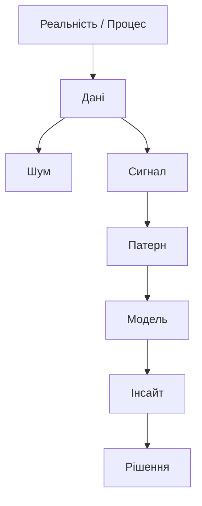

Далі пройдемо цю схему крок за кроком.

---

## ⚖️ 2.1. Рівняння реальності: Дані = Інформація + Шум

Головне завдання — витягнути з шуму **інформацію**. Але не будь-яку, а **багату (rich)**.

!!! note "📖 Історія"
    Наприкінці тижня бухгалтерка фонду радісно повідомляє: «Середня пожертва — понад шість тисяч гривень!» Марта Петрівна вже планує розширення. Ліна перевіряє цифру.

```python
import pandas as pd

# суми пожертв фонду за тиждень, грн
donations = pd.Series([200, 150, 300, 250, 100, 200, 180, 50_000])
print(f"Середня пожертва: {donations.mean():,.0f} грн")
print(f"Медіана:          {donations.median():,.0f} грн")
print(f"Частка найбільшої пожертви в сумі: {donations.max() / donations.sum():.0%}")
```

```text
Середня пожертва: 6,422 грн
Медіана:          200 грн
Частка найбільшої пожертви в сумі: 97%
```

Сім людей дали по 100–300 грн, а одна компанія — 50 000. Середнє 6 422 грн формально правильне, але **не описує жодного реального донора**. Типова пожертва — 200 грн (медіана), і 97% грошей дав один жертводавець. Це вже зовсім інша історія: фонд залежить від однієї компанії, а це ризик.

### ❌ Бідна інформація (Poor Information)

* середні значення без контексту;
* загальні метрики без структури;
* «цікаво, але не корисно».

Приклад: *середній дохід = 1000 $.* Без розподілу це нічого не означає. Можливо, всі заробляють близько 1000, а можливо, дев'ятеро — по 100 і один — 9 100.

### ✅ Багата інформація (Rich Information)

* дієва (actionable) — з нею зрозуміло, що робити;
* пояснює систему;
* дозволяє ухвалювати рішення.

Ось як Ліна перетворює бідну інформацію «витратили на продукти 90 тис. грн» на багату:

```python
spend = pd.DataFrame({
    "commodity": ["Хліб житній", "Гречка", "Олія", "Молоко", "Цукор"],
    "uah": [41_000, 28_000, 12_000, 6_000, 3_000],
})
spend["share"] = spend["uah"] / spend["uah"].sum()
spend["cum_share"] = spend["share"].cumsum()
print(spend.round(2))
```

```text
     commodity    uah  share  cum_share
0  Хліб житній  41000   0.46       0.46
1       Гречка  28000   0.31       0.77
2         Олія  12000   0.13       0.90
3       Молоко   6000   0.07       0.97
4        Цукор   3000   0.03       1.00
```

Тепер видно дію: **хліб і гречка — 77% витрат**. Якщо домовитися про знижку з пекарнею та одним постачальником крупи, економія буде відчутною. Торгуватися за цукор майже не має сенсу.

### 🧠 Архітектурний принцип

```text
Не кожна інформація = інсайт
```

Інсайт — це інформація, після якої хтось робить щось інакше.

??? question "Перевір себе"
    «Середній вік волонтерів фонду — 34 роки». Багата це інформація чи бідна? Що треба додати, щоб вона стала дієвою?

    ??? success "Відповідь"
        Бідна: незрозуміло, чи це половина студентів і половина пенсіонерів, чи всі тридцятирічні. Потрібен розподіл (вікові групи) і зв'язок із задачею: наприклад, «волонтери до 25 років ідуть через 2 місяці, тож навчання для новачків окупається лише після 3-го місяця».

---

## 🧹 2.2. Фільтрація шуму (Signal Extraction)

Шум — це:

* випадковість;
* похибки вимірювань;
* нерелевантні коливання.

!!! note "📖 Історія"
    Тарас почав збирати ціну батона **щодня**. Ліна будує графік, і він схожий на кардіограму: +3 грн, −4 грн, +2 грн. Марта Петрівна питає: «То дорожчає чи ні?» По сирих числах цього не видно.

**Життєвий приклад.** Ти зважуєшся щоранку. Сьогодні 70,8 кг, завтра 69,9, післязавтра 71,2. Вага коливається через воду, їжу, сон, тож окреме зважування майже нічого не каже. А от середнє за тиждень чесно покаже, худнеш ти чи ні.

Змоделюймо це: справжній тренд (сигнал) — повільне подорожчання з 33 до 39 грн за 60 днів, а щоденні коливання (шум) — випадкові.

```python
import numpy as np
import pandas as pd

rng = np.random.default_rng(42)
days = pd.date_range("2024-01-01", periods=60, freq="D")
trend = np.linspace(33, 39, 60)              # сигнал: повільне подорожчання
noise = rng.normal(0, 1.5, 60)               # шум: випадкові коливання
bread = pd.Series(trend + noise, index=days).round(1)

smooth = bread.rolling(window=7).mean()      # ковзне середнє за 7 днів
print("Сирі ціни, перші 7 днів:", bread.iloc[:7].tolist())
print(f"Сирі: найбільший стрибок за день = {bread.diff().abs().max():.1f} грн")
print(f"Згладжені: найбільший стрибок   = {smooth.diff().abs().max():.1f} грн")
print("\nЩотижнева картина (середнє за тиждень):")
print(bread.resample("W").mean().round(1).head(8).to_string())
```

```text
Сирі ціни, перші 7 днів: [33.5, 31.5, 34.3, 34.7, 30.5, 31.6, 33.8]
Сирі: найбільший стрибок за день = 4.2 грн
Згладжені: найбільший стрибок   = 0.7 грн

Щотижнева картина (середнє за тиждень):
2024-01-07    32.8
2024-01-14    34.4
2024-01-21    34.7
2024-01-28    35.5
2024-02-04    36.6
2024-02-11    37.1
2024-02-18    37.9
2024-02-25    37.9
Freq: W-SUN
```

У сирих даних за перший тиждень ціна «падала» з 34,7 до 30,5 грн, і це був лише шум. Після згладжування (`rolling`) і агрегації за тиждень (`resample`) тренд видно одразу: **щотижня приблизно +0,7 грн**. Для Марти Петрівни Ліна покаже саме тижневий ряд, а не щоденний (пам'ятаєш: explanatory, а не exploratory).

### 🧠 Як прибирається шум

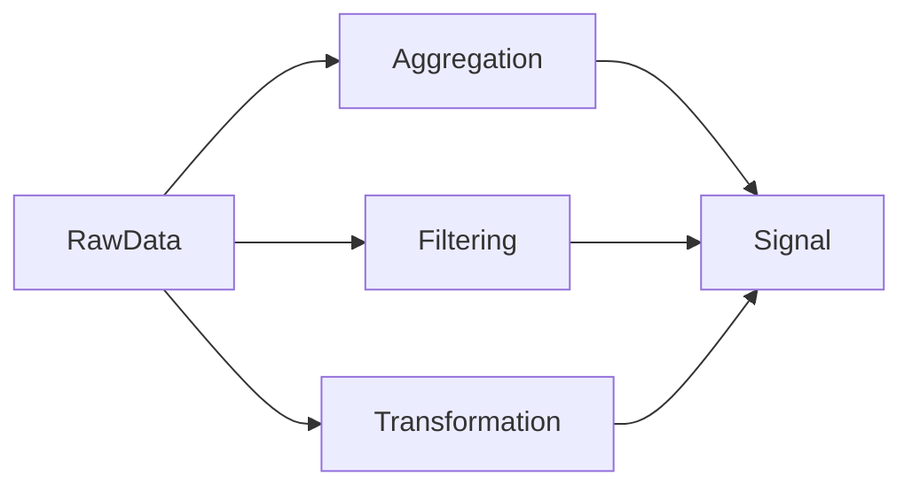

### ⚙️ Основні інструменти

* агрегація (`mean`, `median`) — стискає багато точок в одну;
* фільтрація — прибирає явно хибні значення;
* згладжування (`rolling(...).mean()`) — гасить короткі коливання;
* feature engineering — створює нові ознаки, у яких сигнал помітніший (наприклад, «ціна відносно минулого місяця»).

### 📉 Приклад (критичний)

Погодинні ціни акцій — хаос і шум. Денні — уже видно тренд. Так само з батоном: щоденний ряд «скаче», тижневий росте.

### 🧠 Висновок

```text
Шум = короткострокова випадковість
Сигнал = довгострокова закономірність
```

??? question "Перевір себе"
    Що станеться з графіком, якщо замість `rolling(window=7)` взяти `rolling(window=30)`? Чому це не завжди краще?

    ??? success "Відповідь"
        Лінія стане ще гладшою, але почне запізнюватися: різкий справжній стрибок ціни (наприклад, після закриття пекарні) з'явиться на графіку лише через кілька тижнів і буде «розмазаний». Більше вікно — менше шуму, але повільніша реакція на сигнал.

---

## 🔗 2.3. Закономірність (Pattern) як відображення системи

Закономірність — це не просто тренд. Це **структура системи**, яка проступає крізь дані.

!!! note "📖 Історія"
    Волонтери скаржаться: «У понеділок завжди завал». Марта Петрівна відповідає: «Вам здається». Ліна бере журнал черги за 4 тижні й перевіряє, чи це закономірність, чи враження.

**Життєвий приклад.** Ти помічаєш, що в метро о 8:30 тиснява, а о 10:30 вільно, і так щодня. Це не випадковість, а патерн, бо за ним стоїть система: робочий день починається о 9:00.

```python
import numpy as np
import pandas as pd

rng = np.random.default_rng(7)
days = pd.date_range("2024-03-04", periods=28, freq="D")    # 4 тижні, з понеділка
base = np.where(days.dayofweek == 0, 140, 100)             # у понеділок більше людей
queue = pd.Series(base + rng.integers(-15, 16, 28), index=days)

print("Перший тиждень:", queue.iloc[:7].tolist())
names = ["Пн", "Вт", "Ср", "Чт", "Пт", "Сб", "Нд"]
by_weekday = queue.groupby(queue.index.dayofweek).mean().round(0)
by_weekday.index = names
print("\nСередня черга за днем тижня:")
print(by_weekday.to_string())
```

```text
Перший тиждень: [154, 104, 106, 112, 102, 109, 110]

Середня черга за днем тижня:
Пн    140.0
Вт     99.0
Ср     96.0
Чт    105.0
Пт     98.0
Сб    109.0
Нд    101.0
```

Волонтери мали рацію: у понеділок людей **на 40% більше**, і це повторюється чотири тижні поспіль. Окремий день міг бути випадковістю, а чотири понеділки поспіль — це вже структура. Можливо, люди чекають вихідні, або в понеділок приходять виплати. Патерн підказує, де шукати причину.

### 🧠 Визначення

Pattern — це:

* повторюваність (кожен понеділок);
* залежність (більше людей → довша черга → більше потрібно наборів);
* структура взаємозв'язків.

### 🧬 Архітектурна модель

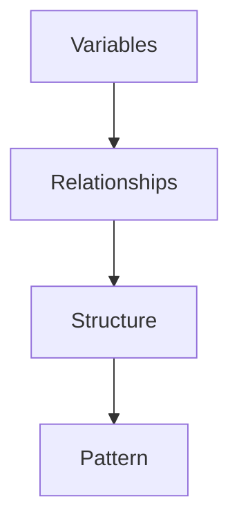

### 📊 Типи патернів

* **тренд (trend)** — батон дорожчає на ~0,7 грн щотижня (розділ 2.2);
* **сезонність (seasonality)** — понеділкова черга (вище);
* **залежність (correlation)** — ціна хліба ходить за ціною борошна;
* **кластери (clusters)** — групи ринків, що поводяться схоже (прифронтові й тилові);
* **форма розподілу (distribution shape)** — як у пожертвах із розділу 2.1.

### 📉 Приклад: скошений розподіл

Пожертви з розділу 2.1 мають **скошений (skewed) розподіл**: більшість значень малі, а кілька — величезні. Це теж патерн, і він каже про систему важливе: фонд тримається на кількох великих донорах. Саме тому середнє там бреше, а медіана ні.

### 🧠 Ключова ідея

```text
Pattern = стиснуте знання про систему
```

Замість 28 чисел із журналу черги достатньо пам'ятати одне речення: «у понеділок на 40% більше людей».

??? question "Перевір себе"
    У перший понеділок прийшло 154 людини, а в першу середу — 106. Чи можна вже після першого тижня казати про «понеділковий патерн»?

    ??? success "Відповідь"
        Ні, один тиждень міг бути випадковим (шум). Патерн підтверджується повторенням: тут усі 4 понеділки вищі за інші дні. Що більше повторень, то впевненіше.

---

## 🔍 2.4. Pattern → Модель

Коли патерн знайдено, його можна **формалізувати** — записати формулою.

!!! note "📖 Історія"
    «Батон дорожчає приблизно на 0,7 грн за тиждень» — це патерн, сказаний словами. Ліна хоче мати формулу, яку можна підставити в бюджет. Вона бере 60 щоденних цін із розділу 2.2, ті самі «зашумлені», і проводить через них пряму.

**Життєвий приклад.** Таксі рахує вартість поїздки за формулою «50 грн посадка + 15 грн за км». Ніхто не записує ціну кожної поїздки в таблицю, бо формула (модель) **стиснула** тисячі поїздок до двох чисел.

```python
import numpy as np

rng = np.random.default_rng(42)
day = np.arange(60)
bread = np.round(np.linspace(33, 39, 60) + rng.normal(0, 1.5, 60), 1)

slope, intercept = np.polyfit(day, bread, deg=1)
print(f"Модель: ціна ≈ {intercept:.1f} + {slope:.3f} × день")
print(f"Тобто ≈ +{slope * 30:.1f} грн за місяць")
print(f"Справжній (схований) тренд: +{6 / 59 * 30:.1f} грн за місяць")

for d in (60, 90):
    print(f"Прогноз на день {d}: {intercept + slope * d:.1f} грн")
```

```text
Модель: ціна ≈ 32.9 + 0.107 × день
Тобто ≈ +3.2 грн за місяць
Справжній (схований) тренд: +3.1 грн за місяць
Прогноз на день 60: 39.4 грн
Прогноз на день 90: 42.6 грн
```

Тут ми знаємо «правду», бо самі її задали: тренд +3,1 грн/місяць. Модель, побачивши тільки зашумлені точки, знайшла +3,2. **Шум не завадив знайти сигнал**, бо модель дивиться на всі 60 точок разом, а не на окремі стрибки.

### 🧠 Перехід

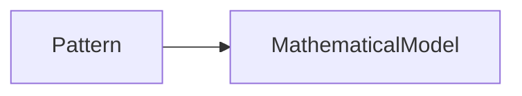

### 📌 Що дає модель

* ти **описала** систему (два числа замість 60);
* ти можеш її **відтворити** (підставити будь-який день);
* ти можеш її **передбачити** (день 90).

### ⚠️ І що вона забуває

Модель — спрощення. Пряма лінія не знає про сезонність, курс, зміну складу ринків. Кожна модель має **межі застосування**, і чесний аналітик називає їх уголос: «працює, поки тренд рівномірний; на 1–2 місяці вперед». Ланцюжок «Pattern → Модель → Обмеження» ти побачиш і в уроці: просте середнє по ринках — це теж модель, і в неї є свої межі.

??? question "Перевір себе"
    Чому модель знайшла +3,2 замість точних +3,1?

    ??? success "Відповідь"
        Через шум: 60 випадкових коливань трохи «нахилили» лінію. Що більше точок і що менший шум, то ближче оцінка до справжнього тренду.

---

## 🔮 2.5. Від структури до прогнозу

Структура — основа прогнозу.

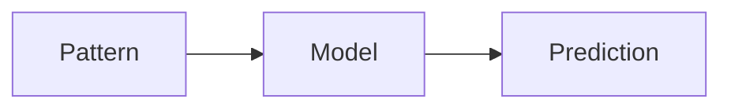

Якщо ти знаєш:

* як система поводиться (батон дорожчає рівномірно);
* як змінні пов'язані (понеділок → більше людей),

то можеш передбачити:

* реакцію системи (у понеділок потрібно на 40% більше наборів);
* майбутні значення (через місяць ≈ 42,6 грн).

**Життєвий приклад.** Досвідчена продавчиня кави знає: о 8:00 черга, о 14:00 тиша, у дощ продажі гарячого шоколаду зростають. Вона не бачить майбутнього, просто знає структуру системи. Тому заздалегідь готує молоко.

!!! note "📖 Історія"
    Ліна поєднує два знайдені патерни. «Марто Петрівно, наступного місяця батон коштуватиме ≈ 42–43 грн, а по понеділках людей на 40% більше. Пропоную закладати бюджет за ціною 43 грн і ставити в понеділок трьох волонтерів замість двох.» Це вже не таблиця, а план.

---

## 🧠 2.6. Візуалізація як інструмент пошуку структури

Проблема: патерни заховані в таблицях. Людське око погано бачить тренд у стовпчику чисел і чудово бачить його на лінії.

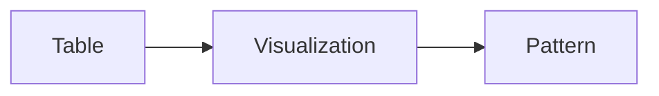

### 📌 Чому це працює

* мозок краще бачить структуру в образах, ніж у цифрах;
* графік — це компресія даних: сотні чисел стають однією формою.

### 🎨 Як SWD радить показувати знайдене

Для **дослідження** будуй швидко й багато, краса не важлива. Для **пояснення** Марті Петрівні — один графік, у якому:

1. **заголовок-висновок** (takeaway title) замість опису: не «Ціни на хліб за ринками», а «У Харкові батон подорожчав на 8 грн — у 5 разів швидше, ніж у Києві»;
2. **один акцентний колір** для головного, а все інше сіре. Колір — preattentive-атрибут: око помічає його ще до того, як ти почала читати;
3. **нічого зайвого**: ні рамки, ні легенди, до якої треба переводити погляд. Підписи стоять прямо біля ліній.

```python
import matplotlib.pyplot as plt
import pandas as pd

prices = pd.DataFrame({
    "month": ["Січ", "Лют", "Бер", "Кві"] * 3,
    "market": ["Київ"] * 4 + ["Львів"] * 4 + ["Харків"] * 4,
    "price": [34.0, 34.5, 35.0, 35.5, 32.0, 32.0, 32.5, 33.0, 33.0, 35.0, 38.0, 41.0],
})

fig, ax = plt.subplots(figsize=(7, 4))
for market, part in prices.groupby("market"):
    accent = market == "Харків"
    ax.plot(part["month"], part["price"],
            color="tab:red" if accent else "lightgray",   # один акцент, решта — контекст
            linewidth=3 if accent else 1.5)
    ax.text(3.1, part["price"].iloc[-1], market,
            color="tab:red" if accent else "gray", va="center")

ax.set_title("У Харкові батон подорожчав на 8 грн — у 5 разів швидше, ніж у Києві",
             loc="left")
ax.spines[["top", "right"]].set_visible(False)              # прибираємо зайве
ax.set_ylabel("грн за батон")
plt.show()
```

На графіку дві сірі майже пласкі лінії (Київ, Львів) і одна червона, що круто йде вгору (Харків). Марта Петрівна прочитає заголовок, побачить червону лінію і за 5 секунд зрозуміє висновок, не розбираючись в осях.

??? question "Перевір себе"
    Чому підписи міст стоять біля кінців ліній, а не в легенді?

    ??? success "Відповідь"
        З легендою око мусить стрибати «колір у легенді → лінія → назад». Підпис біля лінії прибирає цю роботу. Це принцип SWD «прибери зайве навантаження (clutter)».

---

## ⚠️ 2.7. Аномалії: шум чи сигнал?

Не все, що виглядає як шум, — це шум.

!!! note "📖 Історія"
    Тарас надіслав травневі ціни. Ліна одразу помічає три дивні значення: у Харкові батон за 0 грн, в Одесі — за 9 999 грн, а 20 травня в Харкові — 52 грн. Видалити все підозріле? Ліна вирішує спершу знайти, а потім розібратися з кожним окремо.

**Життєвий приклад.** Банк блокує твою картку: «Підозріла операція — 15 000 грн о 3-й ночі». Можливо, це шахрай (критичний сигнал). А можливо, ти справді купила квитки на нічний рейс (нова нормальна поведінка). Банк не видаляє операцію, а **перевіряє** її.

```python
import pandas as pd

raw = pd.DataFrame({
    "market": ["Київ", "Львів", "Харків", "Одеса", "Дніпро", "Чернівці", "Харків"],
    "date": ["2024-05-15"] * 6 + ["2024-05-20"],
    "price": [36.0, 33.5, 0.0, 9999.0, 35.0, 32.5, 52.0],
})

median = raw["price"].median()
raw["ratio"] = (raw["price"] / median).round(2)       # у скільки разів від «типової» ціни
raw["suspicious"] = (raw["ratio"] < 0.5) | (raw["ratio"] > 1.3)
print(f"Медіана: {median} грн")
print(raw)
```

```text
Медіана: 35.0 грн
     market        date   price   ratio  suspicious
0      Київ  2024-05-15    36.0    1.03       False
1     Львів  2024-05-15    33.5    0.96       False
2    Харків  2024-05-15     0.0    0.00        True
3     Одеса  2024-05-15  9999.0  285.69        True
4    Дніпро  2024-05-15    35.0    1.00       False
5  Чернівці  2024-05-15    32.5    0.93       False
6    Харків  2024-05-20    52.0    1.49        True
```

Зверни увагу: «типову» ціну Ліна рахує **медіаною**, бо середнє зіпсувало б саме значення 9 999. Три рядки підозрілі, але причини в них різні:

* **0 грн у Харкові** — помилка: Тарас пояснив, що так позначав «немає в продажу». Правильно буде замінити на пропуск (`NaN`), а не на нуль;
* **9 999 в Одесі** — помилка введення: «заглушка», коли ціну не дізналися. Теж `NaN`;
* **52 грн у Харкові 20 травня** — **не помилка**. Того тижня обстріл пошкодив пекарню, хліб завозили з області. Це найважливіший рядок у таблиці: критичний сигнал, через який Марта Петрівна змінить маршрут вантажівки.

Якби Ліна «почистила» всі три значення одним фільтром, вона б викинула саме те, заради чого існує аналітика.

### 🧠 Варіанти

* ❌ **помилка** — виправити або позначити пропуском;
* ❗ **новий патерн** — система змінилась, модель треба оновити;
* 🚨 **критичний сигнал** — терміново повідомити тим, хто ухвалює рішення.

### 📌 Ще приклади

Різкий стрибок (spike) на графіку відвідувань сайту може бути:

* багом (лічильник порахував одного відвідувача 1000 разів);
* атакою (бот-мережа);
* новим трендом (про тебе написали в новинах).

```text
Аномалію спершу пояснюють, потім вирішують — і ніколи навпаки
```

??? question "Перевір себе"
    Чому для пошуку аномалій Ліна взяла медіану, а не середнє?

    ??? success "Відповідь"
        Середнє з урахуванням 9 999 дорівнює ≈ 1 455 грн. Порівняно з ним «нормальними» виглядали б і 0, і 52. Медіана (35 грн) не реагує на одиничні викиди, тому залишається чесною точкою відліку.

---

## 🧠 2.8. Найглибший рівень

```text
Дані — це відображення системи
Патерн — це структура системи
Інсайт — це розуміння системи
```

Ціни Тараса відображають систему «хліб в Україні». Понеділкова черга — частина структури системи «наш фонд». А розуміння «фонд залежить від одного донора й однієї пекарні в Харкові» — це інсайт, із яким уже можна щось робити.

---

## 🔥 Підсумок розділів 1–2

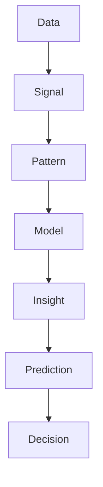

```text
Знайти структуру = перетворити хаос у передбачувану систему
```

Що Ліна винесла з першого тижня в «Хлібному кошику»:

1. Одне питання («Хліб подорожчав?») має чотири рівні відповіді: що, чому, що буде, що робити.
2. Середнє може брехати (пожертви); перед ним завжди варто подивитися на розподіл.
3. Шум гаситься агрегацією й згладжуванням, сигнал проступає з повторень.
4. Аномалію не видаляють наосліп: вона може бути найважливішим рядком таблиці.
5. Аудиторії показують не процес, а висновок: Big Idea одним реченням і один графік із заголовком-висновком.

## 🚀 Аналітик мислить так

Не «що показує графік», а:

```text
Яка система породила ці дані?
Яка її структура?
Як вона зміниться?
Що з цим робити — і кому це сказати одним реченням?
```

___

#  3. Головні патерни аналізу даних

!!! note "📖 Історія"
    Перший тиждень у фонді Ліна прожила серед таблиць. Тарас щодня надсилав нові CSV з цінами з ринків, а Марта Петрівна щоранку ставила одне коротке питання. Скільки коштує хліб? Де дорожче? Чи ростуть ціни? Чому в Харкові інакше? До п'ятниці Ліна помітила, що всі питання зводяться до кількох прийомів. Їх вісім, і далі в цьому розділі — по одному на кожен.

| Патерн | Питання Марти Петрівни | Типовий інструмент pandas |
|---|---|---|
| Aggregation — агрегація | «Скільки в середньому коштує хліб?» | `mean`, `median`, `sum`, `agg` |
| Filtering — фільтрація | «А якщо лише Київ і лише цей рік?» | `df[умова]`, `query` |
| Grouping — групування | «Як по кожному місту?» | `groupby` |
| Comparison — порівняння | «Де дорожче і наскільки?» | різниця, %, `pct_change` |
| Time — час | «Ціни ростуть?» | `resample`, `rolling` |
| Spatial — простір | «Де на карті проблема?» | координати ринків, регіони |
| Relationship — зв'язки | «Ціни йдуть за курсом долара?» | `corr`, scatter |
| Distribution — розподіл | «Які ціни типові, а які дивні?» | `describe`, гістограма, boxplot |

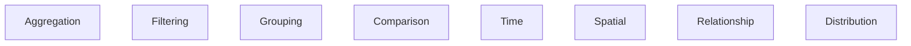

Патерни рідко трапляються поодинці. Типове питання «де хліб подорожчав найбільше за рік?» — це фільтрація (хліб, рік), групування (по містах), агрегація (середня ціна) і порівняння (було → стало) в одному ланцюжку.

---

## 📊 3.1. Aggregation (Агрегація)

!!! note "📖 Історія"
    Понеділок, 9:00. Марта Петрівна заходить з кавою: «Ліно, скільки зараз коштує житній хліб? Одним числом — мені на нараду з донорами». У Ліни таблиця на шість ринків. Марті не потрібні шість чисел. Їй потрібне одне, і воно не повинно її обманювати.

Агрегація — це **стиснення багатьох рядків до одного числа (або кількох чисел)**. Тисячі цін перетворюються на одну метрику.

**Простий приклад без коду.** Учитель не зачитує батькам усі 40 оцінок дитини за семестр. Він каже «середній бал 10» — і це агрегація. Добре, якщо оцінки рівні. Погано, якщо за ним ховаються тридцять дванадцяток і десять двійок.


Перша спроба Ліни:

```python
import pandas as pd

bread = pd.DataFrame({
    "market": ["Київ", "Львів", "Харків", "Одеса", "Дніпро", "Чернівці"],
    "commodity": "Хліб житній",
    "price": [42.0, 38.5, 36.0, 40.0, 37.5, 35.0],
})

print("Записів:        ", bread["price"].count())
print("Середня ціна:   ", round(bread["price"].mean(), 2))
print("Медіана:        ", bread["price"].median())
print("Мінімум/максимум:", bread["price"].min(), "/", bread["price"].max())
```

```text
Записів:         6
Середня ціна:    38.17
Медіана:         38.0
Мінімум/максимум: 35.0 / 42.0
```

Тут середнє й медіана майже збігаються: ціни близькі одна до одної, аномалій немає. Ліна пише Марті: «Житній хліб — близько 38 грн, від 35 у Чернівцях до 42 у Києві».

Зверни увагу: `count()` теж агрегація. Перш ніж довіряти середньому, варто знати, зі скількох значень його пораховано. Середнє з двох записів і з двох тисяч — різні за надійністю числа.

### 🔍 Зв'язок із парадигмою «дані = сигнал + шум»

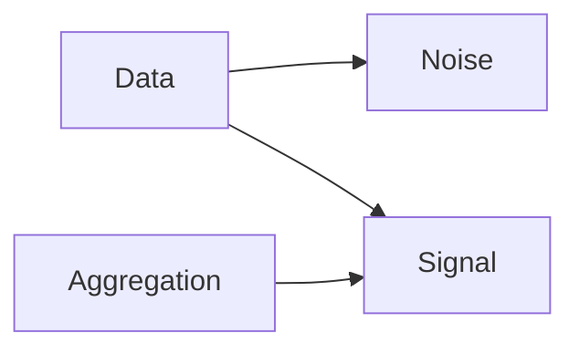

Коли багато значень зводяться в одне, випадкові коливання окремих записів частково гасять одне одного. Агрегація приглушує шум, підсилює сигнал і показує структуру. Але є й ціна: агрегація **викидає деталі**. Тому важливо правильно обрати, як саме стискати.

??? question "Перевір себе"
    Чому поруч із середнім корисно показувати `count()`?

    ??? success "Відповідь"
        Бо середнє з кількох записів дуже нестійке. Одна випадкова ціна його суттєво зсуне. `count()` показує, наскільки числу можна довіряти.

---

### ⚖️ Mean (Середнє) — центр масиву

!!! note "📖 Історія"
    Вівторок. Тарас надсилає оновлену таблицю. Ліна запускає той самий код і бачить, що середня ціна хліба — **672 грн**. Вона вже набирає Марті «катастрофа!», але зупиняється. Хліб за 672 гривні? Щось не так.

```python
import pandas as pd

prices = pd.Series([38.5, 36.0, 40.0, 37.5, 35.0, 3850.0],
                   index=["Київ", "Львів", "Харків", "Одеса", "Дніпро", "Чернівці"])

print("Середнє:", round(prices.mean(), 2))
print("Медіана:", prices.median())
```

```text
Середнє: 672.83
Медіана: 38.0
```

У Чернівцях Тарас пропустив кому: замість `38.50` записав `3850`. Одне помилкове значення з шести підняло середнє майже у 18 разів. Медіана цього навіть «не помітила».

```text
Mean = сума всіх значень / кількість
```

**Ментальна модель — «центр маси».** Уяви дошку-гойдалку, на якій лежать гирі-значення. Середнє — точка, де дошка врівноважиться. Одна дуже важка гиря далеко на краю зсуне цю точку до себе. Середнє використовує **всі** значення, навіть аномалії, тому воно **чутливе до викидів**.

**Життєвий приклад.** У компанії дев'ять працівників отримують по 20 тис. грн, а директор — 1 млн. «Середня зарплата у фірмі — 118 тис.» Формально це правда, але жоден працівник таких грошей не бачить.

```text
Mean = чутливий до викидів
```

??? question "Перевір себе"
    У списку `[10, 12, 11, 9, 1000]` середнє дорівнює 208. Яке значення «винне» і що ти перевіриш першим?

    ??? success "Відповідь"
        Винне `1000`. Спершу треба з'ясувати, чи це помилка запису (як кома в Тараса), чи реальна подія. Від цього залежить, прибирати значення чи досліджувати його.

---

### 🔧 Просунуті варіації Mean

#### Trimmed Mean (усічене середнє)

Ідея проста: відсортувати значення, відкинути певну частку найменших і найбільших, а із залишку порахувати середнє. Так оцінюють виступи в спортивній гімнастиці: найвищу й найнижчу оцінку суддів відкидають, щоб один упереджений суддя не вирішив долю медалі.

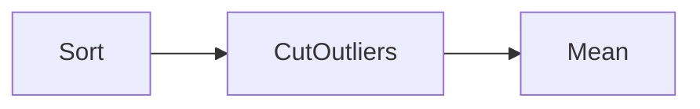

```python
from scipy import stats
import pandas as pd

prices = pd.Series([38.5, 36.0, 40.0, 37.5, 35.0, 3850.0])

trimmed = stats.trim_mean(prices, proportiontocut=0.2)  # по 20% з кожного краю
print("Звичайне середнє:", round(prices.mean(), 2))
print("Усічене (20%):   ", round(trimmed, 2))
print("Медіана:         ", prices.median())
```

```text
Звичайне середнє: 672.83
Усічене (20%):    38.0
Медіана:          38.0
```

20% від шести значень — це одне значення з кожного краю. Відкинулись `35.0` і `3850.0`, а середнє решти — 38.0. Усічене середнє — **робастна (стійка) оцінка**: воно все ще «середнє», але вже не піддається окремим аномаліям. Типова частка — 5–10% з кожного боку. 20% тут лише тому, що значень мало.

#### Weighted Mean (зважене середнє)

!!! note "📖 Історія"
    Наприкінці місяця Марта Петрівна питає інакше: «Скільки ми **в середньому платили** за батон?» Фонд купив 900 батонів у Києві по 42 грн і лише 100 у Чернівцях по 35 грн.

```text
Mean = Σ(x * weight) / Σ(weight)
```

```python
import pandas as pd

sales = pd.DataFrame({
    "market": ["Київ", "Чернівці"],
    "price":  [42.0, 35.0],     # ціна батона
    "loaves": [900, 100],       # скільки батонів купив фонд
})

simple = sales["price"].mean()
weighted = (sales["price"] * sales["loaves"]).sum() / sales["loaves"].sum()

print("Просте середнє:  ", simple)
print("Зважене середнє: ", weighted)
```

```text
Просте середнє:   38.5
Зважене середнє:  41.3
```

Просте середнє відповідає на питання «яка типова ціна на ринках?». Зважене — «скільки ми реально заплатили за один батон?». Обидва числа правильні, але відповідають на **різні питання**. Ось чому SWD радить починати з контексту: спершу з'ясуй, що саме хоче знати аудиторія, а тоді обирай формулу.

Де ще потрібні ваги:

* різна важливість даних (великий ринок важить більше за малий);
* різна точність джерел: точний датчик A отримує вагу 0.8, шумний датчик B — 0.2;
* дисбаланс даних (imbalance): одних записів багато, інших мало.

```text
Mean ≠ одна формула
Mean = клас моделей
```

??? question "Перевір себе"
    Учень отримав 12 за контрольну (вага 3) і 6 за самостійну (вага 1). Яке просте середнє, а яке зважене?

    ??? success "Відповідь"
        Просте: (12 + 6) / 2 = 9. Зважене: (12·3 + 6·1) / (3 + 1) = 42 / 4 = 10.5.

---

### ⚖️ Median (Медіана) — центр порядку

Медіана — це **50-й процентиль**: значення посередині, якщо всі значення вишикувати за зростанням. Половина значень менша за медіану, половина — більша.

**Ментальна модель — «позиція, а не величина».** Вишикуй шість ринків за ціною хліба й подивись на середину ряду. Якщо в Чернівцях замість 38.50 записано 3850, Чернівці просто стануть в кінець ряду. Середина від цього не зсунеться.

```text
[10, 12, 11, 9, 1000]  →  сортуємо  →  [9, 10, 11, 12, 1000]

Median = 11 ✅
```

Медіана працює, бо **ігнорує величину (magnitude) викидів**: для неї важливо лише, що значення «десь угорі», а не наскільки далеко.

```text
Median = робастна метрика
```

**Коли використовувати медіану:**

* асиметричні (skewed) дані, де довгий «хвіст» в один бік;
* дані з викидами (outliers);
* доходи й зарплати (той самий директор-мільйонер);
* ціни (кілька елітних магазинів не повинні «подорожчати» тобі хліб).

**На справжніх даних.** Житній хліб на ринках WFP у 2025 році (файл бонус-уроку):

```python
import pandas as pd

df = pd.read_csv("data/wfp_food_prices_ukr.csv", parse_dates=["date"])
bread = df[(df["commodity"] == "Bread (rye)")
           & (df["pricetype"] == "Retail")
           & (df["market"] != "National Average")
           & (df["date"].dt.year == 2025)]

print("Записів:", bread["price"].count())
print(bread["price"].agg(["mean", "median", "min", "max"]).round(2))
```

```text
Записів: 68
mean      49.51
median    48.12
min       36.38
max       82.40
Name: price, dtype: float64
```

Середнє трохи вище за медіану. Це підказка, що вгорі є «хвіст» дорожчих цін: максимум 82.40 тягне середнє вгору. Коли `mean > median`, розподіл зазвичай скошений праворуч. Детально — у розділі 3.8 «Розподіл».

??? question "Перевір себе"
    Марта Петрівна хоче знати «типову» ціну оренди складу, а серед пропозицій є одна розкішна за 10× ринку. Середнє чи медіана?

    ??? success "Відповідь"
        Медіана. Одна розкішна пропозиція завищить середнє, а на медіану майже не вплине.

---

### 📊 Mode (Мода) — найчастіше значення

Мода — це **найпоширеніше значення**. Вона єдина з «центральних» метрик, яка працює з категоріями: середнє з назв товарів не порахуєш, а найчастішу назву знайдеш.

```mermaid
flowchart LR
    Data --> Frequency --> MaxCount --> Mode
```

!!! note "📖 Історія"
    Гаряча лінія фонду записує, чого люди просять найбільше. Марта питає: «Що класти в набір першим?»

```python
import pandas as pd

requests = pd.Series(["Гречка", "Хліб житній", "Олія", "Гречка",
                      "Молоко", "Гречка", "Хліб житній"])

print("Мода:", requests.mode().tolist())
print(requests.value_counts())
```

```text
Мода: ['Гречка']
Гречка         3
Хліб житній    2
Олія           1
Молоко         1
Name: count, dtype: int64
```

`mode()` повертає Series, а не одне число, бо найчастіших значень може бути кілька (кілька мод). `value_counts()` дає повну картину частот і часто корисніший за саму моду.

Де мода доречна: категоріальні дані (товари, міста), класи (тип звернення), події (найчастіша причина відмови).

```text
["A", "A", "B", "C"] → Mode = A
```

---

### ⚖️ Sum (Сума) — загальний обсяг

Сума — це **накопичений (cumulative) сигнал**. Вона відповідає на питання «скільки всього?»: гроші за місяць, тонни вантажу, кількість виданих наборів.

```python
import pandas as pd

deliveries = pd.DataFrame({
    "market": ["Київ", "Київ", "Львів", "Харків", "Харків", "Харків"],
    "boxes":  [120, 80, 60, 150, 90, 110],
})

print("Наборів усього:  ", deliveries["boxes"].sum())
print("Кількість рейсів:", deliveries["boxes"].count())
print("Набори по містах:")
print(deliveries.groupby("market")["boxes"].sum())
```

```text
Наборів усього:   610
Кількість рейсів: 6
Набори по містах:
market
Київ      200
Львів      60
Харків    350
Name: boxes, dtype: int64
```

Використання: фінанси (витрати, бюджет), обсяги (тонни, набори), потоки (люди, вантажі).

**Обмеження: сума залежить від масштабу.** Харків отримав найбільше наборів, але, можливо, там просто більше людей. Щоб порівняти справедливо, суму треба нормалізувати: набори на 1000 мешканців, на один рейс, на день. Про це — у розділі 3.4 «Порівняння».

??? question "Перевір себе"
    Що повертає `count()`, а що — `sum()` для стовпця `boxes`?

    ??? success "Відповідь"
        `count()` — кількість непорожніх записів (6 рейсів), `sum()` — сума значень (610 наборів).

---

### ⚠️ КРИТИЧНИЙ АНТИПАТЕРН

#### ❌ Mixing units — змішування одиниць виміру

!!! note "📖 Історія"
    Ліна рахує середню ціну гречки й отримує 40 грн за кілограм. Дивно, бо на всіх ринках гречка дорожча за 55. Виявилось, що один ринок Тарас записав у **гривнях за грам**.

```python
import pandas as pd

raw = pd.DataFrame({
    "commodity": ["Гречка", "Гречка", "Гречка"],
    "unit":      ["KG", "KG", "G"],
    "price":     [62.0, 58.0, 0.06],   # Тарас записав одну ціну за грам
})
print("Середнє «як є»:", round(raw["price"].mean(), 2))

per_kg = raw["price"].where(raw["unit"] == "KG", raw["price"] * 1000)
print("Ціни за кг:    ", per_kg.tolist())
print("Середнє за кг: ", round(per_kg.mean(), 2))
```

```text
Середнє «як є»: 40.02
Ціни за кг:     [62.0, 58.0, 60.0]
Середнє за кг:  60.0
```

Код не видав жодної помилки, бо pandas не знає, що числа в різних одиницях. Помилку видно лише тому, що Ліна **знає предметну область**: гречка за 40 грн/кг виглядає підозріло.

```text
метри + кілограми = ❌
день + місяць = ❌
гривні за кг + гривні за грам = ❌
```

```mermaid
flowchart TD
    MixedData --> BrokenAggregation --> WrongInsight
```

Чому це ламає аналіз:

* різні одиниці (кг і грам, гривня і долар);
* різна гранулярність (день і місяць);
* різний контекст (роздрібна й оптова ціна).

У справжніх даних WFP це не теорія. У стовпці `unit` трапляються `KG`, `L`, `Loaf`, `500 G`, `10 pcs`. Перед будь-яким `mean()` фільтруй або перераховуй до однієї одиниці.

```text
Normalize → Aggregate
```

---

### 📊 Гранулярність (Granularity)

Гранулярність — це **рівень деталізації даних**: година, день, тиждень, місяць. Агрегувати можна лише значення **одного рівня**.

```text
Aggregation працює тільки на одному рівні
```

!!! note "📖 Історія"
    Марта питає: «Скільки наборів ми видаємо за тиждень?» Ліна бере тижневі суми й рахує середнє. Але сьогодні середа, і четвертий тиждень ще не закінчився.

```python
import pandas as pd

weeks = pd.DataFrame({
    "week":  ["1 тиж.", "2 тиж.", "3 тиж.", "4 тиж."],
    "days":  [7, 7, 7, 3],          # останній тиждень ще не закінчився
    "boxes": [700, 735, 714, 318],
})

print("Середнє за тиждень «як є»:", weeks["boxes"].mean())
weeks["per_day"] = weeks["boxes"] / weeks["days"]
print(weeks)
print("Середнє за день:", round(weeks["boxes"].sum() / weeks["days"].sum(), 1))
```

```text
Середнє за тиждень «як є»: 616.75
     week  days  boxes  per_day
0  1 тиж.     7    700    100.0
1  2 тиж.     7    735    105.0
2  3 тиж.     7    714    102.0
3  4 тиж.     3    318    106.0
Середнє за день: 102.8
```

«616 наборів на тиждень» звучить як спад. Насправді четвертий тиждень **найпродуктивніший** (106 на день), просто він неповний. Та сама пастка — порівнювати календарний тиждень (7 днів) із робочим (5 днів) або лютий із березнем. Рішення — привести все до спільної одиниці (на день), а вже потім агрегувати.

??? question "Перевір себе"
    Магазин порівнює виручку за лютий і березень і бачить, що березень на 10% кращий. Що перевірити, перш ніж радіти?

    ??? success "Відповідь"
        Кількість днів (28 проти 31, різниця ≈ 11%). Порівнювати варто виручку **за день**.

---

### 🧠 Aggregation як Signal Extractor

```mermaid
flowchart LR
    RawData --> Noise
    RawData --> Aggregation --> Signal
```

!!! note "📖 Історія"
    Гаряча лінія фонду пише лог кожного дзвінка. Ліна дивиться на погодинні дані й нічого не розуміє: 4, 1, 4, 3, 5, 1, 0, 5… Хаос. Але Марта відчуває, що дзвінків стає більше. Чи це правда?

```python
import numpy as np
import pandas as pd

rng = np.random.default_rng(7)
hours = pd.date_range("2024-03-01", periods=24 * 14, freq="h")
rate = np.linspace(3, 6, len(hours))               # попит повільно зростає
calls = pd.Series(rng.poisson(rate), index=hours)  # погодинні дзвінки — хаос

print("Погодинно, перші 8 годин:", calls.head(8).tolist())
daily = calls.resample("D").sum()
print("Дзвінків за день:", daily.tolist())
```

```text
Погодинно, перші 8 годин: [4, 1, 4, 3, 5, 1, 0, 5]
Дзвінків за день: [73, 76, 88, 92, 109, 90, 96, 91, 109, 135, 132, 141, 122, 118]
```

Погодинно бачимо самий шум. Але щойно Ліна підсумувала дзвінки по днях, проступив тренд: від ~75 на день на початку до ~120–140 наприкінці. Агрегація приглушила випадкові коливання й показала структуру.

Тепер у Ліни є Big Idea для Марти, одне речення з позицією і ставкою: **«За два тижні дзвінків на гарячу лінію стало майже вдвічі більше — нам потрібен ще один оператор, інакше люди не додзвонюються»**. Це вже не число, а висновок, з яким можна йти на нараду.

---

### 🔬 Aggregation → Pattern → Insight

```mermaid
flowchart TD
    Data --> Aggregation --> Pattern --> Insight
```

Ланцюжок з історії Ліни:

1. **Data** — 336 погодинних записів про дзвінки.
2. **Aggregation** — `resample("D").sum()`, 14 чисел.
3. **Pattern** — дзвінків стабільно більшає.
4. **Insight** — потрібен ще один оператор.

```text
Без агрегації немає патерну
Без патерну немає інсайту
```

---

### 🧠 Підсумок

| Метрика | Що показує | Чутлива до викидів? | Коли брати | pandas |
|---|---|---|---|---|
| Mean | центр маси | так | симетричні дані без аномалій | `mean()` |
| Trimmed mean | центр без крайніх значень | слабко | є кілька підозрілих значень | `scipy.stats.trim_mean` |
| Weighted mean | центр з урахуванням ваги | так | записи мають різну важливість | `(x * w).sum() / w.sum()` |
| Median | середина ряду | ні | доходи, ціни, скошені дані | `median()` |
| Mode | найчастіше значення | ні | категорії | `mode()`, `value_counts()` |
| Sum | загальний обсяг | так | гроші, обсяги, потоки | `sum()` |
| Count | скільки записів | ні | завжди — як перевірка надійності | `count()` |

Три правила перед будь-якою агрегацією:

1. **Одні одиниці:** спершу нормалізуй (кг, грн, на день), потім агрегуй.
2. **Один рівень гранулярності:** не змішуй повні й неповні періоди.
3. **Правильне питання:** «типова ціна» (медіана), «скільки заплатили» (зважене середнє) і «скільки всього» (сума) — різні питання.

Аналітик думає не «я рахую середнє», а так:

```text
Я стискаю систему до сигналу —
і обираю спосіб стиснення, який не обманює мою аудиторію.
```

## 🔍 3.2. Filtering (Фільтрація)

!!! note "📖 Історія"
    У понеділок Марта Петрівна заходить до Ліни з одним питанням: «Скільки зараз коштує хліб у Харкові? Вирішуємо, чи додавати борошно в харківські набори». Таблиця Ліни містить тисячі рядків: усі міста, усі товари, усі місяці. Відповідь там є, але вона загублена серед іншого. Ліні не потрібно *більше* даних. Їй потрібно бачити *лише потрібні*.

Агрегація стискає тисячі рядків в одне число. Фільтрація робить інше: **вона вирішує, які рядки взагалі потраплять в аналіз.** Фільтр ізолює підмножину даних і відсікає шум.

---

### 🧠 Архітектурна суть фільтрації

Коли ти шукаєш у телефоні фото з моря, ти не гортаєш три тисячі знімків. Ти вводиш «море» в пошук, і галерея ховає решту. Фото нікуди не зникли. Ти просто навела об'єктив.

Тому фільтрація — це **не просто `WHERE` у SQL** чи квадратні дужки в pandas. Це:

```text
Об'єктив / лінза / мікроскоп
```

```mermaid
flowchart LR
    RawData --> Filter
    Filter --> Subset
```

У pandas фільтр складається з двох кроків. Спершу будуємо **маску**, тобто стовпець `True`/`False` для кожного рядка. Потім залишаємо лише рядки, де стоїть `True`:

```python
import pandas as pd

prices = pd.DataFrame({
    "market":    ["Київ", "Харків", "Львів", "Харків", "Одеса", "Харків"],
    "commodity": ["Хліб житній", "Хліб житній", "Гречка", "Гречка", "Хліб житній", "Молоко"],
    "price":     [38.0, 34.5, 62.0, 58.0, 36.0, 41.0],
})

mask = (prices["market"] == "Харків") & (prices["commodity"] == "Хліб житній")
print("Маска (True = рядок проходить фільтр):")
print(mask.tolist())
print()
print(prices[mask])
print(f"\nРядків було: {len(prices)}, лишилось: {mask.sum()}")
```

```text
Маска (True = рядок проходить фільтр):
[False, True, False, False, False, False]

   market    commodity  price
1  Харків  Хліб житній   34.5

Рядків було: 6, лишилось: 1
```

Три харківські рядки пройшли першу умову, три хлібні — другу. Обидві разом пройшов лише один рядок: оператор `&` означає «і те, і те». Кожну умову беремо в дужки, бо `&` у Python «чіпляється» сильніше за `==`.

```text
Фільтрація = керування тим, що ти бачиш
```

??? question "Перевір себе"
    Як змінити маску, щоб отримати хліб **у Харкові або в Одесі**?

    ??? success "Відповідь"
        `prices["market"].isin(["Харків", "Одеса"]) & (prices["commodity"] == "Хліб житній")`. Можна й так: `((prices["market"] == "Харків") | (prices["market"] == "Одеса")) & ...`. Тут `|` означає «або».

---

### ⚖️ Фільтрація як відділення сигналу від шуму

!!! note "📖 Історія"
    Тарас надіслав Ліні таблицю з цінами на хліб від волонтерів: «Порахуй середню, будь ласка». Ліна натискає Enter і бачить **1690 гривень за батон**. Марта б'є на сполох? Ні. Ліна відкриває таблицю: хтось у Дніпрі записав `0` замість «немає в продажу», у Чернівцях `9999` означало «не знаю», Одеса записана двічі, а в Харкові ціни немає зовсім.

Реальні дані завжди **брудні** (помилки), **змішані** (різні товари, різні міста) і **надлишкові** (дублікати). Шум буває двох типів:

| Тип шуму | Що це | Приклад у таблиці Тараса |
|---|---|---|
| 🔹 **Фізичний** | похибки вимірювання, випадкові коливання | ціна `0`, ціна `9999`, пропуск |
| 🔹 **Семантичний** | нерелевантні записи, дублікати, нецільові об'єкти | Одеса двічі, гречка в таблиці про хліб |

```mermaid
flowchart TD
    Data --> Noise
    Data --> Signal
    Filter --> Signal
```

```python
import pandas as pd

raw = pd.DataFrame({
    "market":    ["Київ", "Львів", "Дніпро", "Одеса", "Одеса", "Чернівці", "Харків"],
    "commodity": ["Хліб житній"] * 7,
    "price":     [38.0, 36.5, 0.0, 35.0, 35.0, 9999.0, None],
})
print(f"Середня ціна «як є»: {raw['price'].mean():.1f} грн")

clean = (
    raw
    .drop_duplicates()                       # семантичний шум: повтор запису
    .dropna(subset=["price"])                # пропуск
    .query("price > 0 and price < 500")      # фізично неможливі ціни
)
print(f"Середня ціна після фільтра: {clean['price'].mean():.1f} грн")
print(f"Рядків: {len(raw)} → {len(clean)}")
```

```text
Середня ціна «як є»: 1690.6 грн
Середня ціна після фільтра: 36.5 грн
Рядків: 7 → 3
```

Одне значення `9999` зіпсувало середнє в 46 разів. Три фільтри повернули його до правдоподібних 36,5 грн. Але подивись на останній рядок: **з семи записів лишилось три**. Ціну зберегли лише Київ, Львів і Одеса. Про це поговоримо в розділі про ризики.

```text
Фільтрація = бар'єр між хаосом і змістом
```

??? question "Перевір себе"
    Чому `.query("price > 0")` недостатньо і потрібна ще верхня межа?

    ??? success "Відповідь"
        Нуль ловить лише одну помилку. Значення-заглушка на кшталт `9999` теж додатне, але фізично неможливе. Межу (тут 500 грн) обирають зі знання предмета: батон не коштує як телевізор.

---

### 🔬 Фільтрація в різних доменах

Фільтрація — не винахід pandas. Ти щодня користуєшся нею, навіть не помічаючи цього: спам-фільтр у пошті, навушники з шумозаглушенням, «лише непрочитані» в месенджері.

**🧾 Тексти (NLP).** Слова «у», «на», «і» трапляються в кожному реченні, тому нічого не кажуть про зміст. Це **стоп-слова**, тобто шум. Ключові слова — сигнал.

```mermaid
flowchart LR
    Text --> StopWordsRemoval --> MeaningfulWords
```

**🔊 Сигнали й аудіо.** *Low-pass filter* (фільтр низьких частот) прибирає високочастотне шипіння. *Smoothing* (згладжування) зменшує дрібне тремтіння кривої.

**🖼️ Зображення.** *Median filter* прибирає «зерно» (окремі биті пікселі). *Gaussian*-фільтр м'яко розмиває й згладжує.

**📊 Логи й системи.** Зі ста тисяч рядків журналу інженера цікавлять лише `error`, `warning` або конкретна подія.

```mermaid
flowchart LR
    Logs --> FilterErrors --> UsefulData
```

Той самий патерн працює і без pandas, на звичайних списках Python:

```python
logs = [
    "INFO  набір #101 відправлено у Львів",
    "INFO  набір #102 відправлено в Одесу",
    "ERROR набір #103: немає адреси",
    "INFO  набір #104 відправлено в Дніпро",
    "WARN  набір #105: затримка на складі",
]
problems = [line for line in logs if line.startswith(("ERROR", "WARN"))]
print(f"Усього записів: {len(logs)}, проблемних: {len(problems)}")
for line in problems:
    print(line)

stop_words = {"у", "в", "на", "і", "та", "що"}
text = "хліб у Харкові подорожчав на 10 і гречка теж"
words = [w for w in text.split() if w not in stop_words]
print(words)
```

```text
Усього записів: 5, проблемних: 2
ERROR набір #103: немає адреси
WARN  набір #105: затримка на складі
['хліб', 'Харкові', 'подорожчав', '10', 'гречка', 'теж']
```

```text
Фільтрація — універсальний патерн у всіх системах
```

---

### 🎯 Цільовий та гранулярний аналіз

!!! note "📖 Історія"
    Ліна показує Марті середню ціну «продуктового кошика»: 53,5 грн. Марта питає: «53,5 гривні за *що*?» Ліна розуміє, що змішала в одне число батон хліба й літр олії. Таке число нічого не означає.

Фільтр **змінює контекст аналізу**. Він дозволяє ізолювати явище (феномен) і дивитися на нього окремо. Так роблять у маркетингу («тільки жінки 25–34», «тільки high-value клієнти»), так зробить і Ліна:

```mermaid
flowchart TD
    Data --> Filter
    Filter --> Subset
    Subset --> Analysis
```

```python
import pandas as pd

prices = pd.DataFrame({
    "market":    ["Київ", "Київ", "Харків", "Харків", "Львів", "Львів", "Дніпро", "Дніпро"],
    "commodity": ["Хліб житній", "Олія"] * 4,
    "price":     [36.0, 70.0, 33.0, 79.0, 35.0, 66.0, 34.0, 75.0],
})
print(f"Середня ціна «всього»: {prices['price'].mean():.1f} грн  ← хліб і олія змішані")

bread = prices.query("commodity == 'Хліб житній'")
print(f"Середня ціна хліба: {bread['price'].mean():.1f} грн")

east = prices["market"].isin(["Харків", "Дніпро"])
oil = prices["commodity"] == "Олія"
print(f"Олія на сході: {prices[east & oil]['price'].mean():.1f} грн")
print(f"Олія деінде:   {prices[~east & oil]['price'].mean():.1f} грн")
```

```text
Середня ціна «всього»: 53.5 грн  ← хліб і олія змішані
Середня ціна хліба: 34.5 грн
Олія на сході: 77.0 грн
Олія деінде:   68.0 грн
```

Загальне середнє ховало закономірність, яку видно лише після двох фільтрів: **на сході олія дорожча на 9 грн**. Знак `~` перевертає маску («не схід»).

Тепер Ліна може дати Марті не таблицю, а **заголовок-висновок**: «Олія на сході на 13 % дорожча — варто класти її в набори для Харкова й Дніпра».

```text
Без фільтрації всі патерни змішуються
```

??? question "Перевір себе"
    Чому не можна порівнювати «середню ціну всього» між двома містами, якщо в одному місті записано більше олії, а в іншому — більше хліба?

    ??? success "Відповідь"
        Різниця покаже склад записів, а не ціни. Місто з більшою часткою олії «подорожчає», навіть якщо жодна ціна не змінилась. Спершу фільтруй до одного товару, потім порівнюй.

---

### 🧪 Фільтрація як основа експериментів

!!! note "📖 Історія"
    Фонд хоче з'ясувати, чи допомагають SMS-нагадування. Чи частіше родини приходять по набір, якщо їм нагадати? Ліна ділить список родин на дві групи: тим, хто отримав SMS, і тим, хто не отримав.

Фільтрація — база для **A/B-тестів**, **клінічних досліджень** і **causal inference** (пошуку причинно-наслідкових зв'язків). Суть у тому, щоб створити контрольовані групи, які відрізняються лише одним фактором.

```mermaid
flowchart LR
    Population --> Filter --> GroupA
    Population --> Filter --> GroupB
```

```python
import pandas as pd

families = pd.DataFrame({
    "family_id": [1, 2, 3, 4, 5, 6, 7, 8],
    "sms":       [True, False, True, False, True, False, True, False],
    "came":      [True, False, True, True, True, False, False, False],
})
group_a = families[families["sms"]]       # отримали SMS-нагадування
group_b = families[~families["sms"]]      # не отримали
print(f"Прийшли з SMS:    {group_a['came'].mean():.0%}")
print(f"Прийшли без SMS:  {group_b['came'].mean():.0%}")
```

```text
Прийшли з SMS:    75%
Прийшли без SMS:  25%
```

Середнє від `True`/`False` дорівнює частці `True`, тож одна операція дає відсоток. Різниця велика, але висновок правильний лише тоді, коли групи формували **випадково**. Якщо SMS отримали тільки ті, хто залишив телефон, то, можливо, це просто відповідальніші родини.

```text
Без фільтрації немає валідного експерименту
```

---

### 🔗 Group-level Filtering (просунутий патерн)

Досі ми фільтрували **рядки**. Але іноді треба відкинути цілу **групу**: ринок, регіон чи клієнта. Наприклад, залишити тільки групи з revenue > 10 000 або регіони з населенням понад X.

!!! note "📖 Історія"
    У рейтингу «найдорожчий хліб» Ліна бачить на першому місці Чернівці: 52 грн. Але звідти прийшов **один** запис від одного волонтера. Марта не стане перерозподіляти бюджет через одне число.

```mermaid
flowchart TD
    Data --> GroupBy
    GroupBy --> Aggregate
    Aggregate --> FilterGroups
```

```python
import pandas as pd

prices = pd.DataFrame({
    "market": ["Київ"] * 4 + ["Львів"] * 3 + ["Чернівці"] * 1,
    "price":  [36.0, 37.0, 38.0, 39.0, 35.0, 35.5, 36.0, 52.0],
})
print(prices.groupby("market")["price"].agg(["count", "mean"]))

reliable = prices.groupby("market").filter(lambda g: len(g) >= 3)
print()
print("Ринки, де вистачає спостережень:", reliable["market"].unique().tolist())
```

```text
          count  mean
market               
Київ          4  37.5
Львів         3  35.5
Чернівці      1  52.0

Ринки, де вистачає спостережень: ['Київ', 'Львів']
```

`groupby(...).filter(...)` отримує кожну групу цілою і вирішує: «лишити всю групу чи прибрати всю». Умова може бути будь-якою агрегатною: кількість, сума, середнє.

```text
Фільтрація працює на рівні структури
```

??? question "Перевір себе"
    Як залишити лише ринки, де **середня** ціна вища за 36 грн?

    ??? success "Відповідь"
        `prices.groupby("market").filter(lambda g: g["price"].mean() > 36)`.

---

### ⚡ Фільтрація як оптимізація системи

У великих даних фільтрація — питання виживання. Якщо прибрати непотрібне на самому вході, система витратить менше RAM і CPU, моделі тренуватимуться швидше, а відповідь прийде з меншою затримкою (latency).

```mermaid
flowchart LR
    RawData --> EarlyFilter --> SmallData --> Processing
```

**На справжніх даних.** Файл цін WFP з бонус-уроку містить 112 тисяч рядків і 16 колонок. Ліні потрібен лише житній хліб і чотири колонки:

```python
import pandas as pd

full = pd.read_csv("data/wfp_food_prices_ukr.csv", parse_dates=["date"])
print(f"Усе:      {len(full):>7,} рядків, {full.memory_usage(deep=True).sum() / 1e6:5.1f} МБ")

cols = ["date", "market", "commodity", "price"]
small = pd.read_csv("data/wfp_food_prices_ukr.csv", usecols=cols, parse_dates=["date"])
small = small[small["commodity"] == "Bread (rye)"]
print(f"Потрібне: {len(small):>7,} рядків, {small.memory_usage(deep=True).sum() / 1e6:5.1f} МБ")
```

```text
Усе:      112,259 рядків,  22.7 МБ
Потрібне:   1,934 рядків,   0.1 МБ
```

Фільтр за колонками (`usecols`) і за рядками зменшив дані у 200 разів ще до початку аналізу.

```text
Filter early → compute fast
```

---

### ⚠️ КРИТИЧНІ РИЗИКИ

Фільтр, який прибирає шум, так само легко прибирає й правду. Ось три пастки.

#### ❌ Видалення валідних даних

Банк, який «чистить» дані від підозріло великих транзакцій, може випадково прибрати якраз **шахрайство**, тобто те, що й треба було знайти. Аномалія не завжди помилка, іноді це головний сигнал.

#### ❌ Bias (упередженість)

!!! note "📖 Історія"
    Ліна вирішує: «Візьму лише ринки з повною історією за квартал, так чистіше». Звіт виходить спокійним: хліб подорожчав на 3 %. А Харків, де ряд обірвався в лютому, у звіт не потрапив.

```mermaid
flowchart TD
    Data --> Filter --> BiasedData --> WrongModel
```

```python
import pandas as pd

prices = pd.DataFrame({
    "market": ["Київ"] * 3 + ["Львів"] * 3 + ["Харків"] * 2,
    "month":  ["2024-01", "2024-02", "2024-03"] * 2 + ["2024-01", "2024-02"],
    "price":  [36.0, 36.5, 37.0, 35.0, 35.5, 36.0, 34.0, 45.0],
})
# «Візьму лише ринки з повною історією — так чистіше»
counts = prices.groupby("market")["month"].transform("count")
complete = prices[counts == 3]
print("Лишились ринки:", complete["market"].unique().tolist())

jump = prices.groupby("market")["price"].agg(lambda s: s.iloc[-1] / s.iloc[0] - 1)
print(jump.map("{:+.0%}".format))
```

```text
Лишились ринки: ['Київ', 'Львів']
market
Київ       +3%
Львів      +3%
Харків    +32%
Name: price, dtype: str
```

Дані обриваються не випадково. Частіше за все вони зникають саме там, де стається щось погане: обстріли, окупація, закриття ринку. У справжньому наборі WFP так обриваються ряди окупованих і прифронтових областей. Фільтр «лише повні ряди» систематично прибирає найважливіші місця.

Так само працює класичний приклад: якщо аналізувати **тільки активних користувачів**, ти ніколи не побачиш тих, хто пішов (churn).

#### ❌ Over-filtering (надмірна фільтрація)

Кожна нова умова звужує вибірку. Після п'яти умов може статися, що висновок тримається на одному рядку, а з одного рядка статистики не буває.

```python
import pandas as pd

prices = pd.DataFrame({
    "market":    ["Київ", "Київ", "Львів", "Харків", "Харків", "Одеса"],
    "commodity": ["Хліб житній"] * 6,
    "month":     ["2024-05", "2024-06", "2024-06", "2024-05", "2024-06", "2024-06"],
    "price":     [37.0, 38.0, 36.0, 40.0, 41.0, 35.0],
})
narrow = prices.query("market == 'Харків' and month == '2024-06' and price > 40.5")
print(narrow)
print(f"Висновок про «харківський хліб» на основі {len(narrow)} рядка(ів)?")
```

```text
   market    commodity    month  price
4  Харків  Хліб житній  2024-06   41.0
Висновок про «харківський хліб» на основі 1 рядка(ів)?
```

```text
Фільтрація може зруйнувати реальність
```

??? question "Перевір себе"
    Ліна відфільтрувала «лише родини, які отримали набір хоча б тричі» і з'ясувала, що 95 % задоволені фондом. Що не так?

    ??? success "Відповідь"
        Це упередженість відбору. Незадоволені родини, ймовірно, перестали приходити й не пройшли фільтр «тричі». Вибірка заздалегідь складалась із лояльних.

---

### 🧠 Фільтрація як контроль реальності

```mermaid
flowchart TD
    Reality --> Data --> Filter --> Interpretation
```

Те, що ти відфільтрувала, — це і є те, що ти аналізуєш. Усе інше для твого висновку не існує. Тому досвідчений аналітик після кожного фільтра ставить собі три запитання:

```text
Що я прибрав?
Що я залишив?
Що я втратив?
```

Ліна робить ці запитання частиною коду. Вона проганяє фільтри по кроках і після кожного друкує, скільки рядків і **які ринки** зникли:

```python
import pandas as pd

raw = pd.DataFrame({
    "market":    ["Київ", "Львів", "Дніпро", "Одеса", "Одеса", "Чернівці", "Харків", "Київ"],
    "commodity": ["Хліб житній"] * 7 + ["Гречка"],
    "price":     [38.0, 36.5, 0.0, 35.0, 35.0, 9999.0, None, 64.0],
})

steps = [
    ("лише хліб",       lambda d: d[d["commodity"] == "Хліб житній"]),
    ("без дублікатів",  lambda d: d.drop_duplicates()),
    ("без пропусків",   lambda d: d.dropna(subset=["price"])),
    ("0 < ціна < 500",  lambda d: d.query("0 < price < 500")),
]
df = raw
for name, step in steps:
    after = step(df)
    removed = sorted(set(df["market"]) - set(after["market"]))
    print(f"{name:16} {len(df)} → {len(after)}  зникли ринки: {removed}")
    df = after
```

```text
лише хліб        8 → 7  зникли ринки: []
без дублікатів   7 → 6  зникли ринки: []
без пропусків    6 → 5  зникли ринки: ['Харків']
0 < ціна < 500   5 → 3  зникли ринки: ['Дніпро', 'Чернівці']
```

Тепер у звіті для Марти буде чесна примітка: «Ціни по Харкову, Дніпру й Чернівцях немає або вона некоректна. Висновок стосується трьох міст». Це не слабкість звіту, а його надійність.

---

### 🔥 Підсумок

```mermaid
flowchart LR
    Data --> Filter --> Subset --> Insight
```

- Агрегація — це **стиснення**, фільтрація — це **фокус**.
- Фільтр будується з маски `True`/`False`. Умови поєднуються через `&`, `|`, `~` і `isin`, а `query` дає читабельний запис.
- Фільтр прибирає фізичний і семантичний шум, ізолює сегменти, формує групи для експериментів і пришвидшує обчислення (*filter early*).
- `groupby().filter()` прибирає цілі групи, наприклад ринки з малою кількістю спостережень.
- Кожен фільтр — це рішення про те, що вважати реальністю. Друкуй, що зникло: інакше упередженість відбору або надмірна фільтрація непомітно змінять твій висновок.

```text
Фільтрація — це не про дані
Фільтрація — це про контроль уваги
```

---

## 📈 3.3 Grouping (Групування)

!!! note "📖 Історія"
    Понеділок, ранок. Марта Петрівна заходить до Ліни з чашкою кави:
    «Ліно, скажи одним числом — скільки зараз коштують продукти?»
    Ліна відкриває таблицю цін, рахує середнє по всьому стовпцю `price` і отримує… 52,875 грн.
    «А це за що? — дивується Марта. — За хліб? За гречку? За кілограм чи за батон?»
    Ліна розуміє: одне середнє на всю таблицю змішало хліб із гречкою. Число правильне, але воно ні про що не говорить.

**Життєвий приклад.** Уяви, що вчителька каже: «Середня оцінка школи — 8,1». Це нічого не пояснює. Але якщо вона розкладе оцінки **по класах** («5-А — 9,2, 5-Б — 6,4»), стає зрозуміло, де проблема. Ми не додали нових даних, а лише **розклали** їх на групи.

```python
import pandas as pd

prices = pd.DataFrame({
    "market":    ["Київ", "Київ", "Львів", "Львів", "Харків", "Харків", "Одеса", "Одеса"],
    "commodity": ["Хліб житній", "Гречка"] * 4,
    "price":     [42, 68, 38, 61, 35, 74, 40, 65],
})

print("Середня ціна по всій таблиці:", prices["price"].mean())
```

```text
Середня ціна по всій таблиці: 52.875
```

Тепер маленька зміна: додаємо `groupby("commodity")`, тобто «спершу розклади за товаром».

```python
by_commodity = prices.groupby("commodity")["price"].mean()
print(by_commodity)
```

```text
commodity
Гречка         67.00
Хліб житній    38.75
Name: price, dtype: float64
```

Тепер замість «52,875 незрозуміло чого» є два осмислені числа: батон житнього коштує в середньому 38,75 грн, кілограм гречки — 67 грн. Число 52,875 не було помилкою в арифметиці. Помилкою було питання: ми порівнювали речі, які не можна змішувати (згадай правило з агрегації: **не змішуй різні одиниці виміру**).

```text
Grouping = примусити дані показати свою структуру
```

Люди групують природно: розкладаємо білизну за кольорами, книжки за полицями, витрати за категоріями. Так ми розуміємо світ. В аналітиці групування робить те саме: **розкладає систему на частини**, щоб побачити, чим ці частини різняться.

??? question "Перевір себе"
    Чому середнє 52,875 грн по всій таблиці марне для Марти?

    ??? success "Відповідь"
        Воно змішує ціни різних товарів у різних одиницях (батон і кілограм). Групування за `commodity` розділяє ці «світи» і дає одне осмислене число на кожен.

---

### 🔍 1. Split-Apply-Combine (ядро всього)

```mermaid
flowchart LR
    Data --> Split --> Apply --> Combine
```

**Розділити → застосувати → об'єднати.** Цю схему використовують SQL (`GROUP BY`), pandas, Spark і всі Big Data-системи. Якщо ти зрозумієш її один раз, зрозумієш групування всюди.

**Життєвий приклад.** Волонтери після збору розбирають коробку з пожертвами:

1. **Split.** Розкладають усе на купки: крупи, консерви, гігієна.
2. **Apply.** У кожній купці щось рахують: кількість, вагу, термін придатності.
3. **Combine.** Записують у короткий звіт, по рядку на купку.

Ліна захотіла побачити, що pandas робить «під капотом». Ось кожен крок окремо:

```python
groups = prices.groupby("commodity")
print("Що це за об'єкт:", type(groups).__name__)
print("Скільки груп:", groups.ngroups)

# Split: подивимось, на які шматки pandas розрізав таблицю
for name, part in groups:
    print(f"\n--- група «{name}» ({len(part)} рядки) ---")
    print(part)

# Apply + Combine
print("\nApply + Combine:")
print(groups["price"].mean())
```

```text
Що це за об'єкт: DataFrameGroupBy
Скільки груп: 2

--- група «Гречка» (4 рядки) ---
   market commodity  price
1    Київ    Гречка     68
3   Львів    Гречка     61
5  Харків    Гречка     74
7   Одеса    Гречка     65

--- група «Хліб житній» (4 рядки) ---
   market    commodity  price
0    Київ  Хліб житній     42
2   Львів  Хліб житній     38
4  Харків  Хліб житній     35
6   Одеса  Хліб житній     40

Apply + Combine:
commodity
Гречка         67.00
Хліб житній    38.75
Name: price, dtype: float64
```

Зверни увагу на перший рядок виводу: `groupby` повертає не таблицю, а об'єкт `DataFrameGroupBy`. Він **лінивий**: поки ти не попросиш агрегацію (`mean`, `sum`, `agg`…), він лише пам'ятає, як розбити дані. Обчислення стається тільки на кроці Apply.

```mermaid
flowchart TD
    Data --> Split
    Split --> Groups
    Groups --> Apply
    Apply --> Results
    Results --> Combine
    Combine --> Output
```

| Крок | Що відбувається | У pandas |
|---|---|---|
| **Split** | рядки діляться за ключем: категорія, регіон, клас | `groupby("commodity")` |
| **Apply** | до кожної групи застосовуємо функцію: `mean`, `sum`, `count` або свою логіку | `["price"].mean()`, `.agg(...)` |
| **Combine** | результати збираються в нову компактну структуру, яку легко прочитати | результат: `Series` або `DataFrame` |

??? question "Перевір себе"
    Ліна написала `g = prices.groupby("market")` і нічого не побачила. Чому?

    ??? success "Відповідь"
        `groupby` лінивий: він лише створює «план розбиття». Щоб отримати результат, потрібна агрегація, наприклад `g["price"].mean()`.

---

#### Apply буває різним: `agg` і `transform`

!!! note "📖 Історія"
    Марті одного середнього мало: «А який розкид? Де найдешевше, де найдорожче?»
    А Тарас питає зовсім інше: «Мені для кожного міста треба знати, наскільки воно дорожче за середнє по своєму товару».
    Схема та сама, Split-Apply-Combine, але Apply різний.

**`agg` — кілька підсумків на групу:**

```python
summary = prices.groupby("commodity")["price"].agg(["mean", "min", "max", "count"])
print(summary)
```

```text
              mean  min  max  count
commodity                          
Гречка       67.00   61   74      4
Хліб житній  38.75   35   42      4
```

Можна дати колонкам зрозумілі назви й додати свою функцію (*custom logic*):

```python
summary = prices.groupby("commodity").agg(
    avg_price=("price", "mean"),
    cheapest=("price", "min"),
    priciest=("price", "max"),
    spread=("price", lambda s: s.max() - s.min()),
)
print(summary)
```

```text
             avg_price  cheapest  priciest  spread
commodity                                         
Гречка           67.00        61        74      13
Хліб житній      38.75        35        42       7
```

**`transform` — підсумок групи, «розкладений» назад на кожен рядок:**

```python
# transform повертає значення ДЛЯ КОЖНОГО РЯДКА, а не одне на групу
prices["avg_for_commodity"] = prices.groupby("commodity")["price"].transform("mean")
prices["diff_pct"] = ((prices["price"] / prices["avg_for_commodity"] - 1) * 100).round(1)
print(prices)
```

```text
   market    commodity  price  avg_for_commodity  diff_pct
0    Київ  Хліб житній     42              38.75       8.4
1    Київ       Гречка     68              67.00       1.5
2   Львів  Хліб житній     38              38.75      -1.9
3   Львів       Гречка     61              67.00      -9.0
4  Харків  Хліб житній     35              38.75      -9.7
5  Харків       Гречка     74              67.00      10.4
6   Одеса  Хліб житній     40              38.75       3.2
7   Одеса       Гречка     65              67.00      -3.0
```

Тепер Тарас бачить цікаве: Харків має **найдешевший** хліб (−9,7 %), але **найдорожчу** гречку (+10,4 %). Без порівняння «всередині групи» цього не видно, бо гречка завжди дорожча за хліб.

Різниця між ними — у **формі результату**:

```python
print("agg       →", prices.groupby("commodity")["price"].agg("mean").shape)
print("transform →", prices.groupby("commodity")["price"].transform("mean").shape)
print("таблиця   →", prices.shape)
```

```text
agg       → (2,)
transform → (8,)
таблиця   → (8, 3)
```

```text
agg       = один рядок на групу      (звіт для Марти)
transform = одне значення на рядок   (нова колонка для подальшого аналізу)
```

??? question "Перевір себе"
    Треба додати до кожного рядка колонку «частка міста в загальній кількості наборів свого регіону». Що використаєш: `agg` чи `transform`?

    ??? success "Відповідь"
        `transform("sum")`: потрібна сума регіону **в кожному рядку**, щоб поділити на неї кількість наборів міста. `agg` дав би лише один рядок на регіон.

---

### 📊 2. Групування як пошук структури

```mermaid
flowchart LR
    RawData --> Grouping --> Structure --> Insight
```

Без групування дані схожі на шум: немає сегментів і немає різниці між частинами системи. Ліна побачила це в першій сцені: «52,875» не дає структури. Розклад за товарами дав її миттєво.

**Простий приклад із бізнесу:**

```text
Загальні продажі = 1 млн            ❌ нічого не ясно

Захід  → 500k
Центр  → 300k                       ✅ з'явилась структура:
Схід   → 200k                          половину дає один регіон
```

```text
Grouping = різниця між «дані» і «розуміння»
```

!!! tip "Big Idea для Марти"
    Не «Ось середні ціни за товарами», а **«Гречка в Харкові на 10 % дорожча за середню: у наборах для Харкова варто замінити її на крупу, дешевшу на місці»**. Групування дало факт, а заголовок-висновок перетворив його на рішення.

---

### 🎯 3. Сегментація (Business View)

!!! note "📖 Історія"
    Фонд готує розсилку до дня народження «Хлібного кошика». Марта питає: «Писати всім донорам однаковий лист?» Ліна відповідає: «Ні. Розділімо їх на групи за тим, як часто вони допомагають. Різні групи поводяться по-різному».

```mermaid
flowchart TD
    Population --> Grouping --> Segments --> Strategy
```

Сегментація — це групування з бізнесовою метою: **різні групи потребують різних дій**.

**Типи сегментації:**

- **Демографічна**: вік, стать, дохід, місто.
- **Поведінкова**: покупки (у нас пожертви), активність, *retention* (чи повертається людина).

**Життєвий приклад.** Підлітків шукають у TikTok, дорослих професіоналів — у LinkedIn. Одне оголошення «для всіх» не спрацює ніде.

У pandas ми часто спершу **створюємо** ключ групування (`pd.cut` ріже числа на інтервали), а потім групуємо:

```python
donors = pd.DataFrame({
    "donor":     ["Олена", "Ігор", "Софія", "Максим", "Ірина", "Богдан", "Надія", "Артем"],
    "donations": [1, 12, 3, 24, 2, 9, 15, 1],      # скільки разів донатили за рік
    "total_uah": [200, 6000, 900, 30000, 300, 2700, 9000, 5000],
})

donors["segment"] = pd.cut(
    donors["donations"],
    bins=[0, 2, 10, 100],
    labels=["разові", "регулярні", "постійні"],
)
print(donors)
print()
print(donors.groupby("segment", observed=True)["total_uah"].agg(["count", "sum", "mean"]))
```

```text
    donor  donations  total_uah    segment
0   Олена          1        200     разові
1    Ігор         12       6000   постійні
2   Софія          3        900  регулярні
3  Максим         24      30000   постійні
4   Ірина          2        300     разові
5  Богдан          9       2700  регулярні
6   Надія         15       9000   постійні
7   Артем          1       5000     разові

           count    sum          mean
segment                              
разові         3   5500   1833.333333
регулярні      2   3600   1800.000000
постійні       3  45000  15000.000000
```

Троє постійних донорів дали 45 000 грн із 54 100, тобто понад 80 %. Їм варто написати особистого листа з подякою і звітом. Разовим донорам підійде коротке нагадування.

!!! warning "Пастка в цьому ж виводі"
    Середнє «разових» (1833 грн) майже дорівнює середньому «регулярних» (1800 грн). Причина — **Артем**: один донат на 5000 грн. Без нього середнє разових ≈ 250 грн. Згадай з агрегації: середнє чутливе до викидів. Перш ніж робити висновок про сегмент, подивись на `count` і на медіану.

`observed=True` означає «показуй лише ті категорії, які справді трапились у даних». Ключ `segment` — категоріальний (`category`), і без цього параметра pandas показав би й порожні категорії.

```text
Без сегментації бізнес сліпий: різні групи ≠ одна поведінка
```

??? question "Перевір себе"
    Чому Ліна не стала порівнювати сегменти лише за `mean`?

    ??? success "Відповідь"
        Один викид (Артем, 5000 грн) «підтягнув» середнє разових донорів. Для висновку потрібні ще `count` (скільки людей у групі) і робастна статистика: медіана.

---

### 🤖 4. Кластеризація (ML рівень)

!!! note "📖 Історія"
    Марта хоче поділити міста на «дорогі» й «дешеві», щоб по-різному складати набори. «А де межа? — питає Ліна. — 40 гривень за хліб? 38?» Готової категорії немає. Тоді групи можна знайти **алгоритмом**.

**Якщо груп немає, їх створює алгоритм.** Кластеризація — це автоматичне групування: об'єкти, близькі за ознаками, потрапляють в одну групу.

**Життєвий приклад.** На шкільній дискотеці ніхто не роздає табличок «група 1», «група 2», але за 10 хвилин учні самі збиваються в компанії за інтересами. Алгоритм робить те саме з точками даних: шукає, хто кому «ближчий».

```mermaid
flowchart LR
    Data --> Distance
    Distance --> Clustering
    Clustering --> Clusters
```

Цей приклад потребує бібліотеки scikit-learn (її немає в `requirements.txt` уроку): `pip install scikit-learn`.

```python
from sklearn.cluster import KMeans

markets = pd.DataFrame({
    "market":   ["Київ", "Львів", "Харків", "Одеса", "Дніпро", "Чернівці"],
    "bread":    [44, 41, 33, 42, 34, 31],
    "buckwheat": [72, 70, 58, 71, 60, 56],
})

model = KMeans(n_clusters=2, n_init=10, random_state=0)
markets["cluster"] = model.fit_predict(markets[["bread", "buckwheat"]])
print(markets.sort_values("cluster"))
print()
print(markets.groupby("cluster")[["bread", "buckwheat"]].mean().round(1))
```

```text
     market  bread  buckwheat  cluster
0      Київ     44         72        0
1     Львів     41         70        0
3     Одеса     42         71        0
2    Харків     33         58        1
4    Дніпро     34         60        1
5  Чернівці     31         56        1
```

```text
         bread  buckwheat
cluster                  
0         42.3       71.0
1         32.7       58.0
```

Алгоритм сам знайшов дві групи міст. Далі звичайний `groupby` за створеною колонкою `cluster` описує кожну групу. Номери кластерів (0, 1) не мають сенсу самі по собі. Назву групам («дорожчі ринки», «дешевші ринки») дає аналітик.

**Популярні алгоритми:** k-means (задаєш кількість груп), hierarchical clustering (будує «дерево» схожості), DBSCAN (шукає щільні скупчення й позначає самотні точки як шум).

**Суть будь-якої кластеризації:** максимальна схожість **всередині** групи і максимальна різниця **між** групами.

```text
Clustering = автоматичне grouping
```

??? question "Перевір себе"
    Чим кластеризація відрізняється від `pd.cut` із попереднього прикладу?

    ??? success "Відповідь"
        У `pd.cut` межі груп задає людина (`bins=[0, 2, 10, 100]`). У кластеризації межі знаходить алгоритм за схожістю об'єктів. Інтерпретувати групи все одно має людина.

---

### 🏗️ 5. Ієрархічне групування (Multi-level)

!!! note "📖 Історія"
    Квартальний звіт. Марта питає: «Скільки наборів ми роздали?» Ліна відповідає: «1320». — «А де найбільше?» — «На Сході». — «А в якому місті?» — «У Харкові, всі 590 наборів Сходу». За хвилину розмова пройшла три рівні деталізації.

Групування стає справді потужним, коли дані мають **кілька рівнів**:

```mermaid
flowchart TD
    Country --> Region --> City --> Store
```

Інші приклади ієрархій: компанія → відділ → команда; річка → басейн → суббасейн.

Дві операції руху по ієрархії:

- **roll-up** (узагальнення): з міст піднімаємося до регіонів, з регіонів — до країни;
- **drill-down** (деталізація): з «Схід — 590» спускаємось до «Харків — 590».

```mermaid
flowchart LR
    Detail --> Aggregate --> Summary
    Summary --> DrillDown --> Detail
```

У pandas рівні — це просто **кілька ключів** у `groupby`:

```python
kits = pd.DataFrame({
    "region": ["Захід", "Захід", "Захід", "Центр", "Центр", "Схід", "Схід", "Південь"],
    "market": ["Львів", "Львів", "Чернівці", "Київ", "Дніпро", "Харків", "Харків", "Одеса"],
    "month":  ["2024-01", "2024-02", "2024-01", "2024-01", "2024-02", "2024-01", "2024-02", "2024-02"],
    "kits":   [120, 90, 40, 200, 150, 310, 280, 130],
})

print("Roll-up: уся Україна →", kits["kits"].sum(), "наборів\n")
print("Рівень 1 — регіони:")
print(kits.groupby("region")["kits"].sum().sort_values(ascending=False))
print("\nРівень 2 — регіон → ринок (drill-down):")
print(kits.groupby(["region", "market"])["kits"].sum())
```

```text
Roll-up: уся Україна → 1320 наборів

Рівень 1 — регіони:
region
Схід       590
Центр      350
Захід      250
Південь    130
Name: kits, dtype: int64

Рівень 2 — регіон → ринок (drill-down):
region   market  
Захід    Львів       210
         Чернівці     40
Південь  Одеса       130
Схід     Харків      590
Центр    Дніпро      150
         Київ        200
Name: kits, dtype: int64
```

Два ключі дають **MultiIndex**: індекс із двох рівнів. Якщо ключі — це «що» × «коли», зручно розгорнути другий рівень у колонки через `unstack`:

```python
table = kits.groupby(["region", "month"])["kits"].sum().unstack(fill_value=0)
print(table)
```

```text
month    2024-01  2024-02
region                   
Захід        160       90
Південь        0      130
Схід         310      280
Центр        200      150
```

Тепер видно, що Південь почав отримувати набори лише в лютому, а Захід за місяць отримав майже вдвічі менше. Обидва факти — привід для питань («чому?»), тобто для діагностичної аналітики.

```text
Ієрархія = контроль масштабу аналізу
```

??? question "Перевір себе"
    Марта бачить «Захід — 250» і питає: «А де саме?». Яку операцію робить Ліна і як це виглядає в коді?

    ??? success "Відповідь"
        Drill-down: додає наступний рівень ієрархії в ключ, `kits.groupby(["region", "market"])["kits"].sum()`, і дивиться рядки `Захід` (Львів — 210, Чернівці — 40).

---

### ⚙️ 6. Grouping у Data Pipeline

Групування рідко живе окремо. Зазвичай це **ланка конвеєра**:

```mermaid
flowchart LR
    RawData --> Filter --> Group --> Aggregate --> Model
```

!!! note "📖 Історія"
    Марта: «У якому місті хліб подорожчав найбільше з січня по червень?» Ліна збирає відповідь одним ланцюжком. Кожен рядок коду — один крок конвеєра.

```python
prices = pd.DataFrame({
    "market":    ["Київ", "Київ", "Львів", "Львів", "Харків", "Харків", "Одеса", "Одеса"],
    "commodity": ["Хліб житній"] * 8,
    "month":     ["2024-01", "2024-06"] * 4,
    "price":     [40, 45, 37, 39, 33, 41, 39, 42],
})

growth = (
    prices
    .query("commodity == 'Хліб житній'")                          # Filter
    .groupby(["market", "month"])["price"].mean()                  # Group + Aggregate
    .unstack("month")                                              # місяці → колонки
    .assign(growth_pct=lambda t: ((t["2024-06"] / t["2024-01"] - 1) * 100).round(1))
    .sort_values("growth_pct", ascending=False)
)
print(growth)
```

```text
month   2024-01  2024-06  growth_pct
market                              
Харків     33.0     41.0        24.2
Київ       40.0     45.0        12.5
Одеса      39.0     42.0         7.7
Львів      37.0     39.0         5.4
```

Заголовок-висновок для Марти: **«Хліб у Харкові подорожчав на 24 % за пів року — удвічі швидше, ніж у Києві»**. Це не «Ціни на хліб за містами». На графіку Ліна зробила б Харків яскравим кольором, а інші міста сірими (принцип SWD: один акцент, решта — контекст).

**Де ще групування — ключова операція:**

- **feature engineering**: колонки на зразок «середня ціна товару в регіоні» чи «відхилення від середнього» (`transform` з розділу 1);
- **ML preprocessing**: агрегувати сирі події до рівня «один рядок на клієнта/місто»;
- **dashboards**: кожна плитка KPI — це `groupby` + агрегація;
- **OLAP**: куби даних із roll-up/drill-down (розділ 5).

```text
Без grouping немає feature engineering
```

---

### ⚠️ 7. Типові помилки

#### ❌ 1. Неправильний ключ

!!! note "📖 Історія"
    Тарас приніс таблицю, набрану вручну трьома волонтерами. Ліна групує за містом і бачить Київ… тричі.

```python
raw = pd.DataFrame({
    "market": ["Київ", "Київ ", "київ", "Львів", "Львів"],
    "price":  [42, 44, 40, 38, 39],
})
print("До чистки:")
print(raw.groupby("market")["price"].mean())

raw["market"] = raw["market"].str.strip().str.capitalize()
print("\nПісля чистки:")
print(raw.groupby("market")["price"].mean())
```

```text
До чистки:
market
Київ     42.0
Київ     44.0
Львів    38.5
київ     40.0
Name: price, dtype: float64

Після чистки:
market
Київ     42.0
Львів    38.5
Name: price, dtype: float64
```

Для pandas `"Київ"`, `"Київ "` (з пробілом) і `"київ"` — **три різні ключі**. Одне місто розпалось на три групи, і структура зламалась. Неправильна або «брудна» категорія руйнує групування тихо, без жодної помилки. Тому перед `groupby` перевір унікальні значення ключа: `raw["market"].unique()`.

#### ❌ 2. Занадто грубе групування → втрата деталей
#### ❌ 3. Занадто детальне групування → шум повертається

**Життєвий приклад.** Якщо дивитись на свою вагу **щодня**, вона стрибає на кілограм через воду й вечерю (шум). Якщо раз на **рік**, то пропустиш, що весною набрав три кілограми (втрата деталей). Тенденцію найкраще видно **щомісяця**.

```python
import numpy as np

rng = np.random.default_rng(7)
days = pd.date_range("2024-01-01", "2024-06-30", freq="D")
bread = pd.DataFrame({
    "date": days,
    # повільний ріст ціни + щоденний випадковий «шум»
    "price": (36 + np.arange(len(days)) * 0.03 + rng.normal(0, 1.5, len(days))).round(1),
})

by_day = bread.groupby("date")["price"].mean()
by_month = bread.groupby(bread["date"].dt.to_period("M"))["price"].mean().round(2)
by_year = bread.groupby(bread["date"].dt.year)["price"].mean().round(2)

print("По днях:   ", len(by_day), "значень, перші п'ять:", by_day.head().tolist())
print("По роках:  ", by_year.to_dict())
print("По місяцях:")
print(by_month)
```

```text
По днях:    182 значень, перші п'ять: [36.0, 36.5, 35.6, 34.8, 35.4]
По роках:   {2024: 38.45}
По місяцях:
date
2024-01    35.78
2024-02    37.42
2024-03    38.16
2024-04    39.02
2024-05    39.74
2024-06    40.59
Freq: M, Name: price, dtype: float64
```

- **По днях** (занадто детально): ціна то росте, то падає (36,0 → 36,5 → 35,6 → 34,8). Тренд тоне в шумі.
- **По роках** (занадто грубо): одне число 38,45, і ріст зник зовсім.
- **По місяцях**: чітко видно рівний ріст приблизно на 1 грн щомісяця. Саме це Ліна покаже Марті.

```text
Granularity (рівень деталізації) = ключ до правильного grouping
```

Детальніше про часові групування (`resample`) — у патерні «Time Analysis».

??? question "Перевір себе"
    Ліна згрупувала ціни **за кожним окремим ринком і кожним днем** і отримала тисячі груп з одним записом у кожній. Яка з типових помилок це?

    ??? success "Відповідь"
        Занадто детальне групування: у групах по одному значенню агрегація нічого не «стискає», і шум повертається. Варто підняти рівень: ринок × місяць або регіон × тиждень.

---

### 🌍 На справжніх даних

Те саме на даних WFP з бонус-уроку: середня ціна житнього хліба в 2025 році за ринками.

```python
df = pd.read_csv("data/wfp_food_prices_ukr.csv", parse_dates=["date"])
bread_2025 = df[(df["commodity"] == "Bread (rye)")
                & (df["date"].dt.year == 2025)
                & (df["market"] != "National Average")]

by_market = (bread_2025.groupby("market")["price"]
             .agg(["mean", "count"])
             .round(2)
             .sort_values("mean", ascending=False))
print("Ринків:", len(by_market))
print(by_market.head(3))
print("...")
print(by_market.tail(3))
```

```text
Ринків: 23
               mean  count
market                    
Zaporizhzhya  81.82      3
Chernivtsi    62.77      3
Odesa         57.60      3
...
           mean  count
market                
Ternopyl  40.57      3
Zhytomyr  39.25      3
Cherkasy  36.93      3
```

Різниця між найдорожчим і найдешевшим ринком більш ніж удвічі. Але зверни увагу на `count`: за 2025 рік на кожен ринок є лише **3 записи**. Висновок «у Запоріжжі хліб найдорожчий» — це гіпотеза, яку треба перевірити (що за хліб, які дати, чи немає викиду), а не готовий факт для Марти. Тому `count` завжди варто виводити поруч із `mean`.

---

### 🔥 Підсумок

| Якщо… | то… |
|---|---|
| **filtering** | фокус: відкидаємо зайве |
| **aggregation** | стиснення: тисячі рядків → одне число |
| **grouping** | розкладання реальності на частини, щоб побачити, чим вони різняться |

```mermaid
flowchart LR
    Data --> Grouping --> Structure --> Insight
```

Як змінюється мислення з досвідом:

- **джун** думає: «я роблю `groupby`»;
- **мідл** — «я сегментую клієнтів/ринки»;
- **сеньйор** — «я рухаюсь ієрархією: roll-up і drill-down»;
- **архітектор** — «я розкладаю систему на підсистеми й шукаю, яка з них поводиться інакше».

```text
Grouping — це спосіб побачити систему через її частини
```

!!! tip "3-хвилинна історія Ліни"
    «Одне середнє по всій таблиці нам нічого не казало. Коли я розклала ціни за товарами й містами, з'явилась структура: хліб у Харкові дорожчає вдвічі швидше, ніж у Києві, а гречка там на 10 % дорожча за середню. Пропоную для Харкова змінити склад набору і стежити за цінами щомісяця, а не щодня і не раз на рік».

## 🔄 3.4. Comparison (Порівняння)

Окреме число нічого не означає, поки його нема з чим порівняти.

!!! note "📖 Історія"
    Понеділок, ранок. Ліна приходить на нараду з першим «результатом»:
    — Марто Петрівно, хліб у Києві в червні коштує 42 гривні.
    Марта Петрівна відриває погляд від телефону:
    — І що? Це багато чи мало? Нам треба щось міняти?
    Ліна мовчить. Число вона знає, а що з нього випливає, сказати не може. Цей розділ про те, як із числа зробити висновок.

---

### 🧠 Архітектурна суть порівняння

Фундаментальне правило аналітики:

```text
Метрика без контексту = 0 інсайту
```

```mermaid
flowchart LR
    Metric --> Compare --> Context --> Insight
```

**Життєвий приклад.** Друг каже: «Я пробіг 5 кілометрів». Це добре? Для марафонця це розминка, для людини після операції на коліні це перемога. Число однакове, а сенс дає порівняння: з учорашнім днем, з іншими людьми, з метою.

Так само й Ліна. Ось її «число без контексту»:

```python
import pandas as pd

prices = pd.DataFrame({
    "date": ["2024-01-15"] * 3 + ["2024-06-15"] * 3,
    "market": ["Київ", "Львів", "Харків"] * 2,
    "commodity": "Хліб житній",
    "price": [36.0, 34.0, 33.0, 42.0, 37.0, 41.0],
})

kyiv_june = prices.query("market == 'Київ' and date == '2024-06-15'")["price"].iloc[0]
print(f"Хліб у Києві в червні: {kyiv_june} грн")
```

```text
Хліб у Києві в червні: 42.0 грн
```

Тепер вона додає два стани: «було» (січень) і «стало» (червень). І бере кілька міст, а не одне:

```python
import pandas as pd

prices = pd.DataFrame({
    "date": ["2024-01-15"] * 3 + ["2024-06-15"] * 3,
    "market": ["Київ", "Львів", "Харків"] * 2,
    "commodity": "Хліб житній",
    "price": [36.0, 34.0, 33.0, 42.0, 37.0, 41.0],
})

table = prices.pivot(index="market", columns="date", values="price")
table.columns = ["січень", "червень"]
table["Δ, грн"] = table["червень"] - table["січень"]
table["Δ, %"] = (table["Δ, грн"] / table["січень"] * 100).round(1)
print(table)
```

```text
        січень  червень  Δ, грн  Δ, %
market                               
Київ      36.0     42.0     6.0  16.7
Львів     34.0     37.0     3.0   8.8
Харків    33.0     41.0     8.0  24.2
```

Що змінилося? Те саме число 42 тепер стоїть поруч із «було 36». Видно ще одне: найбільше хліб подорожчав не в Києві (+16.7%), а в Харкові (+24.2%), хоча за ціною Київ досі перший. Без порівняння Ліна цього б не помітила.

Те саме в загальному вигляді:

```text
Середній чек = 50$          ❌ нічого не означає
Було 30$ → стало 50$        ✅ є сигнал
```

```text
Insight = різниця між станами
```

??? question "Перевір себе"
    Сусід хвалиться: «У нашій школі середній бал — 9». Яке одне питання допоможе зрозуміти, добре це чи ні?

    ??? success "Відповідь"
        «А який він був торік?» або «А в інших школах міста?». Будь-яке питання, що дає **точку відліку**: час, іншу групу, стандарт.

---

### 🔍 1. Закон відносності даних

Дані відносні: одне й те саме число звучить по-різному залежно від того, з чим його порівнюють.

```mermaid
flowchart TD
    Data --> ReferencePoint --> Comparison --> Insight
```

Є чотири типи точок відліку (reference point):

| Тип | Питання | Приклад для фонду |
|---|---|---|
| **час** (було → стало) | «Як змінилося?» | червень проти січня |
| **група** (A vs B) | «Як в інших?» | Київ проти Львова |
| **стандарт** (benchmark) | «Як у середньому по ринку?» | Київ проти середньої по країні |
| **очікування** (target) | «Чи вклалися в план?» | ціна проти ліміту в бюджеті фонду |

Ліна перевіряє одне число, 42 грн, проти всіх чотирьох точок відліку:

```python
now = 42.0                                   # хліб у Києві, червень
references = {
    "час (січень)":          36.0,
    "група (Львів)":         37.0,
    "benchmark (країна)":    40.0,
    "target (ліміт бюджету)": 40.0,
}
for name, base in references.items():
    print(f"{name:24} база {base:5.1f} грн -> різниця {now - base:+.1f} грн")
```

```text
час (січень)             база  36.0 грн -> різниця +6.0 грн
група (Львів)            база  37.0 грн -> різниця +5.0 грн
benchmark (країна)       база  40.0 грн -> різниця +2.0 грн
target (ліміт бюджету)   база  40.0 грн -> різниця +2.0 грн
```

Кожен рядок розповідає свою історію. «Подорожчало на 6 грн за пів року» — про інфляцію. «Дорожче за Львів на 5 грн» — про регіональну різницю. «На 2 грн вище ліміту» — про те, що бюджет фонду треба переглядати. Для Марти Петрівни важливий саме останній рядок, бо він веде до **рішення**.

```text
Без reference point немає аналізу
```

!!! tip "Принцип SWD: спершу контекст"
    Перш ніж рахувати, спитай себе: **хто** слухатиме висновок і **яке рішення** він ухвалює? Марта Петрівна вирішує, скільки грошей закласти на набори. Тому для неї найкраща точка відліку — target (ліміт бюджету), а не Львів.

??? question "Перевір себе"
    Тарас каже: «Цього місяця ми роздали 1 200 наборів». Назви три різні точки відліку, з якими варто порівняти це число.

    ??? success "Відповідь"
        Наприклад: минулий місяць (час), інший склад або регіон (група), план фонду на місяць (target). Ще можна взяти кількість заявок: скільки людей просили набори і скільки отримали.

---

### 🎯 2. Явність порівняння (Critical Skill)

Аналітик **не змушує** аудиторію рахувати в голові. Якщо порівняння важливе, воно має стояти прямо поруч із числом.

**Життєвий приклад.** Прогноз погоди «завтра +5°» каже мало. «Завтра +5°, на 10 градусів холодніше, ніж сьогодні» — і ти вже знаєш, що треба брати куртку.

```text
❌ Retention = 40%
✅ Retention = 40% (було 25% минулого місяця)
```

У Python це можна зробити маленькою функцією, яка завжди друкує число разом із базою:

```python
def explicit(name, now, before):
    delta = now - before
    pct = delta / before * 100
    return f"{name}: {now:g} грн (було {before:g}, {delta:+g} грн, {pct:+.1f}%)"

print("Погано:", "Хліб у Києві: 42 грн")
print("Добре: ", explicit("Хліб у Києві", 42, 36))
```

```text
Погано: Хліб у Києві: 42 грн
Добре:  Хліб у Києві: 42 грн (було 36, +6 грн, +16.7%)
```

!!! warning "Відсотки від відсотків"
    Якщо частка зросла з 25% до 40%, це **+15 відсоткових пунктів (в.п.)**, але **+60%** у відносному вимірі. Обидва твердження правдиві, тому завжди пиши, що саме ти маєш на увазі.

```text
Comparison must be explicit
```

!!! tip "Принцип SWD: заголовок-висновок"
    Порівняння найкраще видно в **заголовку**. Замість «Ціни на хліб, Київ» напиши «Хліб у Києві подорожчав на 17% за пів року». Тоді аудиторія бачить висновок ще до того, як подивиться на цифри.

---

### 🧪 3. A/B Testing — вершина Comparison

!!! note "📖 Історія"
    Фонд розсилає донорам щомісячний лист. Ліна припускає, що лист з **історією конкретної родини** зібрав би більше донатів, ніж звичайний звіт «ми роздали N наборів». Тарас пропонує просте рішення: «Давай цього місяця розішлемо новий лист і порівняємо з минулим місяцем!»
    Ліна хитає головою. Минулого місяця були свята, зарплати і зовсім інший настрій у людей. Як тоді відрізнити вплив листа від впливу календаря?

```text
сьогодні vs вчора ≠ експеримент
```

На порівняння «до / після» впливає все одночасно:

* погода
* сезонність (свята, зарплати, початок навчального року)
* конкуренти (інший фонд запустив гучний збір)

Щоб **ізолювати ефект**, потрібні дві групи в той самий час:

* **Control (контроль)** отримує старий лист;
* **Treatment (тест)** отримує новий лист.

```mermaid
flowchart LR
    Population --> RandomSplit
    RandomSplit --> GroupA
    RandomSplit --> GroupB
    GroupA --> Measure
    GroupB --> Measure
    Measure --> Compare
```

Без контрольної групи:

```text
немає причинно-наслідкового висновку
```

**Життєвий приклад.** Ти п'єш чай з медом і за тиждень одужуєш. Мед допоміг? Невідомо, бо застуда й так зазвичай минає за тиждень. Щоб дізнатися, потрібна людина, яка теж застудилася, але без меду.

```text
Тільки контроль дозволяє ізолювати ефект
```

---

### 🎲 4. Рандомізація (ключ до істини)

А як поділити донорів на групи? Тарас пропонує: «Киянам новий лист, усім іншим старий». Погана ідея: якщо кияни й так донатять частіше, ми припишемо листу заслугу міста.

Рішення — **випадковий** поділ. Тоді в обох групах опиниться приблизно однаково киян, щедрих і нещедрих донорів, новачків і постійних. Відрізнятимуться групи лише листом.

```mermaid
flowchart TD
    Population --> Randomization --> EqualGroups --> FairComparison
```

Ліна ділить 1000 донорів випадково і **перевіряє**, що групи справді схожі:

```python
import numpy as np
import pandas as pd

rng = np.random.default_rng(7)
donors = pd.DataFrame({
    "donor_id": range(1, 1001),
    "city": rng.choice(["Київ", "Львів", "Харків", "Одеса"], size=1000),
    "past_gifts": rng.integers(0, 10, size=1000),
})

# Рандомізація: кожен донор випадково потрапляє в A або B
donors["group"] = rng.permutation(["A: старий лист"] * 500 + ["B: лист з історією"] * 500)

check = donors.groupby("group").agg(
    donors=("donor_id", "count"),
    avg_past_gifts=("past_gifts", "mean"),
    share_kyiv=("city", lambda s: (s == "Київ").mean()),
).round(2)
print(check)
```

```text
                    donors  avg_past_gifts  share_kyiv
group                                                 
A: старий лист         500            4.50        0.25
B: лист з історією     500            4.56        0.23
```

Середня кількість минулих донатів (4.50 проти 4.56) і частка киян (25% проти 23%) майже однакові. Групи порівнювані, і різницю в результатах можна приписати листу.

Через місяць Ліна рахує результат:

```python
import numpy as np
import pandas as pd

rng = np.random.default_rng(7)
donors = pd.DataFrame({"donor_id": range(1, 1001)})
donors["group"] = rng.permutation(["A: старий лист"] * 500 + ["B: лист з історією"] * 500)

# Імітуємо результат розсилки: у групі B донати трохи частіші
p = np.where(donors["group"].str.startswith("B"), 0.12, 0.08)
donors["donated"] = rng.random(1000) < p

result = donors.groupby("group")["donated"].agg(["count", "sum", "mean"])
result.columns = ["листів", "донатів", "конверсія"]
print(result.round(3))

a, b = result["конверсія"]
print(f"\nЕфект листа B: {b - a:+.3f} ({(b - a) * 100:+.1f} в.п.)")
```

```text
                    листів  донатів  конверсія
group                                         
A: старий лист         500       43      0.086
B: лист з історією     500       59      0.118

Ефект листа B: +0.032 (+3.2 в.п.)
```

Тарас уже готовий святкувати: +3.2 в.п.! Ліна спершу перевіряє, чи не могла така різниця виникнути випадково:

```python
from scipy.stats import chi2_contingency

table = [[43, 500 - 43],   # A: донатили / ні
         [59, 500 - 59]]   # B
chi2, p_value, dof, expected = chi2_contingency(table)
print(f"p-value = {p_value:.3f}")
```

```text
p-value = 0.117
```

p-value = 0.117 означає, що різниця такого розміру нерідко виникала б і випадково, навіть якби листи нічим не відрізнялися. Тому чесний висновок для Марти Петрівни звучить так: «Новий лист **схоже** працює краще (+3 в.п.), але 1000 донорів замало, щоб бути впевненими. Пропоную повторити тест на всіх 5000 донорах».

```text
Randomization = захист від bias
```

??? question "Перевір себе"
    Чому не можна поділити донорів так: «ті, хто відкрив минулий лист, отримують новий; хто не відкрив — старий»?

    ??? success "Відповідь"
        Бо групи будуть різними ще до експерименту: ті, хто відкриває листи, загалом активніші й частіше донатять. Ефект листа змішається з різницею між людьми. Поділ має бути **випадковим**.

---

### 📊 5. Benchmarking (бізнес рівень)

Benchmarking — це порівняння схожих об'єктів між собою, щоб знайти **найкращий стан** і зрозуміти, до чого прагнути.

```mermaid
flowchart LR
    EntityA --> Compare --> EntityB
    Compare --> Performance
```

Типові приклади:

* швидкість доставки між складами;
* кредитні рішення між філіями банку;
* відгуки між продуктами.

У фонду три склади. Марта Петрівна питає, чому люди в одних областях скаржаться на довге очікування, а в інших ні:

```python
import pandas as pd

deliveries = pd.DataFrame({
    "warehouse": ["Львів", "Львів", "Львів", "Дніпро", "Дніпро", "Дніпро", "Київ", "Київ"],
    "days":      [2, 3, 2, 5, 4, 6, 3, 3],
})

bench = deliveries.groupby("warehouse")["days"].mean().round(1).sort_values()
best = bench.min()
print(bench)
print()
print((bench / best).round(2).rename("у скільки разів повільніше за найкращий"))
```

```text
warehouse
Львів     2.3
Київ      3.0
Дніпро    5.0
Name: days, dtype: float64

warehouse
Львів     1.00
Київ      1.30
Дніпро    2.17
Name: у скільки разів повільніше за найкращий, dtype: float64
```

Львів — еталон (benchmark): 2.3 дня. Дніпро повільніший удвічі з гаком. Висновок не «Дніпро поганий», а питання: **що Львів робить інакше?** Може, там більше волонтерів з авто або склад ближче до траси. Саме так benchmarking підказує, де шукати покращення.

```text
Benchmarking = пошук кращого стану
```

---

### 🔗 6. Grouping + Comparison = ядро аналітики

Ці два патерни працюють разом: групування створює **структуру** (розбиває дані на сегменти), а порівняння дає **сенс** (показує, чим сегменти відрізняються).

```mermaid
flowchart TD
    Data --> Grouping --> Segments --> Comparison --> Insight
```

```python
import pandas as pd

june = pd.DataFrame({
    "market":    ["Київ", "Київ", "Львів", "Львів", "Харків", "Харків", "Одеса", "Чернівці"],
    "commodity": "Хліб житній",
    "price":     [42.0, 43.0, 37.0, 36.0, 41.0, 40.0, 39.0, 35.0],
})

by_market = june.groupby("market")["price"].mean()        # grouping: структура
national = june["price"].mean()                            # baseline
compare = (by_market - national).round(1).sort_values()    # comparison: сенс
print(f"Середня ціна по всіх записах: {national:.1f} грн\n")
print(compare.rename("відхилення від середньої, грн"))
```

```text
Середня ціна по всіх записах: 39.1 грн

market
Чернівці   -4.1
Львів      -2.6
Одеса      -0.1
Харків      1.4
Київ        3.4
Name: відхилення від середньої, грн, dtype: float64
```

Два кроки в коді відповідають двом патернам: `groupby` будує сегменти, віднімання `national` порівнює їх із базою. Одразу видно, що Київ дорожчий за середню на 3.4 грн, а Чернівці дешевші на 4.1 грн.

```text
Без grouping нічого порівнювати
Без comparison немає висновку
```

---

### ⚠️ 7. Типові помилки

**❌ 1. Відсутність бази.** «Ми роздали 1200 наборів» — без порівняння з планом чи минулим місяцем це просто число.

**❌ 2. Неправильний baseline.** Порівнювати ціни в Києві з цінами в селі чи зимові продажі морозива з літніми означає брати не ту групу. Різниця буде, але нічого не пояснить.

**❌ 3. Змішування контекстів.** Різні періоди, різні умови, різні одиниці: хліб «за батон» і «за кг» в одній таблиці.

**❌ 4. Simpson's Paradox.** Найпідступніша помилка: **агреговані дані можуть показувати протилежне до того, що відбувається в кожній групі**.

!!! note "📖 Історія"
    Марта Петрівна хоче нагородити склад, який найчастіше доставляє набори вчасно. Ліна рахує загальний відсоток:

```python
import pandas as pd

sets = pd.DataFrame({
    "warehouse": ["Львів", "Львів", "Дніпро", "Дніпро"],
    "route":     ["місто", "прифронтові села", "місто", "прифронтові села"],
    "sent":      [900, 100, 200, 800],
    "on_time":   [810, 50, 190, 480],
})

total = sets.groupby("warehouse")[["sent", "on_time"]].sum()
print("Разом:")
print((total["on_time"] / total["sent"]).round(2))

print("\nЗа маршрутами:")
by_route = sets.set_index(["route", "warehouse"])
print((by_route["on_time"] / by_route["sent"]).round(2).unstack())
```

```text
Разом:
warehouse
Дніпро    0.67
Львів     0.86
dtype: float64

За маршрутами:
warehouse         Дніпро  Львів
route                          
місто               0.95    0.9
прифронтові села    0.60    0.5
```

«Разом» Львів виглядає кращим (86% проти 67%). Але **на кожному маршруті окремо** кращий Дніпро: 95% проти 90% у містах і 60% проти 50% у прифронтових селах. Як таке можливо?

Річ у тому, що склади мають різні завдання. Львів 90% наборів везе в місто, де доставити вчасно легко. Дніпро 80% наборів везе в прифронтові села, де це складно. Загальний відсоток Дніпра тягне вниз не погана робота, а **важкий мікс маршрутів**.

**Життєвий приклад.** Учитель А ставить високі середні бали, бо веде слабкі класи легкими контрольними. Учитель Б веде сильні класи, але дає олімпіадні задачі. Порівнювати їхні «середні по всіх» нечесно: спершу треба розбити учнів за рівнем.

!!! warning "Правило"
    Якщо групи мають різний склад, порівнюй **всередині однорідних сегментів**, а не лише «разом».

```text
Comparison може як відкрити істину, так і зламати її
```

??? question "Перевір себе"
    Чому висновок «Львів працює краще» за загальним відсотком хибний?

    ??? success "Відповідь"
        Бо склади везуть різні маршрути в різних пропорціях. Загальний відсоток змішує якість роботи з тим, які маршрути дісталися складу. На кожному маршруті окремо Дніпро кращий.

---

### 🔬 8. Comparison як оператор різниці

З математики будь-яке порівняння зводиться до різниці:

```text
Δ = new - old
```

```mermaid
flowchart LR
    State1 --> Difference --> State2
```

Різницю можна виміряти трьома способами:

* **абсолютна**: «+6 грн», зручна, коли масштаб однаковий;
* **відносна (%)**: «+16.7%», дає порівнювати дешевий хліб із дорогою олією;
* **логарифмічна**: `log(new / old)`, зручна для довгих рядів зростання, бо зміни можна просто додавати.

```python
import numpy as np

old, new = 36.0, 42.0
print(f"Абсолютна різниця:    {new - old:+.1f} грн")
print(f"Відносна різниця:     {(new - old) / old * 100:+.1f}%")
print(f"Логарифмічна різниця: {np.log(new / old):+.3f}")

# Чому логарифм зручний: +50% і потім -50% не повертають назад
p = 40.0
up, down = p * 1.5, p * 1.5 * 0.5
print(f"\n40 -> +50% -> {up:.0f} -> -50% -> {down:.0f} грн")
print(f"log: {np.log(up / p):+.3f} і {np.log(down / up):+.3f} -> сума {np.log(down / p):+.3f}")
```

```text
Абсолютна різниця:    +6.0 грн
Відносна різниця:     +16.7%
Логарифмічна різниця: +0.154

40 -> +50% -> 60 -> -50% -> 30 грн
log: +0.405 і -0.693 -> сума -0.288
```

Друга частина виводу показує пастку відсотків: +50%, а потім −50% не повертають ціну до 40 грн, а дають 30. Логарифмічні зміни **додаються** (+0.405 − 0.693 = −0.288 = log(30/40)), тому їх використовують для інфляції, курсів валют і цін за багато років.

```text
Вся аналітика = аналіз різниць
```

---

### 🎨 9. Як показати порівняння: «було → стало»

!!! note "📖 Історія"
    Ліна вже знає висновок: хліб у Харкові подорожчав найбільше. Спершу вона показує Марті Петрівні стовпчикову діаграму з десятьма кольоровими стовпцями (два місяці × п'ять міст) і легендою. Марта Петрівна довго мружиться: «А що тут головне?»
    Тоді Ліна перемальовує графік за принципами *Storytelling with Data*.

Для порівняння двох станів (було → стало) добре підходить **slopegraph**: кожне місто — одна лінія від «січня» до «червня». Нахил одразу показує, де ціна зросла сильніше.

```python
import matplotlib.pyplot as plt
import pandas as pd

table = pd.DataFrame(
    {"січень": [36.0, 34.0, 33.0, 35.0, 32.0],
     "червень": [42.0, 37.0, 41.0, 38.0, 34.0]},
    index=["Київ", "Львів", "Харків", "Одеса", "Чернівці"],
)
focus = "Харків"

fig, ax = plt.subplots(figsize=(6, 4))
for market, row in table.iterrows():
    color = "tab:red" if market == focus else "lightgray"   # один акцент, решта — контекст
    width = 2.5 if market == focus else 1.2
    ax.plot([0, 1], [row["січень"], row["червень"]], color=color, linewidth=width, marker="o")
    ax.text(1.04, row["червень"], f"{market} {row['червень']:g}", color=color, va="center")
    ax.text(-0.04, row["січень"], f"{row['січень']:g}", color=color, va="center", ha="right")

ax.set_xticks([0, 1], ["січень", "червень"])
ax.set_yticks([])                                   # прибираємо зайве: вісь Y не потрібна
for side in ["top", "right", "left"]:
    ax.spines[side].set_visible(False)
ax.set_title("Хліб у Харкові подорожчав найбільше: +24%", loc="left")
plt.tight_layout()
plt.show()
print((table["червень"] / table["січень"] - 1).mul(100).round(1).sort_values(ascending=False))
```

```text
Харків      24.2
Київ        16.7
Львів        8.8
Одеса        8.6
Чернівці     6.2
dtype: float64
```

Що ми бачимо на графіку: чотири сірі лінії і одна червона (Харків), яка найкрутіше йде вгору. Око спершу чіпляється за червоний колір, а заголовок уже каже, що це означає.

Тут застосовано три принципи SWD:

1. **Сфокусуй увагу**: сірий для контексту, **один** акцентний колір для головного (preattentive-атрибут: колір помічаєш раніше, ніж встигаєш подумати).
2. **Прибери зайве**: без легенди (підписи стоять біля ліній), без осі Y і зайвих рамок, бо числа вже написані поруч із точками.
3. **Заголовок-висновок**: «Хліб у Харкові подорожчав найбільше: +24%» замість «Ціни на хліб за містами».

!!! tip "Big Idea для Марти Петрівни"
    «Хліб у Харкові дорожчає найшвидше в країні (+24% за пів року), тому наступну партію наборів варто везти туди першою і закласти на неї на 25% більше бюджету».

??? question "Перевір себе"
    Тобі треба показати, як змінилася ціна на гречку в 6 містах між 2022 і 2024 роком, і підкреслити, що лише в Одесі вона впала. Який графік і які кольори обереш?

    ??? success "Відповідь"
        Slopegraph (дві точки на лінію: 2022 → 2024). Усі міста сірі, Одеса виділена одним яскравим кольором. Заголовок-висновок, наприклад: «Гречка подешевшала лише в Одесі».

---

### 🧾 Підсумок

Аналітик не зупиняється на «я дивлюсь на значення». Він питає:

```text
З чим це порівняти?
Що є baseline?
Яка різниця?
```

```mermaid
flowchart LR
    Data --> Grouping --> Comparison --> Insight --> Decision
```

| Патерн | Роль |
|---|---|
| filtering | фокус |
| aggregation | стиснення |
| grouping | структура |
| **comparison** | **сенс** |

```text
Порівняння — це механізм створення сенсу
```

На початку розділу Ліна принесла на нараду одне число. Тепер вона приносить висновок і рішення: «Хліб у Харкові подорожчав на 24%, це найбільше в країні. Пропоную везти туди набори першими».


## 📉 3.5. Time Analysis (Аналіз у часі)

!!! note "📖 Історія"
    Липень. Тарас забігає до Ліни з ноутбуком: «Молоко дешевшає! З березня мінус дев'ять відсотків. Може, скоротимо закупівлю молока в наборах і переведемо гроші на гречку?»
    Марта Петрівна чекає відповіді до вечора. Ліна дивиться на цифри Тараса — вони правильні. Але висновок, як з'ясується, хибний. Чому — про це весь розділ.

```mermaid
flowchart LR
    Time --> Trend
    Time --> Seasonality
    Time --> Lags
```

Аналіз у часі ставить три питання до будь-якого ряду даних:

* **Trend** — куди воно рухається в довгу?
* **Seasonality** — що повторюється за розкладом?
* **Lags** — наскільки «сьогодні» залежить від «учора»?

---

### 🧠 Архітектурна суть часу

Час — це не просто ще одна колонка на кшталт `market` чи `commodity`.

```text
Час — вимір, який руйнує незалежність даних
```

**Простий приклад.** Візьми зріст 30 випадкових школярів: зріст Олі нічого не каже про зріст Петра — спостереження незалежні. А тепер візьми зріст *одного* Петра щороку з 6 до 16 років. Зріст у 12 років майже повністю визначається зростом в 11. Кожне наступне значення «пам'ятає» попереднє.

```mermaid
flowchart LR
    State_t-1 --> State_t --> State_t+1
```

Ціни поводяться так само, як Петрів зріст. Подивимось на тиждень цін на хліб у Харкові:

```python
import pandas as pd

bread = pd.Series(
    [32.0, 32.5, 32.4, 33.1, 33.0, 33.8, 34.2],
    index=pd.date_range("2024-03-01", periods=7, freq="D"),
    name="price",
)
df = pd.DataFrame({"price": bread})
df["вчора"] = bread.shift(1)                        # зсунули ряд на 1 день
df["зміна_грн"] = bread.diff()                      # сьогодні − вчора
df["зміна_%"] = (bread.pct_change() * 100).round(1) # те саме у відсотках
print(df)
print()
print("Кореляція «сьогодні ↔ вчора»:", round(bread.autocorr(lag=1), 2))
```

```text
            price  вчора  зміна_грн  зміна_%
2024-03-01   32.0    NaN        NaN      NaN
2024-03-02   32.5   32.0        0.5      1.6
2024-03-03   32.4   32.5       -0.1     -0.3
2024-03-04   33.1   32.4        0.7      2.2
2024-03-05   33.0   33.1       -0.1     -0.3
2024-03-06   33.8   33.0        0.8      2.4
2024-03-07   34.2   33.8        0.4      1.2

Кореляція «сьогодні ↔ вчора»: 0.84
```

Три інструменти, які знадобляться в усьому розділі:

* `shift(k)` — «що було k кроків тому»; у першому рядку `NaN`, бо «вчора» для 1 березня в даних немає;
* `diff()` — абсолютна зміна;
* `pct_change()` — відносна зміна (частка; множимо на 100, щоб отримати %).

Ціна сьогодні дуже схожа на вчорашню (кореляція 0.84): ряд **має пам'ять**.

### ⚠️ Чому це критично

Більшість класичних статистичних методів припускають:

```text
observations are independent
```

Для часових рядів (time series) це **неправда**. Якщо перемішати рядки звичайної таблиці — нічого не зламається. Якщо перемішати рядки часового ряду — зникне сам сенс даних.

```text
Дані в часі = залежні. Минуле впливає на майбутнє.
```

??? question "Перевір себе"
    Чому в рядку `2024-03-01` у стовпці `зміна_%` стоїть `NaN`, а не 0?

    ??? success "Відповідь"
        Для першого дня немає попереднього значення — порівнювати нема з чим. 0 означав би «ціна не змінилась», а це інше твердження. `NaN` чесно каже «невідомо».

---

### 🔬 1. Time Analysis = динаміка системи

```mermaid
flowchart TD
    System --> Time --> Evolution --> Pattern
```

Окремий знімок («хліб у Харкові коштує 34 грн») — це фотографія. Часовий ряд — це фільм: видно **зміну**, **розвиток**, **еволюцію**. Лише у фільмі можна побачити, що спершу сталося одне, а потім — інше.

```text
Без часу немає причинності
```

Причина завжди передує наслідку. Тому питання «чому подорожчав хліб?» без осі часу навіть не можна чесно поставити.

#### Перший крок: привести час до одного масштабу — `resample`

!!! note "📖 Історія"
    Тарас приніс щоденні ціни на хліб від волонтерів у Харкові за чотири місяці. Різні продавці, різні дні — графік скаче, як кардіограма. Марта Петрівна питає просте: «Хліб дорожчає чи ні?»

**Простий приклад.** Якщо записувати свою вагу щоранку, цифри стрибають на пів кілограма через воду й сніданок. Середня вага за місяць показує, що відбувається насправді.

```python
import numpy as np
import pandas as pd

rng = np.random.default_rng(42)
days = pd.date_range("2024-01-01", "2024-04-30", freq="D")
# ціна повільно росте + щоденні «стрибки» від різних продавців
price = 32 + 0.03 * np.arange(len(days)) + rng.normal(0, 1.2, len(days))
bread = pd.Series(price.round(2), index=days, name="price")

print("Перші дні — хаос:")
print(bread.head(6).to_string())
print()
print("Середня ціна за місяць (кінець місяця, 'ME'):")
print(bread.resample("ME").mean().round(2).to_string())
print()
print("Те саме, але мітка — початок місяця ('MS'):")
print(bread.resample("MS").mean().round(2).to_string())
```

```text
Перші дні — хаос:
2024-01-01    32.37
2024-01-02    30.78
2024-01-03    32.96
2024-01-04    33.22
2024-01-05    29.78
2024-01-06    30.59
Freq: D

Середня ціна за місяць (кінець місяця, 'ME'):
2024-01-31    32.55
2024-02-29    33.40
2024-03-31    34.16
2024-04-30    34.77
Freq: ME

Те саме, але мітка — початок місяця ('MS'):
2024-01-01    32.55
2024-02-01    33.40
2024-03-01    34.16
2024-04-01    34.77
Freq: MS
```

`resample` — це `groupby`, але по відрізках часу: розбили на місяці → порахували середнє → склали назад. `"ME"` і `"MS"` дають **однакові числа**, різниться тільки мітка дати (кінець чи початок місяця). У pandas 3 стара назва `"M"` більше не працює — пиши `"ME"`. Інші корисні частоти: `"D"` (день), `"W"` (тиждень), `"QE"` (квартал), `"YS"` (рік, мітка на початку).

Відповідь для Марти тепер вміщується в одне речення: **«Так, хліб у Харкові дорожчає — приблизно на гривню щомісяця»**.

??? question "Перевір себе"
    Чому числа в `"ME"` і `"MS"` однакові?

    ??? success "Відповідь"
        Обидва варіанти групують ті самі дні одного календарного місяця. Відрізняється тільки дата, якою підписано групу.

---

### 📈 2. Trend (Тренд)

**Тренд** — довгостроковий напрямок руху: вгору, вниз чи вбік.

```mermaid
flowchart LR
    Time --> Increasing
    Time --> Decreasing
```

Приклади з життя: попит на генератори ↑ (зима 2022), середня температура ↑, рівень води в річці влітку ↓, ціна хліба ↑.

**Простий приклад.** Щоденні оцінки школяра скачуть: 7, 10, 6, 9, 8. Щоб побачити, чи він «росте», вчителька дивиться на середнє за останні кілька тижнів — воно повзе плавно.

Так працює **ковзне середнє** (`rolling`): для кожного дня — середнє за останні N днів.

```python
# bread — щоденні ціни з попереднього прикладу
view = pd.DataFrame({
    "ціна": bread,
    "ковзне_7д": bread.rolling(7).mean().round(2),
})
print(view.iloc[4:10])
print()
print("Розкид щоденних цін (std):", round(view["ціна"].std(), 2))
print("Розкид ковзного середнього:", round(view["ковзне_7д"].std(), 2))
```

```text
             ціна  ковзне_7д
2024-01-05  29.78        NaN
2024-01-06  30.59        NaN
2024-01-07  32.33      31.72
2024-01-08  31.83      31.64
2024-01-09  32.22      31.85
2024-01-10  31.25      31.60

Розкид щоденних цін (std): 1.31
Розкид ковзного середнього: 0.91
```

Перші 6 днів — `NaN`: щоб порахувати середнє за 7 днів, потрібно мати 7 днів. Розкид ковзного середнього менший: шум згладився, лишився рух.

`resample` і `rolling` різняться так:

| | `resample("ME")` | `rolling(7)` |
|---|---|---|
| Кількість точок | менше (1 на місяць) | стільки ж, скільки було |
| Вікна | не перетинаються | ковзають, перетинаються |
| Для чого | змінити масштаб часу | згладити, побачити тренд |

#### 🧠 Проблема: тренд маскує інші патерни

Сильний тренд «перекрикує» все інше. Якщо ціни щороку ростуть на 8%, то на графіку не помітно, що кожного літа вони трохи падають.

#### 🔧 Рішення: Detrending

```mermaid
flowchart LR
    Data --> RemoveTrend --> Residual
```

Прибираємо тренд (віднімаємо ковзне середнє) і дивимось на **залишок** (residual): що відбувається «поверх» загального руху. Детально — у пункті 5 (розклад ряду).

```text
Тренд = глобальний сигнал, але не вся правда
```

??? question "Перевір себе"
    Чому у `rolling(7)` перші шість значень — `NaN`, а в `resample("ME")` порожніх рядків немає?

    ??? success "Відповідь"
        `rolling(7)` чекає, поки накопичиться повне вікно з 7 значень. `resample` групує те, що є в кожному місяці, — а в кожному місяці дні є.

---

### 🔁 3. Seasonality (Сезонність)

**Сезонність** — регулярні повторення з відомим періодом: доба, тиждень, рік.

```mermaid
flowchart LR
    Cycle --> Repeat --> Pattern
```

Приклади: продажі морозива ↑ влітку, трафік на сайті ↓ у вихідні, паводки на Дністрі навесні, черги в АТБ ↑ у п'ятницю ввечері.

**Ментальна модель — «серцебиття системи».** Пульс 120 у людини, що біжить, — не хвороба, а нормальний ритм для бігу. Так само й літнє здешевлення молока: корови дають більше молока на пасовищах, пропозиція росте, ціна падає. Щороку.

Повернімось до Тараса. Ось ціни на молоко (грн/л) за три роки — ці дані використовуємо до кінця розділу:

```python
import pandas as pd

milk = pd.Series(
    [38.0, 38.5, 38.0, 37.0, 35.5, 34.5, 34.0, 34.5, 36.0, 37.5, 39.0, 40.0,   # 2023
     41.0, 41.8, 41.0, 40.2, 38.6, 37.5, 37.0, 37.8, 39.1, 40.4, 42.1, 43.2,   # 2024
     44.0, 44.6, 44.1, 43.0, 41.5, 40.6, 40.0, 40.7, 42.2, 43.6, 45.0, 46.3],  # 2025
    index=pd.date_range("2023-01-01", periods=36, freq="MS"),
    name="milk",
)

# Таблиця «місяць × рік»: так сезонність видно одразу
table = milk.groupby([milk.index.month, milk.index.year]).mean().unstack()
table.index.name = "місяць"
print(table)
print()
by_month = milk.groupby(milk.index.month).mean().round(1)
print("Найдешевший місяць:", by_month.idxmin(), "→", by_month.min(), "грн")
print("Найдорожчий місяць:", by_month.idxmax(), "→", by_month.max(), "грн")
```

```text
        2023  2024  2025
місяць                  
1       38.0  41.0  44.0
2       38.5  41.8  44.6
3       38.0  41.0  44.1
4       37.0  40.2  43.0
5       35.5  38.6  41.5
6       34.5  37.5  40.6
7       34.0  37.0  40.0
8       34.5  37.8  40.7
9       36.0  39.1  42.2
10      37.5  40.4  43.6
11      39.0  42.1  45.0
12      40.0  43.2  46.3

Найдешевший місяць: 7 → 37.0 грн
Найдорожчий місяць: 12 → 43.2 грн
```

Читай таблицю двома способами. **Вниз по стовпцю** видно сезон: кожного року «яма» в липні й пік у грудні. **Вправо по рядку** видно тренд: кожен місяць дорожчий, ніж той самий місяць торік.

#### ⚠️ Критично: сезонність ≠ аномалія

Тепер — кульмінація історії. Тарас порівняв липень із березнем. Ліна порівнює липень із **липнем**:

```python
mar, jul = milk["2025-03-01"], milk["2025-07-01"]
jul_last_year = milk["2024-07-01"]
print(f"Березень 2025: {mar} → липень 2025: {jul} грн/л")
print(f"Зміна за 4 місяці:      {(jul / mar - 1) * 100:+.1f}%  ← «молоко дешевшає!»")
print(f"Липень 2025 до липня 2024: {(jul / jul_last_year - 1) * 100:+.1f}%  ← насправді дорожчає")
print()
yoy = (milk.pct_change(12) * 100).round(1).dropna()   # 12 кроків = рік тому
print("Рік до року, % (останні 6 місяців):")
print(yoy.tail(6).to_string())
```

```text
Березень 2025: 44.1 → липень 2025: 40.0 грн/л
Зміна за 4 місяці:      -9.3%  ← «молоко дешевшає!»
Липень 2025 до липня 2024: +8.1%  ← насправді дорожчає

Рік до року, % (останні 6 місяців):
2025-07-01    8.1
2025-08-01    7.7
2025-09-01    7.9
2025-10-01    7.9
2025-11-01    6.9
2025-12-01    7.2
Freq: MS
```

Обидва числа правильні, але відповідають на різні питання. «−9.3% з березня» — це сезон, тобто звичайне літнє здешевлення. «+8.1% рік до року» (year-over-year, YoY) — це тренд, і він невтішний.

`pct_change(12)` на місячних даних порівнює кожен місяць із тим самим місяцем торік, тож сезон «скорочується» сам собою. Це найпростіший і найчастіший спосіб не потрапити в пастку сезонності.

!!! tip "Big Idea для Марти Петрівни"
    **«Молоко не дешевшає: влітку воно завжди дешевше, а рік до року ціна зросла на 8%. Закупівлю не скорочуємо — навпаки, закладаємо +8% у бюджет на зиму».**
    Одне речення: позиція (не скорочувати) і що на кону (зимовий бюджет).

Сезонність дає змогу:

* відрізнити цикл від проблеми;
* уникнути хибних тривог (false alarms): «продажі впали в серпні!» — та вони щосерпня падають.

```text
Сезонність = нормальна поведінка системи
```

??? question "Перевір себе"
    У тебе **щоденні** дані про відвідуваність сайту фонду, і є тижнева сезонність (у вихідні відвідувачів менше). Яке `k` у `pct_change(k)` прибере цей ефект?

    ??? success "Відповідь"
        `k=7`: кожен день порівнюється з тим самим днем тижня тиждень тому (субота з суботою).

---

### 🔗 4. Lags (Лаги / Автокореляція)

**Лаг** — залежність від минулого: значення зараз пов'язане зі значенням k кроків тому.

```mermaid
flowchart LR
    X_t-1 --> X_t
    X_t-2 --> X_t
```

```text
Система має пам'ять
```

**Прості приклади:**

* вчорашня злива → сьогоднішній рівень води в річці (лаг 1 день);
* подорожчання пального → подорожчання хліба через кілька тижнів (логістика дорожчає не одразу);
* продажі вчора → продажі сьогодні.

**Автокореляція** вимірює, наскільки ряд схожий сам на себе зі зсувом k:

```text
corr(X_t, X_t-k)
```

У pandas це один метод — `autocorr(lag=k)`:

```python
# milk — ціни на молоко з пункту 3
for k in [1, 6, 12]:
    print(f"lag={k:>2}: corr(X_t, X_t-{k}) = {milk.autocorr(lag=k):+.2f}")
```

```text
lag= 1: corr(X_t, X_t-1) = +0.94
lag= 6: corr(X_t, X_t-6) = +0.11
lag=12: corr(X_t, X_t-12) = +1.00
```

Як прочитати результат:

* **lag 1 = 0.94** — ціна цього місяця дуже схожа на минулий: у ряду сильна пам'ять;
* **lag 6 = 0.11** — пів року тому був протилежний сезон (зима ↔ літо), тож схожість майже зникла;
* **lag 12 ≈ 1.00** — через рік сезон повторюється. Наші іграшкові дані повторюються майже ідеально; на справжніх даних буде менше, але пік на лагу 12 — класична ознака **річної сезонності**.

```text
Минуле = предиктор майбутнього
```

Але обережно: будь-який ряд із сильним трендом має високу автокореляцію на малих лагах просто тому, що «завтра вище, ніж учора». Висока автокореляція ще не означає, що ти знайшов глибоку закономірність.

??? question "Перевір себе"
    На якому лагу ти шукатимеш пік автокореляції, якщо підозрюєш **тижневу** сезонність у щоденних даних?

    ??? success "Відповідь"
        На лагу 7 (і кратних йому: 14, 21…).

---

### ⚙️ 5. Decomposition (розклад часу)

Часовий ряд можна розкласти на складові, як акорд — на окремі ноти:

```mermaid
flowchart TD
    Data --> Trend
    Data --> Seasonality
    Data --> Noise
```

```text
Data = Trend + Seasonality + Noise
```

Зробимо це вручну, у чотири кроки, щоб було видно, що всередині немає магії:

```python
# milk — ціни на молоко з пункту 3
trend = milk.rolling(12, center=True).mean()       # 1) повільна складова
detrended = milk - trend                            # 2) прибрали тренд
seasonal = detrended.groupby(milk.index.month).transform("mean")  # 3) типовий «ухил» місяця
noise = milk - trend - seasonal                     # 4) те, що лишилось

parts = pd.DataFrame(
    {"дані": milk, "тренд": trend, "сезон": seasonal, "шум": noise}
).round(2)
print(parts.loc["2024-01":"2024-07"])
print()
print("Найбільший |шум|, грн:", round(noise.abs().max(), 2))
```

```text
            дані  тренд  сезон   шум
2024-01-01  41.0  38.43   2.56  0.01
2024-02-01  41.8  38.68   3.01  0.11
2024-03-01  41.0  38.95   2.10 -0.05
2024-04-01  40.2  39.21   0.90  0.10
2024-05-01  38.6  39.45  -0.91  0.06
2024-06-01  37.5  39.71  -2.16 -0.05
2024-07-01  37.0  39.98  -2.94 -0.04
```

```text
Найбільший |шум|, грн: 0.11
```

Розберемо липень 2024: 37.0 = 39.98 (тренд) − 2.94 (липень зазвичай на ~3 грн дешевший) − 0.04 (шум). Тепер видно, що «молоко за 37 грн у липні» — абсолютно нормальна ціна.

Тут ми використали все, що вже знаємо: `rolling` для тренду (крок 2 — це і є detrending з пункту 2), `groupby` за місяцем для сезону, а залишок — це шум. Якщо шум раптом стрибне до 3 грн, це вже **аномалія**, яку варто розслідувати (див. 2.7).

!!! info "Поглиблення"
    У бібліотеці `statsmodels` це робить одна функція: `seasonal_decompose(milk, model="additive", period=12)`. Якщо сезонні коливання ростуть разом із рівнем (наприклад, ±10% від ціни, а не ±3 грн), бери `model="multiplicative"`: `Data = Trend × Seasonality × Noise`.

```text
Time series = сума патернів
```

??? question "Перевір себе"
    Чому `trend` для перших і останніх шести місяців — `NaN`?

    ??? success "Відповідь"
        Центроване вікно на 12 місяців потребує даних і до, і після точки. На краях ряду однієї зі сторін бракує.

---

### 🔮 6. Time → Prediction

```mermaid
flowchart LR
    Past --> Pattern --> Model --> Future
```

Якщо відомі **тренд** (куди рухається), **сезонність** (що повторюється) і **лаги** (як минуле тягне теперішнє), майбутнє вже можна оцінити.

**Простий приклад.** Синоптик не знає майбутнього, але знає, що в січні зазвичай холодно (сезон), що останні роки зими м'якші (тренд) і що сьогодні мороз, тож завтра теж, швидше за все (лаг). Цього досить для пристойного прогнозу.

Для Марти Ліна може зробити грубий прогноз на грудень 2026 «на серветці»: грудень 2025 (46.3 грн) + річний тренд ~7–8% ≈ **50 грн/л**. Це вже прогностична аналітика (рівень 1.3), і пам'ятай: це ймовірність, а не гарантія.

```text
Час робить дані передбачуваними
```

---

### ⚠️ 7. Типові помилки

#### ❌ 1. Ігнорування часу

Рахувати `milk.mean()` за три роки й казати «молоко коштує 40 грн» — це все одно що усереднити зріст Петра з 6 до 16 років. Число є, але відповіді в ньому немає: ціна весь час рухалась. Часовий ряд не можна аналізувати як звичайну таблицю (treating as tabular data).

#### ❌ 2. Ігнорування сезонності

Хибні аномалії (false anomalies) — історія Тараса: «−9% з березня!». Порівнюй рік до року або спершу прибери сезон.

#### ❌ 3. Leakage (витік майбутнього)

Найпідступніша помилка: модель «підглядає» в дані, яких на момент прогнозу ще не було.

```python
df = pd.DataFrame({"факт": milk})
# ❌ «підглядає» в майбутнє: вікно центроване, бере і наступний місяць
df["leak"] = milk.rolling(3, center=True).mean()
# ✅ чесний прогноз: тільки те, що вже було відомо до цього місяця
df["прогноз"] = milk.shift(1).rolling(3).mean()
df = df.round(2).loc["2025-08":"2025-12"]
print(df)
print()
err = (df["факт"] - df["прогноз"]).abs().mean()
err_leak = (df["факт"] - df["leak"]).abs().mean()
print(f"Похибка чесного прогнозу: {err:.2f} грн")
print(f"Похибка «з підгляданням»: {err_leak:.2f} грн  ← занадто добре, щоб бути правдою")
```

```text
            факт   leak  прогноз
2025-08-01  40.7  40.97    40.70
2025-09-01  42.2  42.17    40.43
2025-10-01  43.6  43.60    40.97
2025-11-01  45.0  44.97    42.17
2025-12-01  46.3    NaN    43.60

Похибка чесного прогнозу: 1.99 грн
Похибка «з підгляданням»: 0.08 грн  ← занадто добре, щоб бути правдою
```

«Прогноз» із підгляданням виглядає блискуче, але в реальному житті він неможливий: у вересні ти ще не знаєш жовтневої ціни. Зверни увагу, що для грудня 2025 leak-версія взагалі нічого не змогла сказати — майбутнього, у яке можна підглянути, вже немає. Правило: **`shift(1)` перед `rolling`**, коли будуєш ознаки для прогнозу. А модель перевіряй на пізніших даних, ніж ті, на яких її будував (не перемішуй рядки випадково).

#### ❌ 4. Неправильний лаг

Якщо пальне впливає на хліб через 3–4 тижні, а ти шукаєш зв'язок «того самого дня», кореляція вийде слабкою, і ти помилково вирішиш, що зв'язку немає. Перевір кілька лагів (`autocorr`, кореляція зі `shift(k)`), перш ніж робити висновок.

```text
Time series легко зламати
```

??? question "Перевір себе"
    Волонтер будує «прогноз» ціни на завтра як середнє за вчора, сьогодні й завтра. Що не так?

    ??? success "Відповідь"
        Це leakage: у прогнозі використана ціна завтрашнього дня, яку ще не знаєш. Чесний варіант — середнє за останні дні, які вже минули: `price.shift(1).rolling(3).mean()`.

---

### 📊 На справжніх даних: житній хліб в Україні

Ті самі інструменти — `resample` і `pct_change` — на даних WFP з бонус-уроку:

```python
import pandas as pd

df = pd.read_csv("data/wfp_food_prices_ukr.csv", parse_dates=["date"])
rye = df.query("commodity == 'Bread (rye)' and market != 'National Average'")

monthly = rye.set_index("date")["price"].resample("MS").mean()   # середнє по ринках
yearly = monthly.resample("YS").mean()
yoy = (yearly.pct_change() * 100).round(1)

print("Житній хліб, середня ціна по ринках, грн/батон:")
print(pd.DataFrame({"ціна": yearly.round(2), "рік до року, %": yoy}).loc["2019":])
```

```text
Житній хліб, середня ціна по ринках, грн/батон:
             ціна  рік до року, %
date                             
2019-01-01  19.48             9.3
2020-01-01  20.90             7.3
2021-01-01  24.40            16.7
2022-01-01  31.63            29.6
2023-01-01  34.95            10.5
2024-01-01  38.81            11.1
2025-01-01  49.51            27.6
2026-01-01  54.32             9.7
```

Видно два різкі стрибки: 2022 (+29.6%) і 2025 (+27.6%). А «скромні» +9.7% у 2026 — пастка: у файлі лише січень–серпень 2026, тобто рік неповний. Порівнювати неповний рік із повними — та сама помилка, що й у Тараса з березнем і липнем. Чесніше порівняти січень–серпень 2026 із січнем–серпнем 2025. Ще одне застереження: склад ринків з роками змінюється (див. [бонус-урок](../bonus_pandas.md)).

#### Як показати це Марті Петрівні

Таблиця — для пошуку (exploratory). Марті потрібен один графік з одним висновком (explanatory). Для часу найкраще підходить **лінія**. Принципи з «Storytelling with Data»: контекст сірим, головне — одним кольором, заголовок — це висновок, зайві рамки прибрати.

```python
import matplotlib.pyplot as plt

trend = milk.rolling(12, center=True).mean()

fig, ax = plt.subplots(figsize=(8, 4))
ax.plot(milk.index, milk, color="lightgray", label="ціна щомісяця")      # контекст
ax.plot(trend.index, trend, color="tab:blue", linewidth=3, label="тренд")  # головне
ax.set_title("Молоко дорожчає ~8% на рік; літнє здешевлення — це сезон, не злам",
             loc="left")
ax.set_ylabel("грн/л")
ax.spines[["top", "right"]].set_visible(False)   # прибрали зайві рамки
ax.legend(frameon=False)
plt.show()
```

Око спершу падає на товсту синю лінію тренду, що повзе вгору, а сіра «пилка» сезону лишається фоном. Заголовок уже каже Марті, що думати, — їй не доводиться розшифровувати графік самій. Порівняй із заголовком «Ціна на молоко 2023–2025»: він описує, але нічого не стверджує.

---

### 🧠 8. Аналітичне мислення

```mermaid
flowchart TD
    System --> Time --> State --> Change --> Pattern
```

Аналітик не каже «я дивлюсь на значення». Він питає:

```text
Як система змінюється у часі?      → тренд (rolling, resample)
Що повторюється?                   → сезонність (groupby за місяцем, pct_change(12))
Що залежить від минулого?          → лаги (shift, autocorr)
З чим я порівнюю?                  → той самий період торік, а не «місяць тому»
Чи не підглядаю я в майбутнє?      → shift перед rolling
```

---

### 🚀 Підсумок

```mermaid
flowchart LR
    Time --> Trend
    Time --> Seasonality
    Time --> Lags
    Trend --> Insight
    Seasonality --> Insight
    Lags --> Insight
```

Тарас мав правильні числа й хибний висновок, бо порівняв липень з березнем. Ліна розклала ряд на тренд і сезон, порівняла рік до року й принесла Марті одне речення, з яким можна йти до бюджету.

Місце часу серед патернів:

* aggregation = стиснення
* filtering = фокус
* grouping = структура
* comparison = сенс
* **time = динаміка системи**

```text
Час перетворює дані на процес
```

| Задача | pandas |
|---|---|
| змінити масштаб часу | `resample("ME" / "MS" / "W" / "QE" / "YS")` |
| згладити шум, побачити тренд | `rolling(n).mean()` |
| зміна до попереднього / торішнього | `diff()`, `pct_change()`, `pct_change(12)` |
| значення k кроків тому | `shift(k)` |
| пам'ять ряду | `autocorr(lag=k)` |
| сезонний профіль | `groupby(index.month).mean()` |

___

## 🌍 3.6. Spatial Analysis (Просторовий аналіз)

Просторові дані → карти → кластери.

!!! note "📖 Історія"
    Марта Петрівна готує план доставки на наступний місяць: «Ліно, у нас один склад у Вінниці й обмаль бусів. Де хліб найдорожчий і куди ми доїдемо найшвидше?» Ліна відкриває таблицю цін по шести ринках і розуміє, що в ній бракує головного: **де** ці ринки.

---

### 🧠 Архітектурна суть простору

Дані майже ніколи не існують у вакуумі. Кожен рядок про ціну колись був **місцем**: ринком на конкретній вулиці конкретного міста, з дорогами, складами й лінією фронту поруч. Дані завжди прив'язані до:

- координат;
- географії;
- фізичного середовища.

Простий приклад без коду: ти шукаєш квартиру й бачиш у списку «12 000 грн, 15 000 грн, 9 000 грн». Поки не відкриєш карту, ці ціни мало що кажуть. На карті одразу видно, що дорогі квартири біля метро, а дешеві на околиці. Карта не додала нових чисел, вона показала **причину**, яка в таблиці була схована.

### 🧬 Базова модель

```mermaid
flowchart LR
    Reality --> Location
    Location --> SpatialData
    SpatialData --> Map
    Map --> Pattern
```

### 🧠 Ключова ідея

```text
Простір = прихований фактор, який пояснює поведінку
```

---

### 🔬 1. Простір як вимір системи

У табличних даних простір «захований»: місто записане просто як текст. Ліна сортує ціни на житній хліб:

```python
import pandas as pd

markets = pd.DataFrame({
    "market": ["Київ", "Львів", "Харків", "Одеса", "Дніпро", "Чернівці"],
    "lat":    [50.45, 49.84, 49.99, 46.48, 48.46, 48.29],
    "lon":    [30.52, 24.03, 36.23, 30.73, 35.05, 25.94],
    "price":  [38, 34, 44, 39, 42, 33],   # хліб житній, грн за батон
})

print(markets.sort_values("price")[["market", "price"]].to_string(index=False))
```

```text
  market  price
Чернівці     33
   Львів     34
    Київ     38
   Одеса     39
  Дніпро     42
  Харків     44
```

Схоже на звичайний список чисел, від 33 до 44, без видимого порядку. А тепер Ліна використовує координати. Довгота (`lon`) показує, наскільки місто на сході. Дамо кожному ринку зону:

```python
markets["zone"] = pd.cut(markets["lon"], bins=[20, 28, 33, 41],
                         labels=["Захід", "Центр", "Схід"])

print(markets[["market", "lon", "zone", "price"]].to_string(index=False))
print()
print(markets.groupby("zone", observed=True)["price"].mean().round(1))
```

```text
  market   lon  zone  price
    Київ 30.52 Центр     38
   Львів 24.03 Захід     34
  Харків 36.23  Схід     44
   Одеса 30.73 Центр     39
  Дніпро 35.05  Схід     42
Чернівці 25.94 Захід     33

zone
Захід    33.5
Центр    38.5
Схід     43.0
Name: price, dtype: float64
```

Хаос перетворився на сходинки: що далі на схід, то дорожчий хліб. Самі ціни не змінилися, змінився кут, під яким ми на них дивимося: тепер одним із вимірів став **простір**.

#### 🧬 Трансформація

```mermaid
flowchart LR
    Table --> Coordinates --> Map --> Insight
```

#### 🧠 Висновок

```text
Карта = декомпресія просторової структури
```

Big Idea Ліни для Марти: *«Хліб на сході на 9–10 грн дорожчий, ніж на заході; набори з хлібом варто везти насамперед у Харків і Дніпро».*

??? question "Перевір себе"
    Чому після сортування за ціною закономірність не було видно, а після групування за зонами вона з'явилася?

    Сортування впорядковує лише за самою ціною і не знає, де розташоване місто. Групування за зоною додає новий вимір (простір), і по ньому видно систематичну різницю між зонами.

---

### 🗺️ 2. Картування як інструмент мислення

Карта — це не «гарна картинка наприкінці звіту», а **інструмент аналізу**. На ній мозок за секунду бачить те, на що в таблиці пішли б хвилини: сусідство, скупчення, порожні місця.

#### 🧬 Типи карт

| Тип | Що показує | Приклад у фонді |
|---|---|---|
| 📊 **Choropleth** (фонова карта) | інтенсивність за регіоном: область зафарбована за значенням | середня ціна хліба по областях |
| 📍 **Point map** (точки) | окремі події чи об'єкти | ринки, склади, точки видачі наборів |
| 🔥 **Heatmap** (теплова карта щільності) | щільність подій | де найбільше звернень по допомогу |

#### 🧠 Модель

```mermaid
flowchart TD
    Data --> Map --> VisualPattern --> Insight
```

Ліна малює точкову карту за правилами SWD: усі ринки **сірі** (контекст), а один, про який розповідь, **червоний**; заголовок одразу формулює висновок, а не «Ціни на хліб за містами».

```python
import matplotlib.pyplot as plt

week = markets[["market", "lat", "lon"]].copy()
week["price"] = [38, 34, 44, 51, 42, 33]      # новий тиждень: Одеса — 51 грн

colors = ["#d62728" if m == "Одеса" else "#b0b0b0" for m in week["market"]]

fig, ax = plt.subplots(figsize=(7, 4.5))
ax.scatter(week["lon"], week["lat"], s=week["price"] * 8, c=colors)
for _, m in week.iterrows():
    ax.annotate(f'{m["market"]} {m["price"]} грн', (m["lon"], m["lat"]),
                xytext=(8, 4), textcoords="offset points", fontsize=9)

ax.set_title("Хліб в Одесі на 13 грн дорожчий, ніж у сусідніх містах", loc="left")
ax.set_aspect(1 / 0.64)          # ≈ 1/cos(50°): щоб Україна не «розтягувалась»
ax.axis("off")                    # осі з градусами Марті не потрібні
plt.show()
```

На графіку шість кіл на місцях міст: розмір кола показує ціну, п'ять кіл сірі, одне червоне. Очі самі йдуть до Одеси (колір — preattentive-атрибут), а заголовок пояснює, чому вона важлива. Звідки взялося число «13 грн», розберемо в пункті 4.

#### 📌 Чому це працює

- мозок бачить простір краще, ніж таблицю;
- карта стискає складність: шість рядків × три стовпці стають однією картинкою.

??? question "Перевір себе"
    Тобі треба показати, **в яких областях** найбільша частка сімей, що просять допомогу. Який тип карти обереш?

    Choropleth: значення належить цілій області, тож область зафарбовують за інтенсивністю. Точкова карта підходить для окремих об'єктів, теплова — для щільності багатьох подій.

---

### 🔥 3. Кластери (Hotspots)

#### 📌 Визначення

Кластер (hotspot) — це **локальна концентрація**: місце, де подій або високих значень помітно більше, ніж навколо. Простий приклад: на карті таксі вечорами світиться район вокзалу й нічних клубів, бо там скупчення замовлень.

#### 🧬 Архітектура

```mermaid
flowchart LR
    Points --> Density --> Cluster
```

У прикладі з пункту 1 «Схід» і є маленьким кластером дорогого хліба: два сусідні ринки, обидва дорожчі за решту. Один дорогий ринок ще не кластер. Кластер утворюють кілька сусідів із тим самим відхиленням.

#### 📉 Приклади

- злочинність у кількох кварталах;
- продажі навколо нового торговельного центру;
- зони підтоплення (flood zones) уздовж русла.

#### 🧠 Інсайт

```text
Кластер = сигнал у просторі
```

---

### 🚨 4. Просторові аномалії

#### 📌 Визначення

Просторова аномалія — це **відхилення від сусідів**, а не від середнього по країні. Ціна 51 грн у Харкові була б майже нормою для сходу, а в Одесі вона «стирчить».

!!! note "📖 Історія"
    Тарас приносить дані за новий тиждень: в Одесі хліб раптом 51 грн. «Може, це я помилився?» — питає він. Ліна вирішує порівняти Одесу не з усією країною, а з **найближчими** містами.

Щоб знайти сусідів, потрібна відстань між точками. Пряма відстань у градусах тут не годиться (чому — у пункті 9), тож Ліна рахує відстань по поверхні Землі формулою гаверсинуса:

```python
import numpy as np

def haversine_km(lat1, lon1, lat2, lon2):
    """Відстань по поверхні Землі (радіус 6371 км)."""
    lat1, lon1, lat2, lon2 = map(np.radians, [lat1, lon1, lat2, lon2])
    a = (np.sin((lat2 - lat1) / 2) ** 2
         + np.cos(lat1) * np.cos(lat2) * np.sin((lon2 - lon1) / 2) ** 2)
    return 2 * 6371 * np.arcsin(np.sqrt(a))

rows = []
for _, m in week.iterrows():
    dist = haversine_km(m["lat"], m["lon"], week["lat"], week["lon"])
    neighbours = week[(dist > 0) & (dist <= 450)]          # сусіди до 450 км
    rows.append({"market": m["market"],
                 "price": m["price"],
                 "сусіди": neighbours["price"].mean().round(1),
                 "різниця": (m["price"] - neighbours["price"].mean()).round(1)})

local = pd.DataFrame(rows)
print(local.to_string(index=False))
print()
print("Країна в середньому:", round(week["price"].mean(), 1))
```

```text
  market  price  сусіди  різниця
    Київ     38    42.5     -4.5
   Львів     34    33.0      1.0
  Харків     44    40.0      4.0
   Одеса     51    37.7     13.3
  Дніпро     42    44.3     -2.3
Чернівці     33    41.0     -8.0

Країна в середньому: 40.3
```

Що видно:

- Одеса на **13,3 грн** дорожча за своїх сусідів, це найбільше відхилення в таблиці. На тлі «країни в середньому» (40,3) різниця менша, і аномалію легко пропустити.
- Харків теж дорожчий за сусідів, але лише на 4 грн: для сходу це нормально.
- Чернівці «на 8 грн дешевші»? Їхній сусід Одеса підняв середнє сусідів. Одна аномалія спотворює оцінку навколо себе, тому підозрілу точку спершу перевіряють, а вже потім рахують решту.

#### 🧬 Модель

```mermaid
flowchart TD
    NormalArea --> Compare --> AnomalyArea
```

#### 📉 Приклад

- район із незвично високими продажами;
- ділянка річки з аномальним рівнем води порівняно з постами вище й нижче за течією.

#### 🧠 Висновок

```text
Аномалія = порушення просторового патерну
```

Далі Ліна діє як детектив: аномалія може бути помилкою (Тарас ввів ціну за «бородинський» замість житнього), а може бути сигналом (зламався логістичний ланцюг, подорожчала доставка). Тож вона спершу дзвонить на ринок, а вже потім несе висновок Марті.

??? question "Перевір себе"
    Чому порівнювати з сусідами краще, ніж із середнім по країні?

    Країна неоднорідна: на сході ціни системно вищі. Середнє по країні змішує різні зони, і локальний стрибок у ньому губиться. Сусіди мають схожі умови, тому відхилення від них — справжній просторовий сигнал.

---

### 🔗 5. Простір як драйвер причинності

Простір впливає на поведінку, процеси й результати. Координата — не просто «адреса рядка», а **частина причини**.

#### 🧬 Архітектура

```mermaid
flowchart LR
    Location --> Environment --> Behavior --> Data
```

#### 📌 Приклади

- біля університету більше активності кав'ярень увечері;
- біля річки вищий ризик паводку;
- біля траси більше трафіку й ДТП;
- для «Хлібного кошика»: що ближче до лінії фронту, то довша й дорожча логістика, а отже, вищі ціни на сході.

#### 🧠 Висновок

```text
Location → причина, а не просто координата
```

Але обережно: «на сході дорожче» — це **патерн**. Те, що причина саме в логістиці, — **гіпотеза**, яку ще треба перевірити (див. 3.7 про кореляцію й причинність).

---

### 🌊 6. Простір у гідрології

Гідрологія — класичний приклад, де простір і є фізикою процесу: вода тече туди, куди веде рельєф.

#### 🧬 Модель

```mermaid
flowchart TD
    Terrain --> Slope --> Runoff --> Flood
```

#### 📌 Фактори

- **DEM** (цифрова модель рельєфу) — висота кожної клітинки;
- **slope** — ухил;
- **land use** — асфальт, ліс, рілля (як швидко вода вбирається);
- **distance to river** — відстань до річки.

#### 📉 Приклад

У низині вода накопичується, а з крутого схилу швидко стікає (runoff). Фонд вибирає, де орендувати склад, і Ліна відсіює місця з ризиком підтоплення за двома просторовими ознаками:

```python
points = pd.DataFrame({
    "склад":          ["A", "B", "C", "D"],
    "висота_над_рікою_м": [1.5, 12.0, 3.0, 25.0],
    "до_річки_м":     [80, 900, 250, 2000],
})

points["ризик_підтоплення"] = (
    (points["висота_над_рікою_м"] < 5) & (points["до_річки_м"] < 500)
)
print(points.to_string(index=False))
```

```text
склад  висота_над_рікою_м  до_річки_м  ризик_підтоплення
    A                 1.5          80               True
    B                12.0         900              False
    C                 3.0         250               True
    D                25.0        2000              False
```

Це спрощене правило, а не гідрологічна модель, але логіка та сама: **низько + близько = ризик**.

#### 🧠 Інсайт

```text
Простір визначає рух води
```

---

### ⚙️ 7. Просторові операції (GIS логіка)

У ГІС (геоінформаційних системах) є кілька базових операцій, з яких складаються майже всі просторові запити:

| Операція | Питання | Приклад у фонді |
|---|---|---|
| **distance** | як далеко? | скільки км від складу до ринку |
| **buffer** | що в радіусі N? | усі ринки в межах 300 км |
| **intersection** | що перетинається? | які точки видачі потрапляють у зону підтоплення |
| **spatial join** | до якого регіону належить точка? | приписати кожен ринок до області |

#### 📌 Модель

```mermaid
flowchart LR
    Geometry --> Operation --> Result
```

#### 🧠 Приклад: «усі об'єкти в радіусі»

Склад фонду у Вінниці. Марта питає: «Куди бус доїде за один день туди-назад?» Ліна вважає, що це до 300 км в один бік:

```python
WAREHOUSE = (49.23, 28.47)   # склад фонду у Вінниці
markets["km"] = haversine_km(WAREHOUSE[0], WAREHOUSE[1],
                             markets["lat"], markets["lon"]).round()

print(markets[["market", "km"]].sort_values("km").to_string(index=False))
print()
near = markets[markets["km"] <= 300]          # «буфер» 300 км
print("У радіусі 300 км:", list(near["market"]))
```

```text
  market    km
    Київ 200.0
Чернівці 213.0
   Львів 327.0
   Одеса 349.0
  Дніпро 489.0
  Харків 565.0

У радіусі 300 км: ['Київ', 'Чернівці']
```

Тут сходяться дві просторові історії, і з них виходить напруга, з якої починається рішення: найдорожчий хліб (Харків, Дніпро) **найдалі** від складу. Big Idea для Марти: *«Схід потребує хліба найбільше, але з Вінниці туди не доїхати за день. Варто відкрити другий склад у Дніпрі»*. Відстань тут пряма («по повітрю»); реальний маршрут дорогами довший, і для точного плану потрібен маршрутизатор.

На практиці для таких операцій беруть `geopandas` (`buffer`, `sjoin`, `distance`) і `shapely`. Логіка та сама, що в коді вище, тільки з геометріями замість пар чисел.

??? question "Перевір себе"
    Яка операція відповідає на питання «у якій області знаходиться кожна точка видачі»?

    Spatial join: кожній точці приписуються атрибути полігона (області), у який вона потрапляє.

---

### 🤖 8. Spatial + ML (GeoAI)

Простір може бути не лише картою, а й **ознакою (feature) для моделі**: відстань до складу, висота, ухил, середня ціна сусідів із пункту 4.

#### 🧬 Архітектура

```mermaid
flowchart TD
    SpatialData --> Features --> Model --> Prediction
```

#### 📌 Приклади

- прогноз паводків (flood prediction) за DEM, ухилом, опадами;
- класифікація земель (land classification) за супутниковими знімками;
- моделювання похибок DEM (DEM error modeling): де модель рельєфу бреше найбільше.

#### 🧠 Інсайт

```text
Простір → фіча для моделі
```

Стовпці `km` і `сусіди` з прикладів вище — уже готові просторові фічі. Колись Ліна передасть їх у модель, що прогнозуватиме ціну на наступний місяць.

---

### ⚠️ 9. Типові помилки

#### ❌ 1. Ігнорування простору

Дані аналізують як звичайну таблицю (treating as tabular), і місто стає просто текстовою міткою. Саме так у пункті 1 закономірність «схід дорожчий» спершу виглядала як шум.

#### ❌ 2. MAUP (modifiable areal unit problem)

Висновок залежить від того, **як ти нарізав територію на зони**. Ліна пробує ті самі шість ринків поділити двома способами:

```python
markets["захід_схід"] = pd.cut(markets["lon"], [20, 28, 33, 41],
                               labels=["Захід", "Центр", "Схід"])
markets["північ_південь"] = markets["lat"].map(
    lambda lat: "Північ" if lat >= 49 else "Південь")

print(markets.groupby("захід_схід", observed=True)["price"].mean().round(1))
print()
print(markets.groupby("північ_південь")["price"].mean().round(1))
```

```text
захід_схід
Захід    33.5
Центр    38.5
Схід     43.0
Name: price, dtype: float64

північ_південь
Південь    38.0
Північ     38.7
Name: price, dtype: float64
```

Ті самі дані дають два протилежні висновки: «різниця 10 грн» і «різниці майже немає». Масштаб і межі зон (місто, область, макрорегіон) змінюють результат. Тому завжди питай себе, чи мають межі зон сенс для твого питання.

#### ❌ 3. Ігнорування просторової автокореляції (spatial autocorrelation)

Сусідні точки схожі між собою: якщо в Дніпрі дорого, то й у Харкові, швидше за все, теж. Тому десять ринків одного регіону — це не десять незалежних доказів, а радше один. У пункті 4 ми бачили й зворотний бік: одна аномалія «забарвлює» оцінку сусідів (Чернівці).

#### ❌ 4. Неправильна проєкція (wrong projection)

Градуси — це кути, а не кілометри. Ліна спершу порахувала відстань Київ–Харків «по-шкільному», через теорему Піфагора в градусах:

```python
dlat, dlon = 49.99 - 50.45, 36.23 - 30.52
naive_deg = np.hypot(dlat, dlon)
print(f"Відстань у градусах: {naive_deg:.2f}°")
print(f"Якщо 1° = 111 км:   {naive_deg * 111:.0f} км")

# Градус довготи коротшає на північ від екватора
for lat in [0, 46.5, 50.5]:
    print(f"1° довготи на широті {lat:>4}°: {111.32 * np.cos(np.radians(lat)):.0f} км")

print(f"Справжня відстань Київ–Харків: {haversine_km(50.45, 30.52, 49.99, 36.23):.0f} км")
```

```text
Відстань у градусах: 5.73°
Якщо 1° = 111 км:   636 км
1° довготи на широті    0°: 111 км
1° довготи на широті 46.5°: 77 км
1° довготи на широті 50.5°: 71 км
Справжня відстань Київ–Харків: 409 км
```

Помилка понад 200 км! На широті України градус довготи вдвічі коротший, ніж на екваторі. Тому зберігають координати в EPSG:4326 (градуси), а **відстані, площі й буфери** рахують або гаверсинусом, або після перепроєкції в метричну систему (наприклад, UTM).

#### 🧠 Висновок

```text
Простір легко спотворити
```

??? question "Перевір себе"
    Колега каже: «Я зробив буфер 0.1 навколо кожного ринку». Що не так?

    Буфер побудовано в градусах (EPSG:4326), а не в метрах. 0.1° по широті — це ~11 км, а по довготі на широті України — лише ~7 км, тож «коло» вийде сплюснутим еліпсом. Спершу перепроєктуй дані в метричну систему (UTM), потім будуй буфер у метрах.

---

### 🧠 10. Аналітичне мислення

```mermaid
flowchart TD
    System --> Space --> Structure --> Pattern
```

#### 📌 Як мислить аналітик

Не «де знаходиться точка», а:

```text
Як простір формує систему?
Де виникають кластери?
Чому саме тут?
```

---

### 🔥 Підсумок

Наративна дуга історії Ліни виглядала так:

1. **Сюжет:** Марта питає, куди везти хліб.
2. **Наростання:** таблиця цін здається хаосом, доки до неї не додали координати.
3. **Кульмінація:** схід дорожчий, Одеса аномальна, а найбільша потреба — найдалі від складу.
4. **Розв'язка:** перевірити ціну в Одесі й обговорити другий склад у Дніпрі.

```mermaid
flowchart LR
    Data --> Spatial --> Map --> Pattern --> Insight
```

Як кожен патерн додає свій вимір:

| Патерн | Що дає |
|---|---|
| filtering | фокус |
| aggregation | стиснення |
| grouping | структура |
| comparison | сенс |
| time | динаміка |
| **spatial** | **геометрію системи** |

```text
Простір перетворює дані на геометрію системи
```

---

## 🔗 3.7. Relationship Analysis (Зв’язки)

```text
Кореляція ≠ причинність
```

!!! note "📖 Історія"
    Марта Петрівна гортає новини: «Долар знову подорожчав. Ліно, скажи чесно: хліб дорожчає *через* курс? Якщо так, то закуповуватимемо борошно наперед, поки гривня не впала ще».
    Ліна вже вміє рахувати середні, фільтрувати, групувати й порівнювати. Але тут питання про **дві змінні одразу**: чи рух однієї пов'язаний з рухом іншої? І, головне, чи одна *спричиняє* іншу?

Цей патерн відповідає на питання:

👉 *Як рух однієї змінної пов'язаний з рухом іншої?*

```mermaid
flowchart LR
    X --> Relationship --> Y
```

Попередні патерни дивилися на одну змінну під різними кутами:

| Патерн | Що робить |
|---|---|
| Aggregation | стискає одну змінну в число |
| Grouping | показує її структуру за категоріями |
| Comparison | знаходить різницю |
| **Relationship** | дивиться, як **дві й більше** змінних рухаються **разом** |

Тут починається багатовимірне мислення: аналітика стає цікавою там, де з'являється взаємодія.

---

### 🔬 1. Кореляція (Correlation)

**Життєвий приклад.** Двоє друзів ідуть парком. Якщо вони завжди крокують у ногу, то їхні кроки «скорельовані». Якщо один іде, коли інший стоїть, і навпаки, то кореляція від'ємна. Якщо кожен іде сам по собі, то кореляції немає. Кореляція міряє саме цю **синхронність руху** і нічого не каже про те, хто кого веде.

Ліна бере 12 місяців 2024 року: середній курс долара і середню ціну житнього батона.

```python
import pandas as pd

months = pd.date_range("2024-01-01", periods=12, freq="MS")
df = pd.DataFrame({
    "date": months,
    "usd_rate": [37.8, 38.0, 38.9, 39.4, 39.8, 40.6, 40.9, 41.2, 41.3, 41.2, 41.3, 41.9],
    "bread":    [31.5, 31.9, 32.0, 32.6, 33.1, 33.0, 33.8, 34.4, 34.3, 35.0, 35.6, 35.9],
})
r = df["usd_rate"].corr(df["bread"])
print(f"Кореляція курс ↔ хліб: {r:.2f}")
```

```text
Кореляція курс ↔ хліб: 0.93
```

Число 0.93 дуже близьке до +1. Ліна вже хоче писати Марті «Так, хліб іде за курсом», але поки що зупинимось на тому, що це число означає.

```text
corr(X, Y) ∈ [-1, +1]
```

| Значення | Що означає |
| -------- | ------------------------- |
| +1 | ідеальна пряма залежність: X росте → Y росте |
| ≈ 0 | **лінійного** зв'язку немає |
| -1 | ідеальна зворотна: X росте → Y падає |

Класичні приклади: температура ↑ → продажі морозива ↑ (додатна), дощ ↑ → продажі морозива ↓ (від'ємна).

`Series.corr()` за замовчуванням рахує **коефіцієнт Пірсона**. Для цілої таблиці є `DataFrame.corr()`, що дає матрицю «кожен з кожним»:

```python
import pandas as pd

# Ціни у 6 містах за один місяць
prices = pd.DataFrame({
    "market": ["Київ", "Львів", "Харків", "Одеса", "Дніпро", "Чернівці"],
    "bread":  [42.0, 38.5, 36.0, 39.0, 37.5, 35.0],
    "milk":   [44.0, 41.0, 38.5, 42.0, 40.0, 37.0],
    "sugar":  [31.0, 34.0, 29.5, 27.0, 33.5, 30.0],
}).set_index("market")

print(prices.corr().round(2))
```

```text
       bread  milk  sugar
bread   1.00  0.99   0.07
milk    0.99  1.00   0.02
sugar   0.07  0.02   1.00
```

Діагональ завжди 1 (змінна корелює сама з собою), а матриця симетрична. Видно, що хліб і молоко дорожчі в тих самих містах, а цукор живе своїм життям. Таку матрицю зазвичай малюють як heatmap (у бонус-уроці це `sns.heatmap(df.corr(), annot=True)`). За SWD тут краще **сірі** клітинки для слабких зв'язків і **один насичений колір** лише для сильних, щоб око одразу знайшло головне.

```mermaid
flowchart LR
    ScatterPlot --> Pattern --> Correlation
```

Перед тим як рахувати число, подивись на **scatter plot** (точкову діаграму): одне число не покаже ні форми зв'язку, ні викидів.

```python
import matplotlib.pyplot as plt

fig, ax = plt.subplots()
ax.scatter(df["usd_rate"], df["bread"], color="grey")
ax.set_xlabel("Курс, грн за $")
ax.set_ylabel("Житній батон, грн")
ax.set_title("Хліб і долар дорожчали разом протягом 2024 року")  # заголовок-висновок
plt.show()
```

??? question "Перевір себе"
    Кореляція між X і Y дорівнює −0.9. Чи означає це, що зв'язок «слабкий», бо число від'ємне?

    Ні. Знак показує **напрям** (X росте → Y падає), а модуль показує **силу**. −0.9 означає такий самий сильний зв'язок, як +0.9, тільки зворотний.

---

### ⚠️ 2. Кореляція ≠ Причинність (найважливіше правило)

```text
Correlation ≠ Causation
```

Два процеси можуть рухатися разом і при цьому не впливати один на одного.

**Класичний приклад.** Улітку продають більше сонцезахисних окулярів, і влітку ж більше людей тоне. Кореляція висока. Висновок «окуляри спричиняють утоплення» абсурдний. Насправді обидва процеси має **спільна причина**: спека.

```mermaid
flowchart TD
    Heat[Спека] --> Sunglasses[Продажі окулярів]
    Heat --> Swimming[Купання]
    Swimming --> Drowning[Утоплення]
```

!!! note "📖 Історія"
    Ліна згадує цей приклад і запитує себе: «А що, як мої 0.93 — це теж "окуляри й утоплення"? Що спільного між курсом і хлібом, крім можливого впливу одного на інше?»
    Відповідь проста: **час**. У 2024 році дорожчало майже все: зарплати, пальне, оренда. Обидва ряди просто росли разом із календарем.

Ліна перевіряє цю гіпотезу. Вона корелює кожен ряд з номером місяця, а потім прибирає спільний тренд: замість рівнів цін дивиться на **зміни місяць до місяця** (`pct_change`).

```python
df["month_no"] = range(1, 13)   # просто «номер місяця» — сам час
print("Хліб ↔ номер місяця:", round(df["bread"].corr(df["month_no"]), 2))
print("Курс ↔ номер місяця:", round(df["usd_rate"].corr(df["month_no"]), 2))

# Прибираємо спільний тренд: дивимось на зміни місяць до місяця, %
changes = df[["usd_rate", "bread"]].pct_change().dropna() * 100
print(changes.round(1).head(4))
print("Кореляція змін:", round(changes["usd_rate"].corr(changes["bread"]), 2))
```

```text
Хліб ↔ номер місяця: 0.99
Курс ↔ номер місяця: 0.96
   usd_rate  bread
1       0.5    1.3
2       2.4    0.3
3       1.3    1.9
4       1.0    1.5
Кореляція змін: -0.48
```

Це і є кульмінація історії. Хліб корелює з *календарем* (0.99) навіть сильніше, ніж з курсом (0.93). Коли спільний тренд прибрано, зв'язок між місячними стрибками курсу й хліба зникає: −0.48 на 11 точках — це шум, а не «зворотна залежність». У місяці, коли курс стрибнув на 2.4 %, хліб подорожчав лише на 0.3 %.

**Правило:** якщо обидва ряди ростуть з часом, кореляція їхніх **рівнів** майже завжди буде високою. Це **хибна (spurious) кореляція**. Корелюй **зміни** (`pct_change()`, `diff()`), а не рівні.

!!! tip "Big Idea для Марти"
    «За 2024 рік хліб і долар дорожчали разом, але місяці, коли стрибав курс, не збігалися з місяцями, коли стрибав хліб. Закуповувати борошно наперед *через курс* немає підстав. Краще стежити за власною динамікою цін на ринках».

**На справжніх даних.** У бонус-уроці той самий ефект видно на цінах WFP (запуск з папки уроку):

```python
import pandas as pd

wfp = pd.read_csv("data/wfp_food_prices_ukr.csv", parse_dates=["date"])
retail = wfp[(wfp["pricetype"] == "Retail") & (wfp["currency"] == "UAH")]

# Середня ціна по всіх ринках, помісячно: рядки — місяці, стовпці — товари
goods = ["Bread (rye)", "Buckwheat grits", "Milk", "Sugar"]
monthly = (retail[retail["commodity"].isin(goods)]
           .pivot_table(index="date", columns="commodity", values="price", aggfunc="mean")
           .dropna())
print("Місяців:", len(monthly))
print("\nКореляція рівнів цін:")
print(monthly.corr().round(2))
print("\nКореляція місячних змін (%):")
print(monthly.pct_change().corr().round(2))
```

```text
Місяців: 45

Кореляція рівнів цін:
commodity        Bread (rye)  Buckwheat grits  Milk  Sugar
commodity                                                 
Bread (rye)             1.00             0.75  0.92   0.84
Buckwheat grits         0.75             1.00  0.61   0.78
Milk                    0.92             0.61  1.00   0.80
Sugar                   0.84             0.78  0.80   1.00

Кореляція місячних змін (%):
commodity        Bread (rye)  Buckwheat grits  Milk  Sugar
commodity                                                 
Bread (rye)             1.00             0.03  0.44   0.52
Buckwheat grits         0.03             1.00 -0.01   0.15
Milk                    0.44            -0.01  1.00   0.20
Sugar                   0.52             0.15  0.20   1.00
```

За рівнями «все пов'язане з усім» (0.61–0.92). За змінами лишаються лише помірні зв'язки (хліб ↔ цукор 0.52, хліб ↔ молоко 0.44), а гречка, судячи з усього, рухається окремо.

??? question "Перевір себе"
    Кількість кав'ярень у місті і кількість ДТП мають кореляцію 0.95. Чи варто закривати кав'ярні?

    Ні. Обидві величини залежать від **розміру міста**: де більше людей, там більше і кав'ярень, і машин. Порівнюй «на 100 тис. мешканців», і зв'язок, найімовірніше, зникне.

---

### 🔍 3. Confounding Variables (приховані фактори)

**Confounder** — це третя змінна, яка впливає і на X, і на Y одночасно та створює між ними «фальшивий» зв'язок.

```mermaid
flowchart TD
    Z --> X
    Z --> Y
```

Приклади: температура → продажі морозива + продажі окулярів; стан економіки → зарплати + ціни; час → курс + ціни (як щойно в Ліни).

!!! note "📖 Історія"
    Тарас приносить таблицю й радіє: «Дивись, де більше наших пунктів видачі, там більше звернень! Значить, пункти притягують людей, треба відкривати ще!»
    Ліна підозрює третю змінну.

```python
import pandas as pd

cities = pd.DataFrame({
    "market":     ["Київ", "Харків", "Одеса", "Дніпро", "Львів", "Чернівці"],
    "population": [2950, 1420, 1010, 970, 720, 265],   # тис. мешканців
    "points":     [  59,   30,   19,   20,  14,    5],   # пунктів видачі
    "requests":   [8850, 4400, 3100, 2800, 2200,  800],  # звернень за місяць
}).set_index("market")
print("Пункти ↔ звернення:", round(cities["points"].corr(cities["requests"]), 2))

# Ділимо на населення — прибираємо спільну причину «розмір міста»
per_100k = cities[["points", "requests"]].div(cities["population"], axis=0) * 100
print(per_100k.round(1))
print("На 100 тис. мешканців:", round(per_100k["points"].corr(per_100k["requests"]), 2))
```

```text
Пункти ↔ звернення: 1.0
          points  requests
market                    
Київ         2.0     300.0
Харків       2.1     309.9
Одеса        1.9     306.9
Дніпро       2.1     288.7
Львів        1.9     305.6
Чернівці     1.9     301.9
На 100 тис. мешканців: -0.2
```

Ідеальна кореляція 1.0 була просто «великі міста великі в усьому». Після нормалізації на населення зв'язок зник: приблизно 2 пункти й 300 звернень на 100 тис. мешканців скрізь.

**Правило:** аналітик завжди шукає третю змінну. Типові підозрювані: **час**, **розмір** (населення, обсяг продажів) і **сезон**. Їх прибирають нормалізацією (на душу населення, у відсотках), переходом до змін або порівнянням усередині груп (`groupby`).

??? question "Перевір себе"
    Які два способи прибрати confounder ти вже бачив у цьому розділі?

    1) Корелювати **зміни** (`pct_change`) замість рівнів, щоб прибрати спільний тренд у часі. 2) **Нормалізувати** на спільну причину (ділити на населення).

---

### 🔗 4. Типи зв’язків

Не кожен зв'язок — пряма лінія:

- **Лінійний:** X росте на 1 → Y росте на сталу величину.
- **Нелінійний:** U-подібний (спершу росте, потім падає), експоненційний (росте «лавиною»).
- **Монотонний:** весь час росте (або весь час спадає), але не обов'язково рівномірно.
- **Немає зв'язку:** хмара точок без форми.

**Підступ.** Коефіцієнт Пірсона ловить **тільки лінійний** зв'язок. Ліна дивиться, скільки людей приходить у пункт видачі залежно від погоди: у мороз і спеку люди сидять удома, а в м'яку погоду приходять.

```python
import pandas as pd

# Скільки людей приходить у пункт видачі залежно від температури, °C
visits = pd.DataFrame({
    "temp":   [-15, -10, -5, 0, 5, 10, 15, 20, 25, 30, 35],
    "people": [ 40,  62, 78, 88, 95, 97, 94, 86, 75, 60, 41],
})
print("Pearson: ", round(visits["temp"].corr(visits["people"]), 2))
print("Spearman:", round(visits["temp"].corr(visits["people"], method="spearman"), 2))
```

```text
Pearson:  -0.02
Spearman: -0.05
```

Залежність дуже сильна (U-подібна дуга), а обидва коефіцієнти показують «нуль». Кореляція ≈ 0 не означає «зв'язку немає». Вона означає «немає **лінійного** (або монотонного) зв'язку». Саме тому спершу малюють scatter plot.

Для **монотонних, але нелінійних** зв'язків є **кореляція Спірмена**. Вона порівнює не самі значення, а їхні ранги (1-ше, 2-ге, 3-тє місце…):

```python
import pandas as pd

# Черга росте не лінійно, а «лавиною»: кожен день людей у 1.5 раза більше
days = pd.Series(range(1, 11), name="day")
queue = pd.Series([round(10 * 1.5 ** d) for d in range(10)], name="queue")
print(queue.tolist())
print("Pearson: ", round(days.corr(queue), 2))
print("Spearman:", round(days.corr(queue, method="spearman"), 2))
```

```text
[10, 15, 22, 34, 51, 76, 114, 171, 256, 384]
Pearson:  0.9
Spearman: 1.0
```

Черга росте **щодня без винятків**, тож Спірмен дає ідеальну 1.0. Пірсон дає 0.9, бо точки лягають не на пряму, а на криву.

| Метод | `method=` | Ловить |
|---|---|---|
| Пірсон | `"pearson"` (за замовчуванням) | лінійний зв'язок; чутливий до викидів |
| Спірмен | `"spearman"` | монотонний зв'язок; стійкий до викидів |
| Кендалл | `"kendall"` | монотонний; зручний на малих вибірках |

```text
Кореляція ≠ тільки лінійність
```

??? question "Перевір себе"
    Pearson = 0.05. Ліна пише Марті: «Температура й відвідуваність не пов'язані». Що з цим не так?

    Пірсон бачить лише лінійний зв'язок. Відвідуваність може залежати від температури U-подібно, як у прикладі вище. Треба спершу подивитися на scatter plot.

---

### 🔬 5. Коваріація vs Кореляція

**Коваріація** показує **напрям** спільного руху (+ чи −), але її величина залежить від одиниць виміру. **Кореляція** — це **нормалізована коваріація** (коваріацію ділять на добуток стандартних відхилень), тому вона завжди лежить у [−1, +1] і не залежить від одиниць.

```python
import pandas as pd

df = pd.DataFrame({
    "bread_uah": [31.5, 31.9, 32.0, 32.6, 33.1, 33.0],
    "milk_uah":  [38.0, 38.4, 38.3, 39.0, 39.6, 39.4],
})
df["bread_kop"] = df["bread_uah"] * 100   # та сама ціна, але в копійках

print("cov(грн, грн): ", round(df["bread_uah"].cov(df["milk_uah"]), 3))
print("cov(коп, грн): ", round(df["bread_kop"].cov(df["milk_uah"]), 3))
print("corr(грн, грн):", round(df["bread_uah"].corr(df["milk_uah"]), 3))
print("corr(коп, грн):", round(df["bread_kop"].corr(df["milk_uah"]), 3))
```

```text
cov(грн, грн):  0.415
cov(коп, грн):  41.5
corr(грн, грн): 0.992
corr(коп, грн): 0.992
```

Ціни ті самі, лише записані в копійках, а коваріація зросла в 100 разів. Кореляція не змінилася. Тому для порівняння «наскільки сильний зв'язок» беруть кореляцію, а коваріацію використовують «під капотом» (у статистиці, PCA, оцінці ризику портфеля).

---

### 🧪 6. Причинність (Causality)

Причинність — це інший рівень: не «рухаються разом», а «зміна X **спричиняє** зміну Y».

```mermaid
flowchart LR
    Cause --> Effect
```

Кореляція з таблиці причинність не доводить. Її доводять **контролем**:

- **експеримент:** ти сам змінюєш X і дивишся на Y;
- **контрольна група:** частина об'єктів не отримує змін;
- **рандомізація:** хто потрапить у яку групу, вирішує жереб, щоб групи не відрізнялися нічим, крім X.

!!! note "📖 Історія"
    Марта хоче знати, чи SMS-нагадування збільшують кількість людей, які забирають набори. Ліна не рахує кореляцію «отримали SMS ↔ прийшли», бо SMS частіше отримують активніші люди, і це той самий confounder.
    Натомість вона пропонує експеримент: у наступному місяці 300 випадково обраних отримувачів дістануть SMS, а 300 інших — ні. Різниця в явці між групами і буде оцінкою **причинного** ефекту (це A/B-тест, див. патерн «Порівняння»).

```text
Причинність = контроль
```

---

### 🔁 7. Relationship у системах

Окремі зв'язки складаються в структуру системи: курс впливає на ціну пального, пальне на логістику, логістика на ціну хліба, а ціна хліба на кількість звернень до фонду. Система — це **граф залежностей**.

```mermaid
flowchart TD
    Variables --> Network --> System
```

```text
Без зв’язків немає системи
```

### 🤖 8. Relationship у ML

Машинне навчання — це автоматичне вивчення зв'язків між ознаками (features) і цільовою змінною.

```mermaid
flowchart LR
    Features --> Model --> Prediction
```

Приклад з гідрології: рівень води = f(дощ, рельєф, ґрунт). Для фонду: кількість звернень наступного місяця = f(ціни, сезон, місто). Модель вивчає ті самі кореляції, тому успадковує всі їхні пастки: хибні тренди, приховані фактори, нелінійність.

```text
ML = навчання зв’язків
```

---

### ⚠️ 9. Типові помилки

| Помилка | Як виглядає | Ліки |
|---|---|---|
| ❌ Сплутати кореляцію з причиною | «Пункти притягують людей» | шукати третю змінну, ставити експеримент |
| ❌ Ігнорувати confounders | корелювати рівні рядів з трендом | `pct_change()`, нормалізація, порівняння всередині груп |
| ❌ Overfitting зв'язків | на 6 точках знайти «закономірність» | більше даних, перевірка на нових даних |
| ❌ Ігнорувати нелінійність | Pearson ≈ 0 → «не пов'язані» | scatter plot, `method="spearman"` |

```text
Зв’язки легко неправильно інтерпретувати
```

---

### 🧠 10. Аналітичне мислення

```mermaid
flowchart TD
    Variables --> Relationships --> System --> Behavior
```

Аналітик не зупиняється на «є кореляція 0.93». Він питає:

```text
Що є причиною?
Що є наслідком?
Що є прихованим фактором?
```

### 🚀 Підсумок

```mermaid
flowchart LR
    Data --> Relationship --> Structure --> Insight
```

Історія Ліни пройшла повну дугу. Спершу було **питання** («хліб дорожчає через курс?»), потім **спокуса** (кореляція 0.93), потім **поворот** (обидва ряди просто ростуть з часом), і нарешті **розв'язка**: спостерігати за ринком, а не за курсом.

Як усі патерни складаються разом:

| Патерн | Роль |
|---|---|
| filtering | фокус |
| aggregation | стиснення |
| grouping | структура |
| comparison | сенс |
| time | динаміка |
| spatial | геометрія |
| **relationship** | **логіка системи** |

```text
Зв’язки — це мова, якою говорить система
```

## ⚖️ 3.8. Distribution Analysis (Розподіл)

!!! note "📖 Історія"
    Марта Петрівна гортає звіт Ліни: «Середня ціна хліба у Львові — 39 гривень. У Харкові — теж 39. Отже, там однаково, можна планувати закупівлі однаково?»
    Ліна відкриває сирі дані — і бачить, що у Львові ціна весь пів року стоїть рівно, а в Харкові скаче від 29 до 49. Одне й те саме середнє ховає дві зовсім різні історії.

Цей розділ — про те, що лежить **під** середнім: розкид (variance), викиди (outliers), асиметрію (skewness) і загальну **форму розподілу**.

```mermaid
flowchart LR
    Data --> Distribution --> Shape --> Insight
```

```text
Розподіл = анатомія даних
```

Агрегація (3.1) стискає тисячу чисел в одне. Розподіл відповідає на питання, **чи можна довіряти цьому одному числу**.

---

### 🔬 1. Чому розподіл критичний

**Життєвий приклад.** Двоє учнів мають середню оцінку 8. В Олі всі оцінки 7–9. У Максима половина — 12, половина — 4. Середнє однакове, а висновок різний: Оля стабільна, Максим або геній, або щось пропускає. Лише середнє цього не покаже.

Те саме з цінами в історії Ліни:

```python
import pandas as pd

prices = pd.DataFrame({
    "market": ["Львів"] * 6 + ["Харків"] * 6,
    "date": list(pd.date_range("2024-01-01", periods=6, freq="MS")) * 2,
    "price": [38, 39, 38, 40, 39, 40,      # Львів: рівно
              30, 48, 31, 47, 29, 49],     # Харків: стрибки
})
stats = prices.groupby("market")["price"].agg(["mean", "min", "max"])
print(stats)
```

```text
        mean  min  max
market                
Львів   39.0   38   40
Харків  39.0   29   49
```

Стовпець `mean` каже «однаково». Стовпці `min` і `max` кажуть: у Харкові ціна розкидана в діапазоні 20 гривень, а у Львові — лише 2.

```text
Середнє без розподілу = ілюзія
```

Без розподілу ти бачиш тільки центр, але не бачиш варіації і структури.

??? question "Перевір себе"
    Два ринки мають середню ціну цукру 30 грн. Яке одне число ти попросиш додатково, щоб зрозуміти, чи ринки справді схожі?

    ??? success "Відповідь"
        Міру розкиду: стандартне відхилення (`std`) або хоча б `min`/`max`. Однакове середнє не означає однакову поведінку.

---

### ⚖️ 2. Variance (Дисперсія / Варіабельність)

Марта питає: «Наскільки Харків нестабільніший — у цифрах?» Ліні потрібна одна метрика, що вимірює **розкид навколо середнього**.

```mermaid
flowchart LR
    Mean --> Spread --> Variance
```

Формально дисперсія — це середній квадрат відхилення від середнього:

```text
Var(X) = E[(X - μ)^2]
Std(X) = √Var(X)        ← у тих самих одиницях, що й дані (грн)
```

```python
spread = prices.groupby("market")["price"].agg(["mean", "var", "std"]).round(1)
print(spread)
spread["cv_%"] = (spread["std"] / spread["mean"] * 100).round(1)
print()
print(spread[["std", "cv_%"]])
```

```text
        mean   var  std
market                 
Львів   39.0   0.8  0.9
Харків  39.0  98.0  9.9

        std  cv_%
market           
Львів   0.9   2.3
Харків  9.9  25.4
```

Як це читати:

* `var` — у «гривнях у квадраті», тому його важко уявити. Для людей зручніше `std`: «у Харкові ціна зазвичай відхиляється від середнього приблизно на 10 грн».
* `cv_%` (коефіцієнт варіації = `std / mean`) — розкид у відсотках від середнього. Ним можна порівнювати товари з різною ціною: гречку за 70 грн і хліб за 39.

Низька дисперсія означає стабільність, висока — невизначеність. У фінансах це **волатильність**, у гідрології — нестабільність потоку, у фонді Ліни — ризик, що бюджет на закупівлю в Харкові «не влізе».

```text
Variance = рівень невизначеності
Висока variance = система нестабільна
```

!!! tip "Big Idea для Марти"
    «Середня ціна хліба у Львові й Харкові однакова, але в Харкові вона щомісяця коливається на ±10 грн. Закладаймо для Харкова резерв 25 % у бюджеті закупівель».

??? question "Перевір себе"
    Чому для порівняння стабільності цін на олію (~70 грн) і цукор (~30 грн) краще брати `cv_%`, а не `std`?

    ??? success "Відповідь"
        `std` залежить від масштабу: у дорожчого товару відхилення в гривнях природно більші. `cv_%` ділить розкид на середнє, тому показує відносну стабільність.

---

### 🚨 3. Outliers (Викиди)

!!! note "📖 Історія"
    Тарас приносить таблицю цін на хліб, зібрану волонтерами. Ліна рахує середнє — 1032 грн за батон. Марта Петрівна підіймає брову. Очевидно, щось у таблиці не так.

**Викид** — значення, що лежить далеко від основної маси.

```mermaid
flowchart TD
    Data --> Normal
    Data --> Outlier
```

**Життєвий приклад.** У щоденнику витрат за місяць: кава 60, кава 65, обід 180… і 36 000 — це ти заплатив за ноутбук. Це не помилка, але й не «типова витрата». А от «кава 6500» — схоже на зайвий нуль.

Стандартний спосіб знайти кандидатів у викиди — **правило IQR** (міжквартильного розмаху):

```python
raw = pd.DataFrame({
    "market": ["Київ", "Львів", "Одеса", "Дніпро", "Чернівці",
               "Харків", "Київ", "Одеса", "Львів", "Дніпро"],
    "commodity": ["Хліб житній"] * 10,
    "price": [42, 38, 40, 36, 35, 9999, 41, 0, 39, 58],
})
q1 = raw["price"].quantile(0.25)
q3 = raw["price"].quantile(0.75)
iqr = q3 - q1
low, high = q1 - 1.5 * iqr, q3 + 1.5 * iqr
print(f"Q1 = {q1}, Q3 = {q3}, IQR = {iqr}")
print(f"Межі «норми»: від {low} до {high} грн")

outliers = raw[(raw["price"] < low) | (raw["price"] > high)]
print("\nПідозрілі рядки:")
print(outliers)
```

```text
Q1 = 36.5, Q3 = 41.75, IQR = 5.25
Межі «норми»: від 28.625 до 49.625 грн

Підозрілі рядки:
   market    commodity  price
5  Харків  Хліб житній   9999
7   Одеса  Хліб житній      0
9  Дніпро  Хліб житній     58
```

Що сталося: `Q1` і `Q3` — межі «середньої половини» даних. Усе, що далі ніж 1,5 × IQR від цих меж, правило позначає як підозріле. Квантилі майже не реагують на 9999, тому межі лишаються розумними (на відміну від середнього).

Тепер найважливіше: правило **знайшло кандидатів, а не винних**. Ліна розбирає кожен рядок окремо:

| Рядок | Значення | Що це | Дія |
|---|---|---|---|
| Харків | 9999 | ❌ **Шум**: заглушка «немає даних» у формі волонтерів | замінити на `NaN` |
| Одеса | 0 | ❌ **Шум**: хліб не буває безкоштовним — пропуск | замінити на `NaN` |
| Дніпро | 58 | 🔥 **Можливо, сигнал**: волонтер записав ціну в магазині біля вокзалу, де справді дорожче | перепитати Тараса, залишити з позначкою |

Викиди бувають двох типів:

* **Noise (шум)** — помилка введення, баг, збій датчика.
* **Signal (сигнал)** — шахрайство, справжня аномалія, початок нового патерну: транзакція ×100 на картці, різкий підйом рівня води в річці, ціна, що злетіла через блокаду.

```text
Викид = або помилка, або золото
Не видаляй викид, поки не зрозумів його
```

??? question "Перевір себе"
    Чому межі IQR рахують через квантилі, а не через `mean ± 2·std`?

    ??? success "Відповідь"
        Викид 9999 сам «роздуває» і середнє, і `std`, тож межі через них стають дуже широкими й викид себе маскує. Квантилі (Q1, Q3) стійкі до кількох екстремальних значень.

---

### 📉 4. Skewness (Асиметрія)

!!! note "📖 Історія"
    Наприкінці місяця Марта просить: «Напиши в звіті донорам, який у нас типовий донат». Ліна рахує середнє — понад 5000 грн. «Чудово, у нас щедрі донори!» — радіє Марта. Ліна сумнівається: вона сама переглядала виписку, і там переважно сотні гривень.

**Життєвий приклад.** У компанії 9 працівників отримують по 20 тис. грн, а директор — 1 млн. «Середня зарплата» — 118 тис. Жоден працівник не впізнає себе в цьому числі.

```python
donations = pd.Series(
    [100, 200, 150, 100, 300, 250, 200, 100, 150, 50_000],
    name="donation_uah",
)
print(f"Середнє:  {donations.mean():>8.0f} грн")
print(f"Медіана:  {donations.median():>8.0f} грн")
print(f"Асиметрія (skew): {donations.skew():.2f}")
print(f"Донатів, менших за середнє: {(donations < donations.mean()).sum()} з {len(donations)}")
```

```text
Середнє:      5155 грн
Медіана:       175 грн
Асиметрія (skew): 3.16
Донатів, менших за середнє: 9 з 10
```

9 із 10 донатів менші за «середній». Одна велика пожертва від компанії перетягнула середнє на себе. Медіана (175 грн) чесно відповідає на питання «який донат типовий».

**Skewness** описує форму розподілу:

```mermaid
flowchart LR
    Symmetric --> SkewedLeft
    Symmetric --> SkewedRight
```

* **Symmetric** (`skew ≈ 0`) — хвости однакові, як у нормальному розподілі. Середнє ≈ медіана.
* **Right-skewed** (`skew > 0`) — довгий хвіст вправо: більшість значень малі, кілька — дуже великі. Доходи, донати, ціни нерухомості. Середнє > медіани.
* **Left-skewed** (`skew < 0`) — хвіст уліво: більшість значень великі, кілька — дуже малі. Наприклад, оцінки на легкому іспиті. Середнє < медіани.

Асиметрія часто показує **нерівність системи**: багато малих донорів і кілька великих, багато бідних і мало дуже багатих.

```text
Mean стає марним при сильному skew → використовуй median
Skewness визначає, яку метрику використовувати
```

!!! tip "Заголовок-висновок для звіту донорам"
    Не «Середній донат — 5155 грн», а «Типовий донат — 175 грн: фонд тримається на сотнях небайдужих людей». Це і правдивіше, і сильніша історія.

??? question "Перевір себе"
    У таблиці `mean = 40`, `median = 52`. Куди «дивиться» хвіст розподілу?

    ??? success "Відповідь"
        Уліво (left-skewed, `skew < 0`): кілька дуже малих значень тягнуть середнє вниз, нижче за медіану.

---

### 📏 5. Квантилі й `describe()`: швидкий рентген розподілу

Перш ніж малювати графіки, Ліна завжди робить один рядок коду — `describe()`. Він повертає «п'ять чисел» розподілу (мінімум, Q1, медіана, Q3, максимум) плюс середнє і `std`.

```python
prices = pd.Series([35, 36, 38, 38, 39, 40, 41, 42, 44, 58], name="price")
print(prices.describe().round(1))
print()
print(prices.quantile([0.1, 0.5, 0.9]))
```

```text
count    10.0
mean     41.1
std       6.5
min      35.0
25%      38.0
50%      39.5
75%      41.8
max      58.0
Name: price, dtype: float64

0.1    35.9
0.5    39.5
0.9    45.4
Name: price, dtype: float64
```

Як читати, мов детектив:

* `mean` (41.1) > `50%` (39.5) — натяк на хвіст управо.
* Від `75%` до `max` стрибок 41.8 → 58 значно більший, ніж від `min` до `25%` (35 → 38) — там і сидить викид.
* `quantile(0.9) = 45.4` — «90 % цін не вищі за 45 грн». Таку фразу Марта зрозуміє без жодної статистики.

??? question "Перевір себе"
    Як одним рядком дізнатися ціну, нижче якої лежать 95 % спостережень?

    ??? success "Відповідь"
        `prices.quantile(0.95)`.

---

### 📊 6. Гістограма і boxplot: побачити форму

Числа підказують, а графік **показує** форму. Два основні інструменти:

* **Гістограма** — ділить значення на інтервали й рахує, скільки потрапило в кожен. Видно горби, хвости, порожнечі.
* **Boxplot («ящик з вусами»)** — малює ті самі п'ять чисел: ящик від Q1 до Q3, лінія медіани, вуса до меж 1,5 × IQR, окремі точки — викиди. Зручно порівнювати кілька груп поруч.

Навіть без графічної бібліотеки гістограму можна «намалювати» текстом. Тарас зібрав ціни хліба з кількох джерел:

```python
bread = pd.Series([34, 35, 36, 35, 37, 34, 36,      # ціна за батон
                   68, 70, 72, 69, 71],             # ціна за кг — інша одиниця!
                  name="price")
bins = pd.cut(bread, bins=[30, 40, 50, 60, 70, 80])
counts = bins.value_counts().sort_index()
for interval, n in counts.items():
    print(f"{str(interval):>9} | {'█' * n} {n}")
print(f"\nСереднє: {bread.mean():.1f} грн — ціна, якої не платив жоден покупець")
```

```text
 (30, 40] | ███████ 7
 (40, 50] |  0
 (50, 60] |  0
 (60, 70] | ███ 3
 (70, 80] | ██ 2

Середнє: 49.8 грн — ціна, якої не платив жоден покупець
```

Два горби з порожнечею посередині — **бімодальний (multimodal) розподіл**. Він майже завжди означає, що в одній колонці змішано дві різні групи. Тут причина — одиниці виміру: частина цін за батон, частина — за кілограм. Середнє 49.8 потрапило рівно в «долину», де немає жодного реального значення.

Те саме в matplotlib, з принципами SWD: сірий для контексту, один акцентний колір для головного, заголовок-висновок замість «Гістограма цін»:

```python
import matplotlib.pyplot as plt

fig, (ax1, ax2) = plt.subplots(1, 2, figsize=(10, 3.5))

ax1.hist(bread, bins=range(30, 81, 5), color="lightgray", edgecolor="white")
ax1.axvline(bread.mean(), color="crimson", linewidth=2)
ax1.set_title("Середнє (червона лінія) падає в «долину» між двома групами", loc="left")
ax1.set_xlabel("Ціна, грн")

ax2.boxplot([prices], orientation="horizontal", widths=0.5)
ax2.set_title("Одна ціна (58 грн) — далеко за вусами", loc="left")
ax2.set_yticks([])

for ax in (ax1, ax2):
    ax.spines[["top", "right"]].set_visible(False)   # прибираємо зайве
plt.tight_layout()
plt.show()
```

На лівому графіку око одразу бачить червону лінію серед сірих стовпців і розуміє, що вона не там, де дані. На правому одна точка за вусами притягує увагу без жодних підписів.

Інші форми, які варто впізнавати:

* **multimodal** — кілька горбів → кілька підгруп (різні ринки, одиниці, періоди «до» і «після»);
* **heavy tails** (важкі хвости) — екстремальні значення трапляються частіше, ніж «має бути» (ціни під час кризи);
* **clusters** — щільні скупчення з порожнечами між ними.

```mermaid
flowchart TD
    Distribution --> Shape --> Pattern --> Insight
```

```text
Форма розподілу = структура системи
```

??? question "Перевір себе"
    Ти бачиш на гістограмі зарплат два горби: близько 15 і близько 45 тис. грн. Яка перша гіпотеза?

    ??? success "Відповідь"
        У даних змішані дві групи (наприклад, неповна і повна зайнятість, або два різні регіони/посади). Треба знайти колонку, яка їх розділяє, і аналізувати групи окремо (3.3 Grouping).

---

### 🌍 На справжніх даних: ціна житнього хліба по ринках

Чи бувають довгі хвости в реальних даних уроку? Перевірмо останній місяць у WFP-файлі (запускати з папки уроку):

```python
df = pd.read_csv("data/wfp_food_prices_ukr.csv", parse_dates=["date"])
bread = df[(df["commodity"] == "Bread (rye)")
           & (df["unit"] == "KG")
           & (df["pricetype"] == "Retail")
           & (df["market"] != "National Average")]
last = bread[bread["date"] == bread["date"].max()]
print(f"Дата: {last['date'].max():%Y-%m-%d}, ринків: {len(last)}")
print(last["price"].describe().round(2))
print(f"skew: {last['price'].skew():.2f}")
top = last.nlargest(3, "price")[["market", "price"]]
print(top.to_string(index=False))
```

```text
Дата: 2026-08-15, ринків: 22
count    22.00
mean     57.94
std       8.52
min      46.51
25%      52.92
50%      55.54
75%      61.63
max      80.44
Name: price, dtype: float64
skew: 1.22
      market  price
  Chernivtsi  80.44
Zaporizhzhya  76.73
   Kyiv city  65.97
```

`skew = 1.22`, середнє (57.94) вище за медіану (55.54): є хвіст управо. Його створюють кілька ринків, де хліб помітно дорожчий. Тепер це вже не помилка, а **питання для діагностики** (рівень 1.2): чому Чернівці й Запоріжжя дорожчі?

---

### 🤖 7. Distribution у ML

Моделі машинного навчання теж «відчувають» форму розподілу.

```mermaid
flowchart LR
    Data --> Distribution --> Feature --> Model
```

Багато моделей (лінійна регресія, k-NN, нейромережі) працюють гірше, якщо ознака має довгий хвіст або ознаки мають різний масштаб. Тому перед навчанням дані готують:

* **normalization / scaling** — зводять ознаки до спільного масштабу (наприклад, 0–1 або середнє 0, `std` 1);
* **transformation** — змінюють форму, найчастіше **log-transform** для правої асиметрії.

```python
import numpy as np

donations = pd.Series([50, 100, 100, 150, 200, 200, 250, 300, 400, 500,
                       500, 700, 1000, 1500, 2000, 3000, 5000, 10000, 20000, 50000])
logged = np.log10(donations)
print(f"skew до:    {donations.skew():.2f}")
print(f"skew після: {logged.skew():.2f}")
print(f"mean / median до:    {donations.mean():.0f} / {donations.median():.0f}")
print(f"mean / median після: {logged.mean():.2f} / {logged.median():.2f}")
```

```text
skew до:    3.50
skew після: 0.73
mean / median до:    4798 / 500
mean / median після: 2.89 / 2.70
```

Логарифм «стискає» великі значення сильніше, ніж малі: 50 000 і 50 стають 4.7 і 1.7. Хвіст коротшає, асиметрія падає з 3.5 до 0.73, середнє й медіана зближуються.

```text
ML залежить від форми розподілу
```

??? question "Перевір себе"
    Чому `np.log10` не можна застосувати до колонки, де є ціни 0?

    ??? success "Відповідь"
        `log(0)` дорівнює мінус нескінченності. Для таких даних беруть `np.log1p(x)` (тобто `log(1 + x)`) або спершу розбираються, чи 0 — це взагалі коректне значення (див. викиди вище).

---

### ⚠️ 8. Типові помилки

| ❌ Помилка | Чим загрожує | ✅ Як правильно |
|---|---|---|
| Дивитися тільки на mean | «Середній донат 5155 грн» вводить донорів в оману | Порівнюй mean з median, дивись `describe()` |
| Ігнорувати variance | Однакове середнє, а бюджет Харкова «не влазить» | Додавай `std` або `cv_%` поруч із середнім |
| Видаляти outliers автоматично | Разом із 9999 можна викинути справжній сигнал | Знаходь кандидатів (IQR), а рішення ухвалюй для кожного |
| Ігнорувати skew | Модель і звіт тягне за собою хвіст | Медіана для звіту, log-transform для моделі |
| Не дивитися на форму | Бімодальність через різні одиниці лишається непоміченою | Гістограма до будь-яких висновків |

```text
Розподіл — найчастіше ігнорована частина аналізу
```

---

### 🧠 9. Як мислить аналітик

```mermaid
flowchart TD
    Data --> Distribution --> Structure --> System
```

Новачок каже: «Я подивився на середнє». Ліна після цього розділу перед кожним висновком ставить собі чотири питання:

```text
Яка форма?          → гістограма
Яка варіація?       → std, cv_%
Чи є викиди?        → IQR, boxplot
Чи є асиметрія?     → mean vs median, skew()
```

І лише після цього пише Марті одне речення-висновок.

---

### 🔥 Підсумок

Історія Ліни закінчилась трьома рішеннями, які не дало б одне середнє: резерв бюджету для нестабільного Харкова, очищені від «9999» і «0» дані Тараса, чесний «типовий донат» у звіті донорам.

Розподіл доповнює решту патернів:

* filtering = фокус
* aggregation = стиснення
* grouping = структура
* comparison = сенс
* time = динаміка
* spatial = геометрія
* relationship = зв'язки
* **distribution = анатомія**

```text
Розподіл — це карта внутрішньої структури даних
```

# 4. Повний цикл аналізу даних

!!! note "📖 Історія"
    Понеділок, ранок. Марта Петрівна заходить до Ліни з чашкою кави:
    «У п'ятницю рада фонду. Маємо гроші на 300 додаткових наборів. Мені треба знати одне: **куди їх везти першими?** Люди кажуть, хліб дуже подорожчав. Це правда? І де найбільше?»
    На раді в Ліни буде три хвилини. Не годину, не презентація на 20 слайдів — три хвилини.

Розберемо всю п'ятницю Ліни крок за кроком. Кожен крок циклу нижче — це окремий розділ її історії.

```mermaid
flowchart TD
    Problem --> Data --> Cleaning --> Features --> Analysis --> Interpretation
    Interpretation --> Problem
```

1. Розуміння задачі
2. Огляд даних
3. Очистка
4. Feature Engineering
5. Аналіз
6. Інтерпретація

Стрілка з кінця на початок — це не прикраса. Хороший аналіз майже завжди закінчується **новим питанням**.

---

## 4.1. Розуміння задачі: спершу контекст, потім код

Найчастіша помилка початківця — відкрити ноутбук і одразу писати `pd.read_csv`. Ліна спочатку бере ручку й папір і відповідає на три питання:

| Питання | Відповідь Ліни |
|---|---|
| **Хто моя аудиторія?** | Марта Петрівна і рада фонду. Не аналітики, часу мало. |
| **Яке рішення вони ухвалюють?** | Куди везти 300 наборів першими. |
| **Що мені треба, щоб вони його ухвалили?** | Де хліб дорожчає найшвидше — і чи можна вірити цим числам. |

Життєвий приклад: лікар не починає з аналізів «про всяк випадок». Спершу він питає, що болить. Аналізи — потім, і лише ті, що відповідають на питання.

Ще одна корисна думка з книги *Storytelling with Data*: є два різні режими роботи.

- **Exploratory (дослідницький)** — ти відкриваєш сто устриць, щоб знайти дві перлини. Тут можна будувати десятки таблиць і графіків, помилятися, шукати.
- **Explanatory (пояснювальний)** — ти показуєш аудиторії **тільки перлини**. Не всі сто устриць.

Марта не хоче бачити сто устриць. Але Ліна мусить їх відкрити.

---

## 4.2. Огляд даних: перше знайомство

Тарас приніс таблицю цін на житній хліб з п'яти міст за січень і червень. Ліна дивиться на неї, ще нічого не рахуючи:

```python
import pandas as pd

raw = pd.DataFrame({
    "date": ["2024-01-15", "2024-01-15", "2024-01-15", "2024-01-15", "2024-01-15",
             "2024-06-15", "2024-06-15", "2024-06-15", "2024-06-15", "2024-06-15",
             "2024-06-15", "2024-01-15"],
    "market": ["Київ", "Львів", "Харків", "Одеса", "Дніпро",
               "Київ", "Львів", "Харків", "Одеса", "Дніпро",
               "Харків", "Київ"],
    "commodity": ["Хліб житній"] * 12,
    "price": [34.0, 32.5, 31.0, 33.0, 30.5,
              36.0, 33.5, 39.5, 34.5, None,
              9999.0, 34.0],
})
print(raw.shape)
print(raw.head(3))
```

```text
(12, 4)
         date  market    commodity  price
0  2024-01-15    Київ  Хліб житній   34.0
1  2024-01-15   Львів  Хліб житній   32.5
2  2024-01-15  Харків  Хліб житній   31.0
```

12 рядків — але ж міст п'ять, а місяців два. Мало би бути 10. Ліна насторожується й дивиться глибше:

```python
print("Пропуски:", raw["price"].isna().sum())
print("Дублікати:", raw.duplicated().sum())
print(raw["price"].describe().round(1))
```

```text
Пропуски: 1
Дублікати: 1
count      11.0
mean      939.8
std      3004.6
min        30.5
25%        32.8
50%        34.0
75%        35.2
max      9999.0
Name: price, dtype: float64
```

**Середня ціна хліба — 940 гривень.** Якби Ліна понесла це число Марті, засідання закінчилося б сміхом (або панікою). Але медіана — 34 грн, а максимум — 9999. Хтось набрав «9999» замість ціни: класичний «заповнювач», коли людина не знала числа.

Правило: перш ніж рахувати, **подивись на дані**: `shape`, `head`, `describe`, `isna`, `duplicated`. Рядок `describe()` — це п'ять секунд, які рятують від ганьби.

---

## 4.3. Очистка: кожне рішення — свідоме

```python
clean = (
    raw.drop_duplicates()                      # двічі внесений Київ
       .query("price < 1000")                  # 9999 — помилка вводу
       .dropna(subset=["price"])               # Дніпро без ціни в червні
       .assign(date=lambda d: pd.to_datetime(d["date"]))
)
print(len(raw), "→", len(clean), "рядків")
print(clean["price"].describe().round(1))
```

```text
12 → 9 рядків
count     9.0
mean      33.8
std       2.7
min       30.5
25%       32.5
50%       33.5
75%       34.5
max      39.5
Name: price, dtype: float64
```

Тепер середнє (33.8) і медіана (33.5) майже збігаються. Це добрий знак: великих викидів не лишилось.

Зверни увагу на Дніпро. Ціну за червень ми **не замінили нулем**. Нуль — це «хліб безкоштовний», а насправді це «ми не знаємо». Невідоме має лишатися невідомим (докладніше — у розділі 9).

---

## 4.4. Feature Engineering: створюємо колонку, якої не було

У сирих даних немає відповіді на питання Марти. Там є ціни, а Марту цікавить **зміна** цін. Тож Ліна сама створює нові ознаки: місяць і відсоток зміни.

```python
clean["month"] = clean["date"].dt.strftime("%Y-%m")
wide = clean.pivot_table(index="market", columns="month", values="price")
wide["зміна, %"] = (wide["2024-06"] / wide["2024-01"] - 1) * 100
print(wide.round(1).sort_values("зміна, %", ascending=False))
```

```text
month   2024-01  2024-06  зміна, %
market                            
Харків     31.0     39.5      27.4
Київ       34.0     36.0       5.9
Одеса      33.0     34.5       4.5
Львів      32.5     33.5       3.1
Дніпро     30.5      NaN       NaN
```

Feature engineering — це переклад питання людини мовою колонок. «Де подорожчало найбільше?» → колонка `зміна, %`.

---

## 4.5. Аналіз: що кажуть числа

У Харкові хліб подорожчав на 27% за пів року, а в інших містах — на 3–6%. Це не «трохи більше», це **у 4–9 разів швидше**. Про Дніпро сказати нічого не можна: немає червневої ціни.

---

## 4.6. Інтерпретація: від таблиці до історії

Тепер — найважливіше. Таблиця вище правильна, але Марті вона не потрібна. Їй потрібне **рішення**.

**Big Idea** — одне речення, у якому є твоя позиція і те, що на кону:

> Хліб у Харкові подорожчав на 27% за пів року — значно швидше, ніж деінде, тож 300 нових наборів варто першими відправити туди, інакше саме харківські родини найбільше відчують брак.

**Три хвилини на раді.** Ліна будує розповідь за класичною наративною дугою:

| Частина дуги | Що каже Ліна |
|---|---|
| **Сюжет (контекст)** | «Ми маємо 300 наборів і питання: куди першими?» |
| **Наростання напруги** | «Хліб дорожчає всюди, у середньому на 3–6%. Але одне місто випадає з ряду.» |
| **Кульмінація** | «У Харкові — +27% за пів року.» (один графік, де Харків виділений кольором) |
| **Розв'язка / заклик** | «Пропоную першу партію — у Харків. І прошу Тараса до вівторка дістати ціни з Дніпра: там у нас прогалина.» |

**Заголовок-висновок** для слайда: не «Ціни на хліб за містами», а «Хліб у Харкові дорожчає найшвидше». Як побудувати такий графік — у розділі 8.

А далі цикл замикається: Марта питає «**Чому** саме Харків?» — і починається нове коло, вже діагностичної аналітики.

??? question "Перевір себе"
    Ліна могла б одразу порахувати `raw["price"].mean()` і піти з результатом на раду. Який крок циклу вона б пропустила і що б сталося?

    ??? success "Відповідь"
        Огляд і очистку. Вона повідомила б, що хліб коштує в середньому 940 грн, — через одне значення 9999 і дубль.

---

# 5. Як мислить аналітик

```mermaid
flowchart TD
    Question --> Hypothesis --> Test --> Insight
```

Аналітик:

* задає питання
* перевіряє гіпотези
* не довіряє сирим даним

!!! note "📖 Історія"
    На раді член правління впевнено каже: «Та очевидно ж: у великих містах усе дорожче. Везімо в Київ, Харків, Одесу». Марта дивиться на Ліну: «Це так?»

Звичайна людина почула б «очевидно» і погодилася. Аналітик чує **гіпотезу**: твердження, яке треба перевірити. Як у суді: «очевидно винен» — це ще не вирок, потрібні докази.

```python
import pandas as pd

june = pd.DataFrame({
    "market": ["Київ", "Львів", "Харків", "Одеса", "Дніпро", "Чернівці"],
    "population_k": [2950, 720, 1420, 1010, 970, 265],   # тис. мешканців
    "bread": [36.0, 33.5, 39.5, 34.5, 35.0, 33.0],
})
june["size"] = june["population_k"].map(lambda p: "велике" if p >= 1000 else "менше")
print(june.groupby("size")["bread"].agg(["mean", "count"]).round(1))
```

```text
        mean  count
size               
велике  36.7      3
менше   33.8      3
```

Здається, гіпотеза підтвердилась: у великих містах дорожче на 3 грн. Але Ліна не зупиняється на середньому. Вона дивиться на окремі рядки:

```python
print(june.sort_values("bread", ascending=False)[["market", "size", "bread"]])
```

```text
     market    size  bread
2    Харків  велике   39.5
0      Київ  велике   36.0
4    Дніпро   менше   35.0
3     Одеса  велике   34.5
1     Львів   менше   33.5
5  Чернівці   менше   33.0
```

Виявляється, «велике» середнє тягне вгору один Харків. Одеса (велике місто) дешевша за Дніпро. А в кожній групі лише три міста — замало, щоб робити загальний висновок.

Відповідь Ліни на раді: «Розмір міста, схоже, не головне. Головне — що відбувається саме в Харкові. Я б не везла набори в Київ лише тому, що він великий».

Правило: **середнє групи — це гіпотеза, а не висновок.** Завжди подивись, хто всередині групи і скільки їх там.

??? question "Перевір себе"
    Які дві причини не довіряти рядку «велике — 36.7, менше — 33.8»?

    ??? success "Відповідь"
        1) Середнє тягне один викид (Харків). 2) Вибірка крихітна — по три міста в групі.

---

# 6. Типові помилки (CRITICAL)

```mermaid
flowchart TD
    Errors --> Units
    Errors --> Aggregation
    Errors --> Correlation
    Errors --> Sample
    Errors --> Missing
```

* змішування одиниць
* неправильна агрегація
* correlation ≠ causation
* small sample bias
* missing data ignored

Кожна з цих помилок трапилась із Ліною за перший місяць роботи. Ось п'ять коротких історій.

---

## ❌ 6.1. Змішування одиниць

!!! note "📖 Історія"
    Ліна порахувала середню ціну гречки: 46 грн за кілограм. «Дешевшає!» — зраділа вона. Тарас подивився через плече: «А Одеса ж подає ціну за 100 грамів».

Життєвий приклад: якщо додати зріст у сантиметрах до зросту в метрах, «середній зріст» класу вийде 90 — ні те, ні се.

```python
import pandas as pd

buckwheat = pd.DataFrame({
    "market": ["Київ", "Львів", "Одеса"],
    "unit": ["KG", "KG", "100 G"],
    "price": [68.0, 64.0, 7.2],
})
print("Середня ціна (наївно):", round(buckwheat["price"].mean(), 1))
```

```text
Середня ціна (наївно): 46.4
```

Правильно — спершу звести все до однієї одиниці:

```python
to_kg = {"KG": 1, "100 G": 10}          # скільки «одиниць» в 1 кг
buckwheat["price_kg"] = buckwheat["price"] * buckwheat["unit"].map(to_kg)
print(buckwheat)
print("Середня ціна за кг:", round(buckwheat["price_kg"].mean(), 1))
```

```text
  market   unit  price  price_kg
0   Київ     KG   68.0      68.0
1  Львів     KG   64.0      64.0
2  Одеса  100 G    7.2      72.0
Середня ціна за кг: 68.0
```

Насправді Одеса — найдорожча. Правило: **перед будь-якою агрегацією перевір колонку `unit`** (`df["unit"].value_counts()`).

---

## ❌ 6.2. Неправильна агрегація: «середнє середніх»

!!! note "📖 Історія"
    Марта питає: «Скільки в середньому платить за хліб родина, якій ми допомагаємо?» У Ліни є середні ціни по двох регіонах. Вона бере середнє з двох чисел.

Життєвий приклад: у класі А (30 учнів) середній бал 10, у класі Б (2 учні) — 4. «Середній бал школи» не 7, бо 30 учнів важать більше, ніж двоє.

```python
regions = pd.DataFrame({
    "region": ["Київ", "Чернівці"],
    "avg_price": [36.0, 33.0],      # середня ціна хліба, грн
    "families": [900, 100],          # скільки родин фонду в регіоні
})
print("Середнє середніх:", regions["avg_price"].mean())
weighted = (regions["avg_price"] * regions["families"]).sum() / regions["families"].sum()
print("Зважене середнє:  ", weighted)
```

```text
Середнє середніх: 34.5
Зважене середнє:   35.7
```

Правило: **середнє середніх — це рівна вага кожній групі.** Якщо групи різного розміру, рахуй зважене середнє (або агрегуй із сирих рядків).

---

## ❌ 6.3. Кореляція ≠ причинність

!!! note "📖 Історія"
    Тарас приніс «відкриття»: «Чим більше в нас волонтерів, тим дорожчий хліб! Кореляція 0.99!»

```python
monthly = pd.DataFrame({
    "month": ["01", "02", "03", "04", "05", "06"],
    "bread": [33.0, 33.4, 34.1, 34.8, 35.5, 36.0],
    "volunteers": [40, 44, 47, 52, 55, 61],
})
print(round(monthly["bread"].corr(monthly["volunteers"]), 2))
```

```text
0.99
```

Число правильне, висновок — ні. Волонтери не піднімають ціни на хліб. Обидва ряди просто **ростуть з часом**: прихованим спільним фактором є сам час (і війна, яка водночас приводить людей у фонд і розганяє інфляцію). Життєвий приклад: продажі морозива й кількість сонячних опіків корелюють, але морозиво не обпікає — обидва спричинені літом.

Правило: кореляція каже «ці числа рухаються разом», а не «одне спричиняє інше». Шукай третій фактор і перевіряй на даних без спільного тренду.

---

## ❌ 6.4. Мала вибірка (small sample bias)

!!! note "📖 Історія"
    Ліна склала рейтинг «найдорожча олія» і поставила Чернівці на перше місце. Марта вже збиралася дзвонити партнерам у Чернівцях.

```python
oil = pd.DataFrame({
    "market": ["Київ", "Київ", "Київ", "Львів", "Львів", "Львів", "Чернівці"],
    "price": [72.0, 74.0, 73.0, 70.0, 71.0, 69.0, 95.0],
})
print(oil.groupby("market")["price"].agg(["mean", "count"]).sort_values("mean", ascending=False))
```

```text
          mean  count
market               
Чернівці  95.0      1
Київ      73.0      3
Львів     70.0      3
```

Лідер рейтингу — **одне** спостереження. Може, це пляшка преміальної олії, а може, помилка. Життєвий приклад: ресторан з однією оцінкою «5 зірок» не кращий за ресторан з тисячею оцінок «4.8».

Правило: **завжди показуй `count` поруч із `mean`.** Групи з дуже малою кількістю спостережень або позначай, або відкидай.

---

## ❌ 6.5. Ігнорування пропусків

!!! note "📖 Історія"
    Щоб «прибрати NaN, бо заважають», Ліна написала `fillna(0)`. Середня ціна молока впала майже вдвічі.

```python
milk = pd.Series([40.0, 42.0, None, None, 41.0], name="milk",
                 index=["Київ", "Львів", "Харків", "Одеса", "Дніпро"])
print("mean():          ", milk.mean())
print("fillna(0).mean():", milk.fillna(0).mean())
print("Пропусків:", milk.isna().sum(), "з", len(milk))
```

```text
mean():           41.0
fillna(0).mean(): 24.6
Пропусків: 2 з 5
```

`mean()` у pandas пропускає NaN сам — і це правильно. А нуль означає «молоко безкоштовне». Але є й тонкий момент: навіть 41.0 — це середнє лише по **трьох** містах із п'яти. Якщо Харків і Одеса не подали дані саме тому, що там проблеми, середнє вийде занадто оптимістичним.

Правило: **рахуй пропуски і кажи про них уголос** («дані з 3 із 5 міст»). Не заповнюй нулями те, чого не знаєш.

??? question "Перевір себе"
    Зіставте помилку з одним рядком коду, який її ловить: (а) змішані одиниці, (б) мала вибірка, (в) пропуски.

    ??? success "Відповідь"
        (а) `df["unit"].value_counts()`; (б) `.agg(["mean", "count"])`; (в) `df.isna().sum()`.

---

# 📊 7. Метрики та їх сенс

!!! note "📖 Історія"
    Тарас сяє: «Наш звіт — бомба! Перегляди дописів фонду виросли втричі за три місяці!» Ліна відкриває ту саму таблицю й бачить інше.

```python
import pandas as pd

report = pd.DataFrame({
    "month": ["Квітень", "Травень", "Червень"],
    "post_views": [12_000, 25_000, 41_000],    # перегляди дописів фонду
    "requests": [500, 520, 610],               # заявки від родин
    "delivered_3d": [430, 400, 390],           # набори, доставлені ≤ 3 днів
})
report["share_3d, %"] = (report["delivered_3d"] / report["requests"] * 100).round(1)
print(report)
```

```text
     month  post_views  requests  delivered_3d  share_3d, %
0  Квітень       12000       500           430         86.0
1  Травень       25000       520           400         76.9
2  Червень       41000       610           390         63.9
```

Перегляди ростуть. А частка родин, яким допомогли вчасно, **падає**: з 86% до 64%. Заявок більше, рук не вистачає. Одна й та сама таблиця — і дві протилежні історії. Яка з них правдива, залежить від того, **що ми вирішили вимірювати**.

Метрика — це не просто число. Це:

```text
стандартизований сигнал, який описує стан системи
```

## 🧠 Архітектурна суть метрик

```mermaid
flowchart LR
    System --> Process --> Measurement --> Metric --> Decision
```

Метрика — це місток між тим, що відбувається у фонді (система), і тим, що вирішує Марта:

```text
Метрика = інтерфейс між реальністю та рішенням
```

## ⚠️ Фундаментальне правило

```text
Що вимірюється → те оптимізується
```

Це правило ще називають законом Гудгарта: коли показник стає ціллю, він перестає бути добрим показником. Якщо волонтерам сказати «головне — перегляди», вони писатимуть більше дописів, а не возитимуть більше наборів.

Тобто метрики:

* керують поведінкою людей
* керують системами
* визначають рішення

```text
Погана метрика = погана система
```

---

## ⚠️ 7.1. Проблема: Vanity Metrics

**Vanity metrics** («метрики марнославства») — метрики, які виглядають добре, але нічого не означають для рішення. Перегляди Тараса — класичний приклад. Інші:

* кількість лайків
* кількість завантажень застосунку (а скільки людей ним користуються?)
* кількість рядків коду

Простий тест: **«Якщо це число зміниться вдвічі — що ми зробимо інакше?»** Якщо відповідь «нічого», це vanity metric.

```text
Vanity metrics ≠ реальна цінність
Метрика повинна вести до дії
```

---

## 🧬 7.2. Архітектура метрики

```mermaid
flowchart TD
    RawData --> Processing --> Metric --> Dashboard --> Decision
```

Метрика `share_3d, %` складається з чотирьох частин — і кожна може зламатися:

1. **Дані** — таблиця заявок і доставок (а якщо кур'єр забув відмітити доставку?).
2. **Логіка обчислення** — `delivered_3d / requests` (а заявки, скасовані родиною, рахуємо?).
3. **Візуалізація** — як її показати (лінія за місяцями).
4. **Інтерпретація** — що означає падіння (бракує кур'єрів? виросли заявки?).

```text
Метрика = результат pipeline
```

---

## 🎯 7.3. SMART — дизайн правильної метрики

```mermaid
flowchart LR
    S[Specific] --> M[Measurable] --> A[Achievable] --> R[Relevant] --> T[Time-bound]
```

Марта каже: «Хочу, щоб фонд працював краще». Ліна перетворює це побажання на метрику — літера за літерою.

### 🎯 S: Specific (Конкретна)

Метрика має бути чіткою й однозначною — двоє людей мають порахувати її однаково.

* ❌ «задоволеність родин», «працювати краще»
* ✅ «% заявок, за якими набір доставлено протягом 3 днів»
* ✅ «медіанний час від заявки до доставки»

```text
Концепт ≠ метрика
```

### 📏 M: Measurable (Вимірювана)

Метрика має бути числом, яке можна регулярно отримати з даних. Для цього потрібні: регулярний збір даних, відсутність дублікатів, валідність (дата доставки не може бути раніше за дату заявки).

```text
Без даних немає метрики
```

### 🏆 A: Achievable (Досяжна)

Ціль має бути реалістичною. Її виводять із **baseline** (де ми зараз) і **benchmark** (де інші або де ми були):

```python
baseline = report["share_3d, %"].iloc[-1]
target = 85.0
print(f"Зараз: {baseline}%  →  ціль на вересень: {target}%  (розрив {target - baseline:.1f} п.п.)")
```

```text
Зараз: 63.9%  →  ціль на вересень: 85.0%  (розрив 21.1 п.п.)
```

85% — не з повітря: у квітні фонд уже мав 86%. Так само в бізнесі: churn = 25%, у конкурентів (benchmark) = 15% → ціль 15%. А «100% за тиждень» — не ціль, а спосіб демотивувати команду.

```text
Метрика повинна мати реальний target
```

### 🔗 R: Relevant (Релевантна)

Метрика має бути пов'язана з метою. Мета фонду — щоб родини вчасно мали їжу. Перегляди дописів з нею майже не пов'язані; частка вчасних доставок — пов'язана напряму.

В ІТ той самий антипатерн — «кількість рядків коду». Краще: дефекти на 1000 рядків (defects / 1000 LOC), час відповіді (response time).

```text
Метрика повинна відображати цінність
```

### ⏱️ T: Time-bound (Час)

«64% вчасних доставок» — за який період? За день? За рік? Метрика без часового вікна не має сенсу.

```mermaid
flowchart LR
    Data --> TimeWindow --> Metric
```

* швидкі процеси → день (заявки під час обстрілів)
* повільні → місяць / квартал (ціни, бюджет фонду)

Занадто коротке вікно — самий шум; занадто довге — пізно реагувати.

```text
Час визначає якість сигналу
```

**Підсумок SMART для фонду:** «Частка заявок, доставлених протягом 3 днів, щомісяця; ціль — 85% до вересня».

---

## 🔗 7.4. Метрики у системі

```mermaid
flowchart TD
    Metrics --> Monitoring --> Feedback --> SystemChange
```

Метрики створюють **feedback loop**: Марта бачить падіння до 64% → наймає ще двох кур'єрів → частка росте → таблиця наступного місяця це покаже.

```text
Метрики керують еволюцією системи
```

---

## ⚙️ 7.5. Типи метрик

| Тип | Що робить | Приклад у фонді | Приклад у бізнесі |
|---|---|---|---|
| **Leading** (провідні) | попереджають заздалегідь | кількість нових заявок | активність, engagement |
| **Lagging** (запізнілі) | підтверджують по факту | доставлені набори | прибуток, revenue |

У таблиці вище заявки (`requests`) почали рости в червні — це **провідний** сигнал. Доставки впали **після** цього. Якби Ліна стежила за заявками, вона б попередила Марту ще в травні.

```text
Leading → прогнозують
Lagging → підтверджують
```

---

## ⚠️ 7.6. Типові помилки з метриками

**❌ 1. Неправильна метрика.** Перегляди замість доставок.

**❌ 2. Over-optimization.** Система «хакає» метрику. Якщо кур'єрам платити премію за «доставлено ≤ 3 днів», хтось почне відмічати доставку ще до приїзду. Метрика росте, реальність — ні.

**❌ 3. Немає контексту.** «64%» — це добре чи погано? Без порівняння (з квітнем, з ціллю, з іншим фондом) невідомо.

**❌ 4. Ігнорування distribution — середнє бреше.**

```python
days = pd.Series([1, 2, 2, 2, 3, 3, 2, 1, 2, 30])   # днів до доставки, 10 заявок
print("Середнє:", days.mean(), "дн.")
print("Медіана:", days.median(), "дн.")
print("Частка ≤ 3 дн.:", (days <= 3).mean())
```

```text
Середнє: 4.8 дн.
Медіана: 2.0 дн.
Частка ≤ 3 дн.: 0.9
```

«У середньому 4.8 дня» звучить погано, але 9 із 10 родин отримали набір за 1–3 дні. Одна заявка чекала місяць — і **саме вона** заслуговує на окрему увагу (може, це віддалене село?). Середнє сховало і хорошу новину, і погану.

```text
Метрики легко спотворити
```

---

## 🧠 7.7. Аналітичне мислення

```mermaid
flowchart TD
    Reality --> Measurement --> Metric --> Decision --> Action --> Reality
```

Аналітик думає не «я рахую метрику», а:

```text
Що вона оптимізує?
Яку поведінку створює?
Чи не ламає систему?
```

??? question "Перевір себе"
    Тарас пропонує нову метрику: «кількість наборів, роздана за місяць». Яку поведінку вона може створити і як її покращити?

    ??? success "Відповідь"
        Можна «розганяти» число — роздавати набори туди, куди легше доїхати, а не туди, де найбільша потреба. Краще: частка заявок, закритих вчасно, — бажано окремо по регіонах.

## 🧾 Підсумок розділу

```mermaid
flowchart LR
    Data --> Metric --> Insight --> Decision --> System
```

Якщо кожен патерн аналізу має свою роль:

* filtering = фокус
* aggregation = стиснення
* grouping = структура
* comparison = сенс
* time = динаміка
* spatial = геометрія
* relationship = зв’язки
* distribution = форма

то метрики — це те, через що ми **керуємо** системою:

```text
Метрика — це не число, це механізм управління системою
```

---

# 🔥 8. Data → Insight

```mermaid
flowchart LR
    Data --> Graph --> Insight --> Action
```

!!! note "📖 Історія"
    Четвер, вечір перед радою. Ліна показує Марті свій слайд: п'ять різнокольорових ліній, легенда справа, сітка, заголовок «Ціни на хліб за містами, січень–червень 2024».
    Марта дивиться секунд десять і питає: **«І що мені з цим робити?»**

Цей момент — серце розділу. Графік був правильний. Але він не був **інсайтом**.

## 🧠 Архітектурна суть

Інсайт — це не графік, а:

```text
рішення, яке змінює систему
```

```text
Інсайт = дія
```

**Що НЕ є інсайтом:**

* красивий графік
* статистика
* середнє значення
* correlation

**Що є інсайтом** — відповідь на питання:

```text
Що ми будемо робити?
```

---

## 🧬 8.1. Повний аналітичний pipeline

Усі патерни з розділу 3 — це сходинки до однієї мети:

```mermaid
flowchart TD
    RawData --> Filtering
    Filtering --> Aggregation
    Aggregation --> Grouping
    Grouping --> Comparison
    Comparison --> Time
    Time --> Spatial
    Spatial --> Relationship
    Relationship --> Distribution
    Distribution --> Metrics
    Metrics --> Visualization
    Visualization --> Insight
    Insight --> Action
```

```text
Весь аналіз існує тільки для одного — дії
```

---

## 📊 8.2. Роль графіків (Graph ≠ Insight)

```mermaid
flowchart LR
    Data --> Visualization --> Interpretation --> Insight
```

Графік:

* показує патерн
* підсвічує проблему
* виявляє структуру

Але:

```text
Графік сам нічого не вирішує
Visualization = інтерфейс, а не результат
```

Життєвий приклад: GPS показує карту, але їхати чи ні, вирішуєш ти. Хороший GPS ще й **підсвічує маршрут** — не просто малює всі дороги міста. Саме цього бракувало слайду Ліни.

---

## 🎨 8.3. Як перетворити графік на інсайт: принципи Storytelling with Data

Ліна переробляє слайд за кроками з книги Cole Nussbaumer Knaflic *Storytelling with Data*:

1. **Контекст.** Аудиторія — Марта, рішення — куди везти набори. Отже, на графіку має бути видно **одне місто, яке випадає з ряду**.
2. **Обрати ефективний візуал.** Зміна в часі → лінійний графік. (Не кругова діаграма, не 3D.)
3. **Прибрати зайве (clutter).** Сітка, рамка, легенда, через яку очі бігають туди-сюди, — геть. Підписи ставимо прямо біля ліній.
4. **Сфокусувати увагу.** Колір — найсильніший «preattentive»-сигнал: око помічає його раніше, ніж мозок почне читати. Усі міста — **сірі** (це контекст), Харків — **один яскравий колір**.
5. **Думати як дизайнер.** Заголовок — не опис, а **висновок** (takeaway title).
6. **Розповісти історію.** Графік — кульмінація трихвилинної розповіді з розділу 4.6.

```python
import pandas as pd
import matplotlib.pyplot as plt

prices = pd.DataFrame({
    "Київ":   [34.0, 34.3, 34.8, 35.2, 35.6, 36.0],
    "Львів":  [32.5, 32.6, 32.9, 33.1, 33.3, 33.5],
    "Харків": [31.0, 32.4, 34.0, 35.9, 37.8, 39.5],
    "Одеса":  [33.0, 33.2, 33.6, 33.9, 34.2, 34.5],
    "Дніпро": [30.5, 31.4, 32.3, 33.2, 34.1, 35.0],
}, index=["січ", "лют", "бер", "кві", "тра", "чер"])

fig, ax = plt.subplots(figsize=(7, 4))
for market in prices.columns:
    is_focus = market == "Харків"
    ax.plot(prices.index, prices[market],
            color="#d62728" if is_focus else "#bbbbbb",   # один акцент, решта — сірий контекст
            linewidth=3 if is_focus else 1.5)
    ax.text(5.1, prices[market].iloc[-1], market, va="center",
            color="#d62728" if is_focus else "#888888")   # підпис замість легенди
ax.set_title("Хліб у Харкові подорожчав на 27% за пів року — найшвидше серед п'яти міст",
             loc="left", fontsize=11)
ax.set_ylabel("грн за батон")
ax.spines[["top", "right"]].set_visible(False)            # прибираємо зайву рамку
plt.show()
```

Що бачить Марта: чотири спокійні сірі лінії й одна червона, яка круто йде вгору. Заголовок уже каже висновок, тож графік лише **підтверджує** його. Читати легенду не треба — підпис стоїть прямо біля лінії. На все — дві секунди.

Числа для заголовка Ліна не вигадує, а рахує:

```python
change = (prices.iloc[-1] / prices.iloc[0] - 1) * 100
print(change.round(1).sort_values(ascending=False))
```

```text
Харків    27.4
Дніпро    14.8
Київ       5.9
Одеса      4.5
Львів      3.1
dtype: float64
```

Порівняй два заголовки:

| Описовий (було) | Заголовок-висновок (стало) |
|---|---|
| «Ціни на хліб за містами, січень–червень 2024» | «Хліб у Харкові подорожчав на 27% за пів року — найшвидше серед п'яти міст» |
| Читач сам шукає, що важливо | Читач одразу знає, що важливо, і перевіряє це на графіку |

??? question "Перевір себе"
    Навіщо всі міста, крім Харкова, сірі? Може, краще їх взагалі прибрати?

    ??? success "Відповідь"
        Сірі лінії — **контекст**: без них не видно, що Харків «випадає з ряду». Прибрати їх — і «+27%» не буде з чим порівняти. Сірий колір дозволяє їх показати, не відволікаючи увагу.

---

## 🔍 8.4. Що таке справжній Insight

```text
Insight = Pattern + Interpretation + Decision
```

| | Приклад |
|---|---|
| ❌ не інсайт | «Retention = 40%» · «Середня ціна хліба — 35 грн» |
| ✅ інсайт | «Retention впав на 20% після зміни UI → потрібно повернути старий flow» |
| ✅ інсайт | «Хліб у Харкові дорожчає найшвидше серед міст → першу партію наборів везти туди» |

У кожному справжньому інсайті є стрілка «→» і дієслово після неї.

```text
Інсайт завжди має дію
```

---

## ⚙️ 8.5. Insight → Action → Feedback Loop

```mermaid
flowchart TD
    Insight --> Action
    Action --> System
    System --> Data
    Data --> NewInsight
```

Аналітика — це цикл. Фонд відвіз набори в Харків → через місяць Тарас приносить нові дані: чи стало менше заявок звідти? Інсайт змінив систему, а система породила нові дані для наступного інсайту.

```text
Інсайт змінює систему → система генерує нові дані
```

---

## 🔬 8.6. Типи інсайтів

Ті самі чотири рівні аналітики з розділу 1 — на прикладі історії з хлібом:

| Тип | Питання | У фонді |
|---|---|---|
| 📊 Descriptive | що сталося | «У Харкові хліб +27%» |
| 🔍 Diagnostic | чому | гіпотеза: «Бо подорожчала доставка борошна» (її ще треба перевірити) |
| 🔮 Predictive | що буде | «За такого темпу в серпні буде ~43 грн» |
| ⚖️ Prescriptive | що робити | «Першу партію наборів — у Харків» |

```text
Справжній інсайт = prescriptive
```

(Описові факти — необхідна основа, але рада фонду збирається заради останнього рядка.)

---

## ⚠️ 8.7. Anti-patterns (дуже важливо)

* ❌ **Data ≠ Insight** — 112 тисяч рядків WFP самі нічого не кажуть.
* ❌ **Dashboard ≠ Insight** — дашборд із 30 графіками, на якому кожен шукає своє, — це сто устриць замість двох перлин.
* ❌ **Correlation ≠ Insight** — «волонтери корелюють з цінами» (розділ 6.3).
* ❌ **Over-analysis** — ще один зріз, ще одна таблиця… а рада вже була вчора. Аналіз без рішення.

```text
Без дії аналіз = шум
```

---

## 🧠 8.8. Аналітичне мислення

```mermaid
flowchart TD
    Data --> Understanding --> Decision --> Action --> SystemChange
```

Аналітик питає не «що показують дані?», а:

```text
Яке рішення це запускає?
Як це змінить систему?
```

---

## 🌊 8.9. Приклад: від дощу до попередження про повінь

Та сама логіка працює далеко за межами фонду — наприклад, у гідрології.

**Дані:** рівень води ↑, опади (rainfall) ↑. На графіку видно, що обидва ряди мають піки. Але просте `corr()` дає дивний результат — від'ємний! Ліна згадує розділ «Час» і перевіряє **затримку** (лаг):

```python
river = pd.DataFrame({
    "rain_mm": [0, 0, 25, 5, 0, 0, 0, 30, 2, 0, 0, 0],
    "level_cm": [120, 121, 120, 122, 150, 132, 124, 121, 123, 158, 135, 125],
})
for lag in range(4):
    r = river["rain_mm"].shift(lag).corr(river["level_cm"])
    print(f"дощ {lag} дн. тому ↔ рівень сьогодні: r = {r:.2f}")
```

```text
дощ 0 дн. тому ↔ рівень сьогодні: r = -0.36
дощ 1 дн. тому ↔ рівень сьогодні: r = -0.18
дощ 2 дн. тому ↔ рівень сьогодні: r = 0.96
дощ 3 дн. тому ↔ рівень сьогодні: r = 0.02
```

**Insight:**

```text
Після дощу рівень води зростає через 2 дні
```

**Action:** попередження про повінь (flood) за 48 годин — люди встигають підготуватися.

```text
Insight → реальний вплив
```

(Пам'ятай про 6.3: 12 днів — мала вибірка, а висока кореляція ще не доводить причину. Тут фізика процесу її підтверджує, але на реальних даних потрібен довший ряд.)

---

## 🧾 Підсумок розділу

```mermaid
flowchart LR
    Data --> Insight --> Action --> Impact
```

Якщо:

* filtering = фокус
* aggregation = стиснення
* grouping = структура
* comparison = сенс
* time = динаміка
* spatial = геометрія
* relationship = зв’язки
* distribution = форма
* metrics = управління

то:

```text
Insight = трансформація системи

Дані самі по собі нічого не змінюють.
Змінює тільки рішення.
```

---

# 🧠 9. Ментальні моделі

```mermaid
flowchart TD
    System[Дані як система] --> Reality[Дані як відображення]
    Reality --> Unknown[Що ми не знаємо]
```

!!! note "📖 Історія"
    Через пів року роботи Ліна помітила дивну річ. Pandas вона вже знає добре. Але найкращі свої висновки вона зробила не завдяки новій функції, а завдяки звичці ставити три питання до кожної таблиці: **Звідки взялися ці дані? Що вони насправді показують? Чого в них немає?**

## 🧠 Архітектурна суть

Щоб стати сильним аналітиком, недостатньо:

* знати Python
* знати SQL
* знати статистику

Потрібно:

```text
думати правильними моделями
```

```text
Ментальні моделі = операційна система аналітика
```

```mermaid
flowchart LR
    Data --> Thinking --> Structure --> Insight
```

Інструменти (pandas, SQL) — це програми. Ментальні моделі — операційна система, на якій вони працюють.

---

## ⚙️ 9.1. Дані як система

Дані не з'являються самі. Вони є:

```text
виходом (output) системи
```

```mermaid
flowchart TD
    System --> Process --> Data
```

Згадай «9999» з розділу 4. Це число створила система: волонтер на ринку з телефоном, форма, де поле «ціна» обов'язкове, і людина, яка не знала ціну, але мусила щось ввести. Зрозумієш систему — зрозумієш, які помилки в даних чекати.

Приклади:

* транзакції → результат поведінки клієнтів
* лог-файли → результат роботи системи
* рівень води → результат фізичних процесів
* ціни WFP → результат того, як і де волонтери збирають ціни

---

## 🪞 9.2. Дані як відображення реальності

```text
Дані ≠ реальність
```

Дані — це:

```text
спрощена проекція світу
```

```mermaid
flowchart LR
    Reality --> Measurement --> Data
```

Життєвий приклад: фотографія — це не людина. Вона пласка, зроблена в один момент, з одного ракурсу. За фото можна багато зрозуміти, але не все.

Кожен датасет:

* **неповний** — ціни з 5 міст, а не з усієї області;
* **спотворений** — ціна в супермаркеті ≠ ціна, яку платить родина на ринку;
* **агрегований** — одна «ціна хліба» за місяць ховає різницю між днями й сортами.

Ще приклади:

* кліки ≠ інтерес
* продажі ≠ задоволення
* рівень води ≠ вся гідросистема

```text
Модель працює настільки добре,
наскільки дані відповідають реальності
```

⚠️ Критична помилка — **сліпа довіра даним**.

```text
Дані — це тінь реальності, а не сама реальність
```

---

## 🕳️ 9.3. Що ми не знаємо (Unknown)

Найбільший ризик:

```text
думати, що ми знаємо все
```

```mermaid
flowchart TD
    Known --> Unknown --> Risk
```

**На справжніх даних.** Ліна рахує, зі скількох ринків WFP має ціни на цукор у різні роки (файл бонус-уроку):

```python
import pandas as pd

df = pd.read_csv("data/wfp_food_prices_ukr.csv", parse_dates=["date"])
sugar = df[(df["commodity"] == "Sugar") & (df["market"] != "National Average")]
markets = sugar.groupby(sugar["date"].dt.year)["market"].nunique()
print(markets.loc[[2014, 2015, 2021, 2022, 2023, 2025]])
```

```text
date
2014    27
2015    25
2021    25
2022    25
2023    23
2025    23
Name: market, dtype: int64
```

Які ринки зникли між 2021 і 2025 роками?

```python
gone = set(sugar.loc[sugar["date"].dt.year == 2021, "market"]) - set(
    sugar.loc[sugar["date"].dt.year == 2025, "market"])
print(sorted(gone))
```

```text
['Donetsk', 'Luhansk']
```

Ряди окупованих і прифронтових областей обриваються. Якщо порахувати «середню ціну цукру по Україні» за 2021 і 2025 роки, ми порівняємо **різні набори ринків**. Саме ті місця, де, ймовірно, найтяжче, тихо випали з даних. Це **survivor bias** (упередження вцілілих): ми бачимо лише тих, хто «вижив» у вибірці.

Типи «невідомого»:

**🔹 Missing variables** — не зібрали дані або немає потрібних ознак (у нас немає доходу родин — лише ціни).

**🔹 Bias** — неправильна вибірка, survivor bias (як вище).

**🔹 External factors** — погода, економіка, поведінка людей (неврожай, курс гривні, панічні закупи).

Аналітик завжди питає:

```text
Чого тут НЕ вистачає?
```

```text
Сильний аналітик думає про невідоме більше, ніж про відоме
```

??? question "Перевір себе"
    Середня ціна цукру за 2023 рік (23 ринки) нижча, ніж могла б бути, якби Донецьк і Луганськ лишились у даних. Чому висновок «ціни стабілізувались» може бути хибним?

    ??? success "Відповідь"
        Бо змінився склад вибірки: зникли саме ті ринки, де ціни, ймовірно, найвищі. Порівнювати треба однаковий набір ринків (лише ті, що є в обох роках), а про решту — прямо писати «даних немає».

---

## 🔗 9.4. Інтеграція трьох моделей

```mermaid
flowchart TD
    System --> Data
    Data --> Reality
    Reality --> Unknown
    Unknown --> Insight
```

Ці три моделі працюють разом:

* **система** → генерує дані (волонтер вводить ціну);
* **дані** → відображають реальність (але лише частину: 23 ринки, а не всі);
* **реальність** → завжди неповна (найважливіше може бути саме там, де даних немає).

```text
Аналітика = навігація між системою, реальністю і невідомим
```

---

## 🔥 Головна формула

```text
Аналітика = мислення + структура + сигнал
```

**🧠 1. Мислення** — основа всього: питання, гіпотези, критичність («очевидно ж» з розділу 5 — не доказ).

**⚙️ 2. Структура** — методи: filtering, grouping, comparison, time, spatial та інші патерни з розділу 3.

**📡 3. Сигнал** — результат: insight → decision → action («першу партію — у Харків»).

---

## 🔁 9.5. Повна модель аналітики

```mermaid
flowchart TD
    Reality --> Data
    Data --> Structure
    Structure --> Signal
    Signal --> Insight
    Insight --> Action
    Action --> Reality
```

!!! note "📖 Кінець історії (і початок наступної)"
    У п'ятницю Ліна говорила дві хвилини сорок секунд. Рада проголосувала за Харків. Через місяць Тарас приніс нову таблицю — і в ній уже була ціна з Дніпра. Цикл почався знову.

## 🔥 ФІНАЛЬНИЙ ВИСНОВОК

```text
Справжня аналітика — це не код.
Це здатність бачити сигнал крізь шум,
структуру крізь хаос,
і реальність крізь дані.
```

